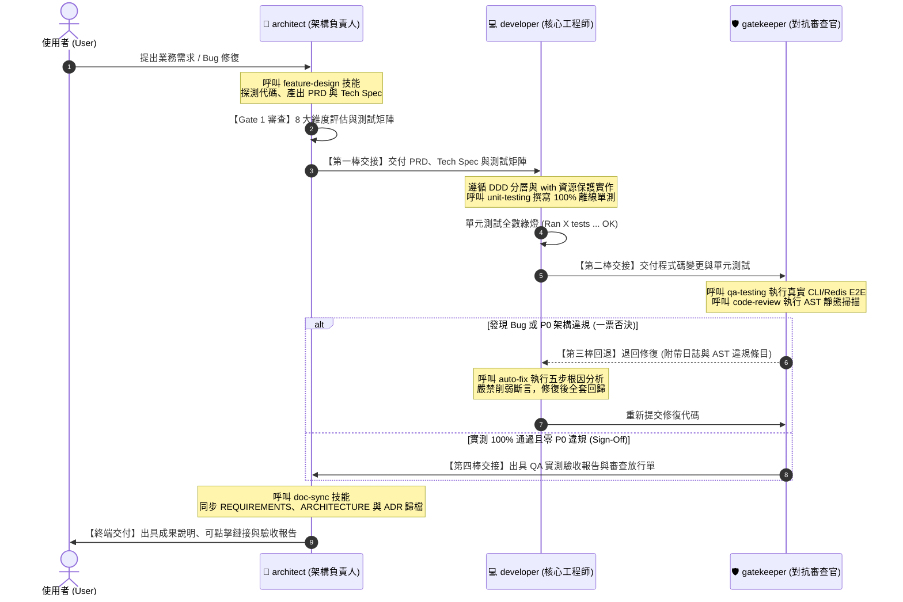

# 多代理協同總章程與交接協議 (Multi-Agent Teamwork Charter & Handoff Protocol)

本文件定義本專案閉環開發的**角色分工與交接協定**，可供單一助理依階段切換角色，或在使用者要求時用於多代理協同。
此角色分工旨在落實「職權分離（Separation of Duties）」與「確定性交接協議（Deterministic Handoff Contracts）」，降低單一視角造成的遺漏，提升閉環交付品質。

> **Codex 預設模式**：`architect/AGENT.md`、`developer/AGENT.md` 與 `gatekeeper/AGENT.md` 是角色職責手冊，不會自行建立或啟動子 Agent。功能開發與缺陷修復時，由目前的助理依階段讀取角色手冊並載入對應 Skill，依序切換角色完成閉環。只有使用者明確要求多代理協作時，才啟動子 Agent。

---

## 一、三大角色手冊目錄架構

本專案將三種角色指引獨立建置於 `.agents/` 根目錄下，與共用技能庫（`skills`）平級：

```
.agents/
├── README.md               # ★【全域總章程】定義協同協議、時序圖與產出合約表 (本文件)
├── skills/                 # 【共用技能庫】供各代理按需加載 (feature-design, qa-testing 等 8 大技能)
├── architect/              # 📐【架構師實體目錄】
│   └── AGENT.md            #   架構與規格負責人 (Step 1 前審 / Step 7 文檔同步)
├── developer/              # 💻【開發工程師實體目錄】
│   └── AGENT.md            #   核心開發者 (Step 2 實作 / Step 3 單測 / Step 6 修復)
└── gatekeeper/             # 🛡️【對抗審查官實體目錄】
    └── AGENT.md            #   QA 與資安審查員 (Step 4 QA 實測 / Step 5 代碼審查)
```

---

## 二、協同作業時序圖 (Teamwork Collaboration Sequence)



---

## 三、四大標準產出物交接合約 (Handoff Artifacts Contract)

為防止交接過程中資訊遺漏，每個交接點均強制約定產出物格式與檢驗標準：

| 交接階段 | 發起方 ➔ 接收方 | 傳遞的實體產出物 (Artifacts) | 驗收放行標準 (Gate Check) |
| :--- | :---: | :--- | :--- |
| **第一棒交接** | `architect`<br>➔ `developer` | 1. `PRD`（明訂 In/Out Scope、AC 條件）<br>2. `Tech Spec`（DDD 四層設計、DTO 定義）<br>3. `QA 驗收測試案例矩陣` | **Gate 1**：零高風險架構債，8 大維度審查通過，測試案例覆蓋齊全。 |
| **第二棒交接** | `developer`<br>➔ `gatekeeper` | 1. 業務程式碼變更（符合 DDD 邊界）<br>2. `tests/unit/` 100% 離線單元測試 | **單測檢驗**：`python -m unittest` 離線單測 100% 綠燈，無網路/真實 Redis 依賴。 |
| **第三棒交接<br>(打回協議)** | `gatekeeper`<br>➔ `developer` | 1. 失敗的 Traceback 堆疊追蹤與系統日誌<br>2. `audit_guardrails.py` AST 違規項目清單 | **退回標準**：任何功能 Bug、未預期崩潰或 P0 阻斷型違規，觸發 Step 6 自主修復。 |
| **第四棒交接<br>(簽核放行)** | `gatekeeper`<br>➔ `architect` | 1. `QA 實測驗收報告` (RTM 100% 覆蓋 AC)<br>2. Code Review 雙門禁審查合格清單 | **Gate 2**：零 P0 阻斷型違規、真實 CLI/Redis 實測全數通過。 |
| **終端交付** | `architect`<br>➔ 使用者 | 1. 同步後的 [`REQUIREMENTS.md`](../REQUIREMENTS.md)<br>2. 更新後的 [`ARCHITECTURE.md`](../ARCHITECTURE.md)<br>3. 轉為 Accepted 的 [`docs/adr/`](../docs/adr/) 決策紀錄 | **Doc Sync**：`verify_doc_sync.py` 驗證 100% 通過，零文檔債。 |

---

## 四、角色定義指引

點擊進入各專屬代理目錄查閱個別職責與系統提示詞：
* [`.agents/architect/AGENT.md`](architect/AGENT.md)：架構與規格負責人手冊
* [`.agents/developer/AGENT.md`](developer/AGENT.md)：核心開發工程師手冊
* [`.agents/gatekeeper/AGENT.md`](gatekeeper/AGENT.md)：對抗式 QA 與安全審查官手冊
