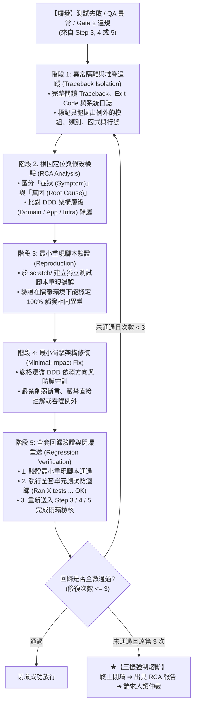

# 自主診斷與閉環修復技能 (Autonomous Diagnosis & Closed-Loop Fix)

本技能提供本專案實施 **「Step 6：自主診斷與修正 (Auto-Fix Loop)」** 時的最高作業規範。
當系統在 **Step 3（單元測試）**、**Step 4（QA 實測）** 或 **Step 5（代碼審查 Gate 2）** 遭遇任何測試失敗、異常崩潰或架構違規時，AI 必須遵循本技能定義的五步診斷修復法則，**精準定位根本原因（RCA）、以最小衝擊修正代碼、嚴禁削弱測試斷言，並執行全套回歸驗證**。

---

## 一、自主診斷修復五步作業流程 (5-Step Auto-Fix Workflow)



---

## 二、各階段具體執行指南

### 階段 1：異常隔離與堆疊追蹤 (Traceback Isolation)
* **抓取核心資訊**：
  1. **例外類型 (Exception Type)**：精準辨認是 `AssertionError`, `FileNotFoundError`, `PermissionError` (Windows 檔案鎖定), `KeyError`, 還是自定義領域例外。
  2. **最底層原始幀 (Bottom Frame)**：找到真實觸發例外的程式碼行號，而非外層裝飾器或 runner 的包裝幀。
  3. **輸入情境**：觸發該錯誤時的傳入參數、檔案路徑、環境變數或 Mock 狀態。

### 階段 2：根因定位與假設檢驗 (Root-Cause Analysis)
* 避免「治標不治本」：
  - 症狀（Symptom）：例如呼叫 `redis.hget` 報 `NoneType`。
  - 根因（Root Cause）：並非單純加上 `if val is None` 即可，應探究為何寫入時 key 未被成功保存（可能是前綴不一致、過期 TTL、或是跨執行緒覆寫）。
* 對照四層架構定界：
  - 若為業務規則不一致 ➔ 修正 **Domain / Application** 層。
  - 若為第三方 SDK 呼叫或檔案處理 ➔ 修正 **Infrastructure** 層。

### 階段 3：最小重現腳本驗證 (Minimal Reproduction)
* 複雜問題（如 Windows 檔案鎖死、編碼問題、AST 靜態掃描違規）建議在工作區暫存目錄 `scratch/` 撰寫極簡腳本（不超過 30 行），分離干擾變因並驗證重現。

### 階段 4：最小衝擊架構修復 (Minimal-Impact Fix)
* **不可踰越的四大修復底線**：
  1. **嚴禁削弱測試斷言 (No Assertion Erasure)**：嚴禁將 `assertEqual(result.score, 100)` 改為 `>= 0`，或將失敗的斷言移除。測試是驗收合約，程式碼必須滿足合約。
  2. **嚴禁破壞例外鏈**：修復例外捕獲時，若重新拋出必須保留 `raise DomainError(...) from err`。
  3. **資源鎖定強制防護**：涉及檔案與 PyMuPDF 串流時，修正程式碼必須保持在 `with` Context Manager 保護內。
  4. **保持向下相容性**：不得因為修復 bug 而變更 CLI 原有參數名稱或破壞既有 Use Case 入參結構。
  5. **三振熔斷防死迴圈 (Max 3 Attempts)**：同一缺陷自動修復最多連續嘗試 3 次。第 3 次修復後若回歸測試仍未通過，嚴禁無休止繼續修改代碼，必須立即中斷閉環並出具《根因分析與決策求助報告》，交由人類決策，杜絕 Token 燃燒。
  6. **增量日誌防禦 (Delta-only Context & Log)**：在多輪重試期間，上下文與交接訊息中僅保留「最新一輪失敗影格 (Last Frame Traceback)」與「已排除的無效假設清單」，徹底捨棄前幾輪累積的冗長終端輸出與除錯 print，維持上下文高度聚焦。

### 階段 5：全套回歸驗證與閉環重送 (Regression Verification)
修復程式碼後，**嚴禁僅驗證該單一測試案例**，必須依序執行：
1. **單元測試全集驗證**：
   ```bash
   python -m unittest discover -s tests/unit -p "test_*.py"
   ```
   確認現有所有測試 100% PASS，無任何 Regression。
2. **重送原發步驟**：
   - 若由 Step 3 觸發 ➔ 確認單元測試通過後進入 Step 4。
   - 若由 Step 4 觸發 ➔ 重新執行 `tests/e2e/` 實測腳本確認 AC 達成。
   - 若由 Step 5 觸發 ➔ 重新執行 `audit_guardrails.py` 與 Checklist 覆核。

---

## 三、參考資料與手冊
* [修復防反模式清單 (Fix Anti-Patterns)](./references/fix_anti_patterns.md)
* [根因分析與故障診斷手冊 (RCA Guide)](./references/rca_guide.md)
