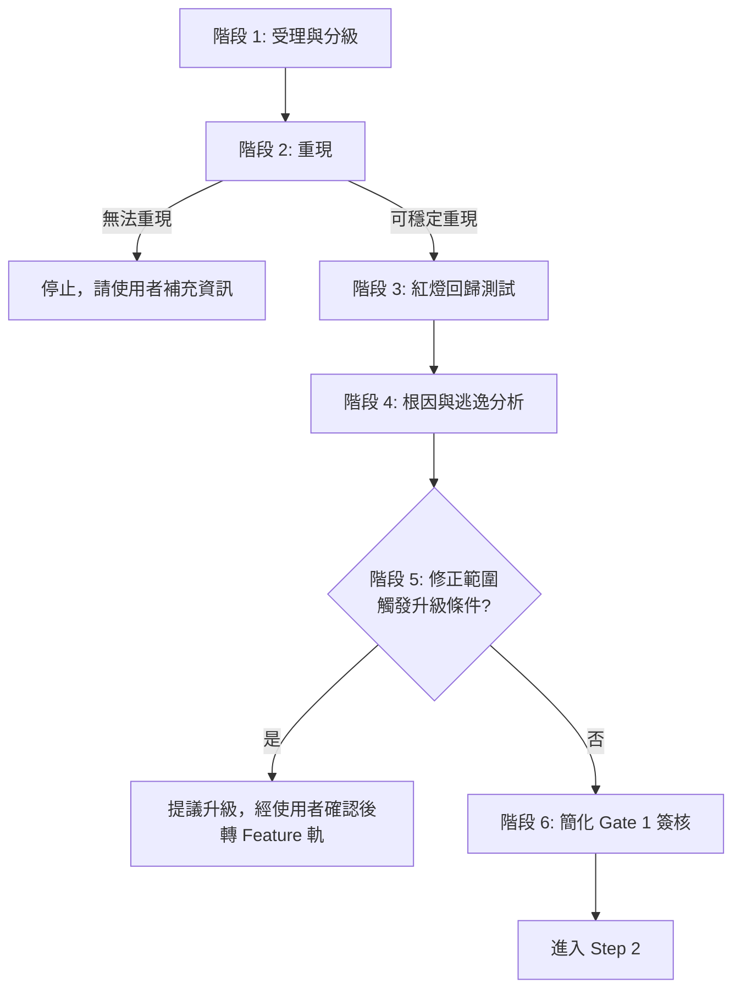

# 缺陷分析技能 (Bug Triage)

本技能為 **Bug 軌 Step 1B** 的作業規範，流程編排見 [bug.md](../../workflows/bug.md) 與 [hotfix.md](../../workflows/hotfix.md)。
適用於外部回報或使用者發現的缺陷。閉環內部的測試失敗、QA 缺陷與 Gate 2 違規，仍由 [auto-fix](../auto-fix/SKILL.md) 處理。

產出物：`docs/bugs/XXXX-*.md` 缺陷報告（範本：[bug_report_template.md](./references/bug_report_template.md)）與一個紅燈回歸測試。編號與 `docs/specs/` 共用同一流水號。

---

## 六階段作業流程



### 階段 1：受理與分級（developer）
* 記錄現象、環境（OS、Python 版本、相依服務狀態）、觸發條件、回報來源。
* 依下表判定嚴重度：

  | 等級 | 定義 | 流程 |
  | :--- | :--- | :--- |
  | **S1** | 資料損壞或遺失、個資外洩、安全漏洞、主要流程（見[專案概況](../../project/profile.md)）全面失敗 | [hotfix.md](../../workflows/hotfix.md) |
  | **S2** | 功能錯誤但有替代做法，或影響非主要流程 | [bug.md](../../workflows/bug.md) |
  | **S3** | 邊角情境、訊息文字、不影響結果的瑕疵 | [bug.md](../../workflows/bug.md) |

### 階段 2：重現（developer）
* 建立**可穩定重現**的最小步驟，記錄預期結果與實際結果。
* 重現資料一律使用合成內容（如 `王小明`、`sample_input.md`），不得貼入真實個資（類型見[專案概況](../../project/profile.md)第 4 節）或日誌中的個資。
* **無法重現即停止**：記錄已嘗試的方法，向使用者索取缺少的資訊。嚴禁在未重現的情況下猜測式修正。

### 階段 3：紅燈回歸測試（developer）
* 將重現步驟寫成**永久測試**：優先放 `tests/unit/`（遵循 [unit-testing](../unit-testing/SKILL.md) 的 Mock 隔離規範）；只有需要真實 CLI 或外部服務才能重現時，才放 `tests/e2e/`。
* 在**未修正**的代碼上執行，確認：
  1. 測試失敗；
  2. 失敗原因正是該缺陷（檢查斷言訊息或 Traceback），而不是匯入錯誤、夾具錯誤等無關原因。
* 斷言必須驗證**正確行為的預期結果**，不得只斷言「會拋例外」來描述缺陷現狀。
* 將失敗輸出摘要記入缺陷報告第 2 節。
* 此測試單獨成一個 `test:` commit，後續修正另成 `fix:` commit（規則見 [bug.md](../../workflows/bug.md)）。

### 階段 4：根因與逃逸分析（developer）
* **根因**：區分症狀與真因，標出所屬 DDD 層（domain / application / infrastructure / interfaces）與檔案:行號。可沿用 [auto-fix](../auto-fix/SKILL.md) 的五步 RCA 方法。
* **逃逸分析**：回答「既有測試或防線為何沒抓到」，並分類：
  - 測試缺口：該情境沒有測試；
  - 斷言過弱：有測試但斷言沒驗證到結果；
  - 規格缺口：規格沒寫到這個情境；
  - 防線缺口：`audit_guardrails.py`、`security_scan.py` 或 Checklist 應抓到但沒有。
  若屬防線缺口，在報告中提出改善建議（另案處理，不併入本次修正）。
* **教訓歸屬**（安全或非功能缺陷必填，其他建議填寫）：依 [security_nfr_framework.md](../feature-design/references/security_nfr_framework.md) 第七節，指出失效層（範圍宣告／威脅建模／標準對照／工具規則／規範缺漏），並判定：
  - **通用**：任何專案都可能重演 → 開規範變更回寫閉環核心層，報告記錄該變更編號；
  - **專案專屬**：只與本專案領域或技術有關 → 回寫專案檢核實例或 `project.toml`。

### 階段 5：修正範圍與升級判斷（developer）
* 列出預計修改的檔案與修改性質。
* 逐條檢查升級條件（[bug.md](../../workflows/bug.md)「升級回 Feature 軌」）：
  1. 需修改 Domain 契約檔（`project.toml` 的 `layers.domain_interfaces`）的 Protocol 或 DTO 欄位；
  2. 需修改資料模型或持久化結構（資料庫綱要、索引；本專案見專案概況）；
  3. 需在設定模組（`config.module`）新增環境變數，或新增 CLI 參數；
  4. 「正確行為」在現有規格中未定義或定義矛盾；
  5. 修正範圍跨越 3 個以上 DDD 層。
* 任一成立：停下並向使用者說明符合哪一條、理由為何，**經使用者確認**後才轉 Feature 軌。缺陷報告標為「已升級 → Spec-XXXX」。

### 階段 6：簡化 Gate 1（architect）
簽核以下三點，任一不成立即退回階段 5：
1. 修正只恢復既有規格行為，不新增行為。
2. 影響面（呼叫端、相依模組、既有測試）已列出。
3. 無介面破壞，既有 CLI 與 API 相容。

S1 可於合併後補簽（見 [hotfix.md](../../workflows/hotfix.md)）。

---

## 交付給 Step 2 的交接內容
```json
{
  "trace_id": "bug_<編號>_step1b",
  "from_agent": "developer",
  "to_agent": "developer",
  "action": "implement",
  "summary": "<缺陷現象、根因、修正範圍，3–5 行>",
  "artifacts": ["docs/bugs/<編號>-<slug>.md", "<紅燈測試路徑>"],
  "constraints": ["只改修正範圍內的檔案", "紅燈測試須轉綠且不得削弱斷言"]
}
```

## 相關參考資料
* [缺陷報告範本](./references/bug_report_template.md)
* [Bug 軌流程](../../workflows/bug.md)、[Hotfix 流程](../../workflows/hotfix.md)
