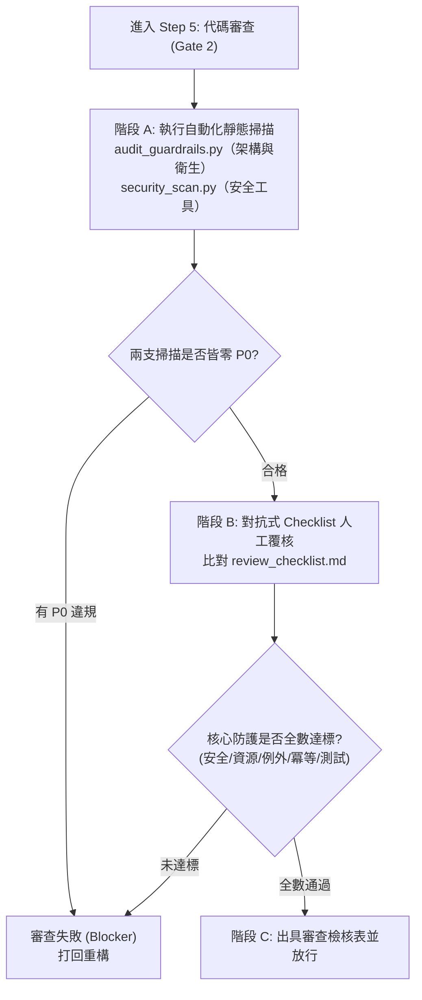

# 代碼審查與架構防線技能 (Adversarial Code Review)

本技能提供本專案實施 **對抗式代碼審查（Adversarial Code Review）** 的標準作業程序。
用以防止實作者「自我認證（Self-Certification）」與盲目閉環，確保所有代碼嚴格符合 Clean Architecture (DDD)、惡意輸入防禦、資源防鎖死、例外鏈保留、日誌零洩漏與冪等性規範。

---

## 審查作業流程 (Review Workflow)

當進入閉環流程的 **Step 5（代碼審查階段 - Gate 2）** 時，必須嚴格依序執行以下 3 個步驟：



### 階段 A：執行自動化靜態掃描
在終端機執行本技能內建的兩支掃描腳本：
```bash
python .agents/skills/code-review/scripts/audit_guardrails.py
python .agents/skills/code-review/scripts/security_scan.py
```
* `audit_guardrails.py` 檢查本閉環自訂的架構、資源、例外、硬編碼與版控衛生規則。
* `security_scan.py`（閉環通用核心）依 `project.toml` 的 `[security.tools]` 執行 Semgrep 靜態掃描與 pip-audit 依賴漏洞掃描，只阻斷基準檔（`baseline`）以外的新增發現；工具無法連網時印 WARN 不阻斷，須於 QA 報告記錄未執行項目。
* **阻斷條件 (P0)**：任一腳本回傳 Exit Code $\neq 0$（存在 P0 級違規，如 Domain 污染、DIP 違規、非 with 管理之 open 呼叫、高嚴重度安全發現、掃描工具缺失），禁止交付，必須立即分析錯誤訊息並修正。
* **警告處置 (P1)**：若存在 P1 級警告（例如盲目吞噬例外、例外鏈未關聯 `raise ... from`、中低嚴重度安全發現），評估是否應修正；保留者須附理由。安全掃描發現的處置方式以 [review_checklist.md](./references/review_checklist.md)「安全工具掃描」項為準。

### 階段 B：對抗式 Checklist 覆核
針對變更程式碼，逐項對照 [review_checklist.md](./references/review_checklist.md)（Gate 2 檢核項的唯一正本）進行對抗式覆核。檢核項與等級只在該清單維護，本檔不另行列舉。
：架構邊界、輸入安全、防禦與容錯、冪等與索引演進、代碼品質與測試防護（含需求—斷言追溯、Bug 軌先紅後綠與逃逸分析）、Token 能效、零硬編碼配置、Prompt 治理、Git 版控衛生與零個資。

### 階段 C：出具審查結果
1. **持久化紀錄**：將本輪審查追加至該功能 QA 報告（`docs/qa_reports/XXXX-*.md`）第 9 節「Gate 2 代碼審查紀錄」，包含審查輪次、發現項目與處置、需求—斷言追溯抽查，以及下方審查結論區塊。格式見 [QA 報告範本](../qa-testing/references/qa_report_template.md) 第 9 節。複審時新增一列輪次，不覆寫前一輪。
2. **交付摘要**：向使用者回報交付成果時，附帶以下審查摘要：
```markdown
### 🛡️ Code Review 雙門禁審查結果
* **架構靜態掃描**： 通過 (`audit_guardrails.py` 零 P0 違規)
* **安全工具掃描**： 通過 (`security_scan.py` 零 P0；P1 N 項已處置；未執行項目：無 / 列出)
* **DDD 依賴邊界**： 通過 (Domain 純潔、Application DIP 完整)
* **安全與配額硬上限**： 通過 (Zip Bomb 防禦、Prompt 標籤圍欄防注入)
* **資源釋放與鎖定防禦**： 通過 (強制 Context Manager，防止 Windows 檔案鎖死)
* **Twelve-Factor 配置治理**： 通過 (零寫死金鑰/URL/絕對路徑，所有閥值可配置化)
* **邊界例外與例外鏈**： 通過 (API 降級健全，拋出例外保留原始 from 堆疊)
* **日誌安全合規**： 通過 (零 PII 明文與 Secrets 洩漏)
* **資料操作與冪等性**： 通過 (Redis 清除舊切片、版本相容)
* **測試隔離與負面覆蓋**： 通過 (單元測試 100% Mock 記憶體建構，包含異常故障注入測試)
* **需求—斷言追溯**： 通過 (N/N 條 AC 具備直接驗證預期結果之斷言；抽查 AC-x、AC-y、AC-z 預期值來源獨立)
* **先紅後綠與逃逸分析**（僅 Bug 軌／Hotfix）： 通過 (`test:` commit 紅燈、`fix:` commit 綠燈；逃逸分析已記錄) / 不適用
* **Git 版控衛生與零個資防線**： 通過 (零真實個資/企業案例、跨平台相對路徑、.gitignore 與 .env.example 100% 同步)
```

---

## 相關參考資料
* [審查檢核清單與等級定義](./references/review_checklist.md)
* [架構掃描腳本](./scripts/audit_guardrails.py)
* [安全掃描腳本](./scripts/security_scan.py)
