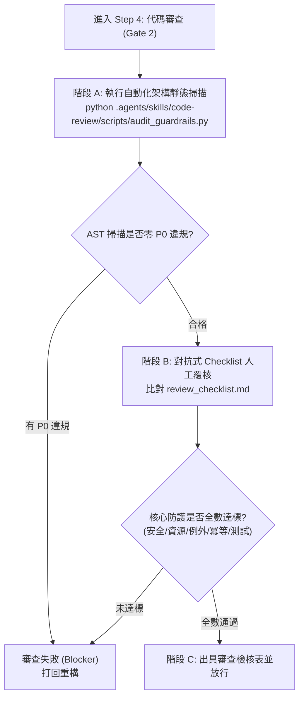

# 代碼審查與架構防線技能 (Adversarial Code Review)

本技能提供本專案實施 **對抗式代碼審查（Adversarial Code Review）** 的標準作業程序。
用以防止實作者「自我認證（Self-Certification）」與盲目閉環，確保所有代碼嚴格符合 Clean Architecture (DDD)、惡意輸入防禦、資源防鎖死、例外鏈保留、日誌零洩漏與冪等性規範。

---

## 審查作業流程 (Review Workflow)

當進入閉環流程的 **Step 4（代碼審查階段 - Gate 2）** 時，必須嚴格依序執行以下 3 個步驟：



### 階段 A：執行自動化架構靜態掃描
在終端機執行本技能內建的靜態分析腳本：
```bash
python .agents/skills/code-review/scripts/audit_guardrails.py
```
* **阻斷條件 (P0)**：若回傳 Exit Code $\neq 0$（存在 P0 級違規，如 Domain 污染、DIP 違規、非 with 管理之 open 呼叫），禁止交付，必須立即分析錯誤訊息並修正。
* **警告處置 (P1)**：若存在 P1 級警告（例如盲目吞噬例外、例外鏈未關聯 `raise ... from`），評估是否應加入明確例外捕獲或補全原始堆疊追蹤。

### 階段 B：對抗式 Checklist 覆核
對照參考手冊：[review_checklist.md](./references/review_checklist.md) 針對變更程式碼進行對抗式檢查：
1. **輸入安全與配額防禦**：是否限制檔案大小（25MB）、頁數（30頁）及 Zip 膨脹比？LLM Prompt 是否具備 `<resume_content>` 上下文圍欄隔離？
2. **資源釋放與 Windows 鎖定防禦**：所有檔案讀寫、Document 與串流是否 100% 使用 `with` Context Manager，確保控制代碼即時關閉？
3. **API 故障隔離與安全攔截**：外部 Gemini API 呼叫是否具備 `429`、`配額耗盡` 與 `FinishReason.RECITATION` 的安全降級？
4. **無損與容錯性**：是否未篡改磁碟原始檔案？Word 破圖是否有記憶體自動修復機制？
5. **例外鏈完整度**：重新拋出領域自定義例外時，是否一律使用 `raise ... from err` 保留原始呼叫堆疊？
6. **日誌資安合規**：日誌中是否完全避免印出未脫敏之個資（PII）、原始履歷明文與 API 憑證？
7. **資料庫操作冪等性與索引演進**：Redis 向量索引入庫前是否清除舊切片？索引鍵是否保留版本前綴以利藍綠遷移？
8. **Twelve-Factor 配置與零硬編碼防禦**：是否零寫死 API 金鑰、零未受控 URL？所有運行時安全配額、重試退避與演算法門檻是否可由 `AppConfig` 與 `.env` 覆寫？是否零寫死本機絕對路徑？
9. **單元測試隔離度與負面測試**：單元測試是否 100% Mock 外部連線且零依賴本機 `data/`、`resume/` 實體檔案？是否包含超時、損毀、配額耗盡等負面情境測試？
10. **Git 版控衛生與零個資防線 (Git Hygiene & Zero-PII)**：代碼、API 參數說明、CLI 範例、測試、Prompt 與文檔是否零真實求職者姓名/檔名、零真實企業案例？專案文檔連結是否全數使用相對路徑？`.gitignore` 與 `.env.example` 是否 100% 同步對齊？

### 階段 C：出具審查結果
在向使用者回報交付成果時，必須附帶審查摘要：
```markdown
### 🛡️ Code Review 雙門禁審查結果
* **架構靜態掃描**： 通過 (`audit_guardrails.py` 零 P0 違規)
* **DDD 依賴邊界**： 通過 (Domain 純潔、Application DIP 完整)
* **安全與配額硬上限**： 通過 (Zip Bomb 防禦、Prompt 標籤圍欄防注入)
* **資源釋放與鎖定防禦**： 通過 (強制 Context Manager，防止 Windows 檔案鎖死)
* **Twelve-Factor 配置治理**： 通過 (零寫死金鑰/URL/絕對路徑，所有閥值可配置化)
* **邊界例外與例外鏈**： 通過 (API 降級健全，拋出例外保留原始 from 堆疊)
* **日誌安全合規**： 通過 (零 PII 明文與 Secrets 洩漏)
* **資料操作與冪等性**： 通過 (Redis 清除舊切片、版本相容)
* **測試隔離與負面覆蓋**： 通過 (單元測試 100% Mock 記憶體建構，包含異常故障注入測試)
* **Git 版控衛生與零個資防線**： 通過 (零真實個資/企業案例、跨平台相對路徑、.gitignore 與 .env.example 100% 同步)
```

---

## 相關參考資料
* [審查檢核清單與等級定義](./references/review_checklist.md)
* [架構掃描腳本](./scripts/audit_guardrails.py)
