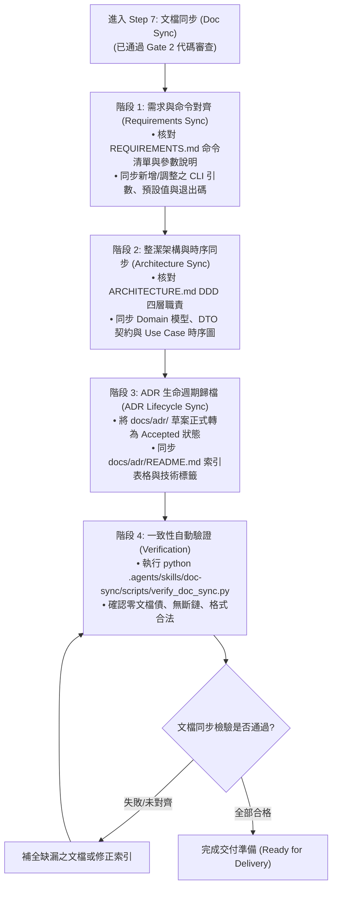

# 文檔、規格與 ADR 雙向同步技能 (Documentation, Spec & ADR Sync)

本技能提供本專案實施 **「Step 7：文檔、規格與 ADR 同步 (Doc Sync)」** 時的最高作業規範。
確保每次功能交付或缺陷修復後，程式碼實作、技術文件（`REQUIREMENTS.md`、`ARCHITECTURE.md`）與架構決策紀錄（`docs/adr/`）**保持 100% 雙向即時一致**，徹底杜絕「代碼已更新、文檔卻落後」的文檔漂移（Doc Drift）問題。

---

## 一、文檔同步四階段作業流程 (4-Phase Workflow)



---

## 二、各階段具體執行規範

### 階段 1：需求與命令對齊 (Requirements Sync)
* **目標檔案**：[`REQUIREMENTS.md`](../../../REQUIREMENTS.md)
* **檢核與同步要點**：
  1. **CLI 參數對齊**：若本次異動新增或修改了命令列參數（本專案參數舉例見[專案概況](../../project/profile.md)），必須在 `REQUIREMENTS.md` 中詳細列出參數名稱、型別、預設值與使用範例。
  2. **業務驗收追溯**：將本次 PRD 中的主要驗收標準（AC）成果反映至需求文檔的「核心功能實作狀態」章節。
  3. **向下相容性聲明**：確認既有命令語法與範例依然有效，無非預期的破壞性更動。

### 階段 2：整潔架構與時序同步 (Architecture Sync)
* **目標檔案**：[`ARCHITECTURE.md`](../../../ARCHITECTURE.md)
* **檢核與同步要點**：
  1. **DDD 領域實體與 DTO**：若有新增或擴充的實體、值物件或 DTO，必須同步更新文檔中的實體欄位定義與職責說明。
  2. **依賴反轉 Protocol 契約**：若在 Domain 契約檔（`project.toml` 的 `layers.domain_interfaces`）增修了協定介面，需於基礎設施章節記錄對應的實作類別。
  3. **Mermaid 流程與時序圖**：若調度流程有異動，必須更新 Markdown 內嵌的 Mermaid `flowchart` 或 `sequenceDiagram`，維持可視化架構與代碼完全相符。

### 階段 3：ADR 生命週期歸檔 (ADR Lifecycle Sync)
* **目標目錄**：[`docs/adr/`](../../../docs/adr/) 與 [`docs/adr/README.md`](../../../docs/adr/README.md)
* **檢核與同步要點**：
  1. **狀態轉換**：若本次變更在 Step 1 草擬了架構決策紀錄（狀態為 `提案中 (Proposed)`），在通過審查與實作落地後，必須正式將狀態變更為 **`已採納 (Accepted)`**，並補全實施後的評估結論。
  2. **編號與索引維護**：檢查新 ADR 是否依照連續編號命名（如 `0006-xxxx.md`），並在 [docs/adr/README.md](../../../docs/adr/README.md) 的索引表格中追加該條目，填妥編號、標題、狀態、日期與核心技術標籤。
  3. **8 大架構維度完整性**：確保 ADR 第 5 節依 [arch_review_checklist.md](../feature-design/references/arch_review_checklist.md)（維度定義唯一正本；本專案通過標準見 [arch_review_criteria.md](../../project/arch_review_criteria.md)）逐項填寫評估結論，不適用者寫理由。

### 階段 3.5：索引與範本鏡像同步 (Index & Mirror Sync)
* **`docs/README.md` 索引**：本次新增的規格、QA 報告、缺陷報告須登錄於對應表格（功能規格表或缺陷修正表），並填妥測試檔與 QA 報告連結。
* **`docs/templates/` 鏡像**：若修改了 `.agents/skills/*/references/` 下的範本，自正本重新複製至 `docs/templates/`。範本內引用其他檔案一律寫專案路徑，不使用相對連結。

### 依軌別的同步範圍

| 軌別 | 同步範圍 |
| :--- | :--- |
| 功能開發 | 階段 1–4 全部 |
| 缺陷修正、緊急止血 | 缺陷報告結案、`docs/README.md` 缺陷索引、階段 4；REQUIREMENTS／ARCHITECTURE 僅在文件描述有誤時修改；不產出 ADR |
| 規範變更 | `.claude/**` 轉接層、`docs/templates/` 鏡像、`docs/README.md` 索引、階段 4；另依 [governance.md](../../workflows/governance.md) 執行 G4 檢查清單 |

### 階段 4：一致性自動驗證 (Automated Verification)
執行本技能內建的驗證腳本：
```bash
python .agents/skills/doc-sync/scripts/verify_doc_sync.py
```
* 該腳本自動檢核以下項目（結束碼非 0 即未通過）：
  - `REQUIREMENTS.md`、`ARCHITECTURE.md`、`docs/README.md`、`docs/adr/README.md` 存在且非空。
  - `docs/adr/`、`docs/specs/`、`docs/qa_reports/`、`docs/bugs/` 的檔名格式與索引登錄；ADR 狀態標註。
  - 規格與缺陷報告的「品質評測範圍」宣告，以及宣告屬範圍時驗收標準中的品質指標。
  - `.claude/` 轉接層與 `.agents/` 正本一致。
  - AGENTS.md 分流表連結的流程檔皆存在，且流程檔皆已登錄。
  - `docs/templates/` 鏡像與正本一致。
  - AGENTS.md 超過 200 行時印出警告（不影響結束碼）。
* 腳本**不檢查** CLI 參數是否已寫入 `REQUIREMENTS.md`，此項依 [doc_sync_checklist.md](./references/doc_sync_checklist.md) 人工確認。

---

## 三、參考資料與範本
* [ADR 標準撰寫範本 (ADR Template)](./references/adr_template.md)
* [文檔同步自我檢核清單 (Doc Sync Checklist)](./references/doc_sync_checklist.md)
