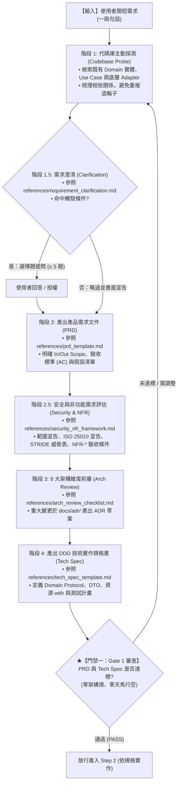

# 需求規格化與架構技術設計技能 (Feature Design & Arch Spec)

本技能提供本專案在實施 **「門禁一：架構與規格審查 (Gate 1)」** 時的標準作業程序。
用以杜絕 AI 助理在接收到簡短使用者指令時「天馬行空、想到哪寫到哪」的通病，確保每一項新功能在動工撰寫程式碼前（缺陷修復改走 Bug 軌 Step 1B，見 [bug-triage](../bug-triage/SKILL.md)），均經過**充分代碼探測**、**結構化 PRD 需求細化**、**安全與非功能需求評估**、**8 大架構維度衝擊評估**與**嚴謹的 DDD 技術規格書 (Tech Spec) 產出**。

---

## 作業流程 (Feature Design Workflow)

當進入閉環流程的 **Step 1（規劃與架構前審階段 - Gate 1）** 時，必須嚴格依序執行以下階段（1、1.5、2、2.5、3、4、5）：

---

### 階段 1：代碼庫主動探測 (Codebase Exploration)
在接獲使用者簡短指令時，**嚴禁立即修改代碼**，必須先使用工具探查現有代碼：
1. 檢索 Domain 層（`project.toml` 的 `layers.domain`）：確認是否有現成可復用的業務模型或契約。
2. 檢索 Application 層（`layers.application`）：確認是否有相關的 Use Case 或 DTO。
3. 檢索 Infrastructure 層（`layers.infrastructure`）：確認現有外部工具整合方式（如資料庫綱要或索引結構、檔案解析器、外部 API 客戶端）。
4. 檢索 CLI 等對外入口（本專案入口見[專案概況](../../project/profile.md)）：確認現有參數命名與調用方式。

### 階段 1.5：需求澄清 (Requirement Clarification)
代碼探測只能回答「怎麼做」；「為什麼做、做到哪裡算完成」須交還使用者決定。依 [requirement_clarification.md](./references/requirement_clarification.md)（觸發判定、提問方式、途中新問題處理之唯一正本）判定是否提問；未命中觸發條件者略過，但須於 PRD 假設清單書面宣告。

### 階段 2：產出產品需求文件 (PRD)
參照 [prd_template.md](./references/prd_template.md)，將使用者簡短需求展開為完整的 PRD：
* **使用者情境與目標**：界定觸發時機與商業痛點。
* **範疇界定 (Scope)**：嚴格劃分 In-Scope 與 Out-of-Scope，防止無節制膨脹。
* **輸入與輸出合約**：定義參數型別、必填性與回傳格式。
* **驗收標準 (Acceptance Criteria)**：以條列或 Given-When-Then 明確定義正常情境、極限邊界與錯誤處理。
* **假設清單 (Assumptions)**：每條假設註明來源；寫不出合法來源者回階段 1.5。

### 階段 2.5：安全與非功能需求評估 (Security & NFR Assessment)
依 [security_nfr_framework.md](./references/security_nfr_framework.md)（閉環通用核心，移植時不得刪除）執行，結果寫入 PRD 第 5 節：
* **範圍宣告**：於驗收標準段落宣告 `安全評估範圍：是／否`（判定條件見框架第一節）；輕量變更也須書面宣告，不得只做心智自檢。
* **非功能需求宣告**：依 ISO/IEC 25010 逐項宣告適用與否；適用者至少一條可驗證的 `NFR-*`，敘述性要求一律改寫為 `NFR-*`。
* **威脅建模**：範圍為「是」時，對每條跨信任邊界的資料流以 STRIDE 六問推導威脅，緩解措施引用框架第四節之標準條目，並對應 `NFR-*` 或測試案例。
* **殘餘風險**：依框架第五節判定嚴重度與處置。
* 自 `project.toml` 的 `docs.security_ac_enforced_from` 編號起，`verify_doc_sync.py` 強制檢查宣告、威脅表與 `NFR-*`。

### 階段 3：8 大架構維度前審 (Architecture Review)
逐項對照 [arch_review_checklist.md](./references/arch_review_checklist.md)（8 大架構維度的唯一正本）進行衝擊評估，適用維度依本專案通過標準 [arch_review_criteria.md](../../project/arch_review_criteria.md) 判定，並依其「輕重分流判定原則」決定 Fast Track 或 Deep Track。
> [!IMPORTANT]
> 若評估為 **重大架構變更 (Deep Track)**，必須於 [`docs/adr/`](../../../docs/adr/) 先撰寫 ADR 草案。

### 階段 4：產出技術實作規格書 (Technical Specification)
參照 [tech_spec_template.md](./references/tech_spec_template.md)，產出工程實作藍圖：
* **【領域層】**：定義 Entity 與 Protocol 介面（零外部 SDK 依賴）。
* **【應用層】**：定義 Command/Result DTO，並設計依賴注入結構。
* **【基礎設施層】**：外部套件串接方式、資源釋放（強制 Context Manager `with`）、例外鏈保留（`raise ... from err`）與日誌脫敏。
* **【表現層】**：對外介面（CLI 參數、API 端點等）設計與向下相容策略。
* **【測試計畫】**：規劃單元測試清單（正常情境 + 負面故障注入情境）。
* **【QA 驗收案例矩陣】**：對照每條 AC 與 `NFR-*` 規劃 Step 4 驗收案例（範本第 7 節）。
* **【品質評測】**：規格宣告屬品質評測範圍時，依 [quality-evaluation](../quality-evaluation/SKILL.md) 定義品質 AC 與標註資料來源。

### 階段 5：Gate 1 門禁放行 (Gate 1 Sign-Off)
出具 PRD 與 Tech Spec，向使用者或在工作區呈現清晰架構藍圖。
確認方向明確、無架構隱患後，方可放行進入 **Step 2 依規格實作**。

---

## 相關參考資料
* [需求澄清規則 (Requirement Clarification)](./references/requirement_clarification.md)
* [產品需求文件範本 (PRD Template)](./references/prd_template.md)
* [技術實作規格書範本 (Tech Spec Template)](./references/tech_spec_template.md)
* [8 大架構維度檢核清單 (Arch Review Checklist)](./references/arch_review_checklist.md)
* [安全與非功能需求評估框架 (Security & NFR Framework)](./references/security_nfr_framework.md)
