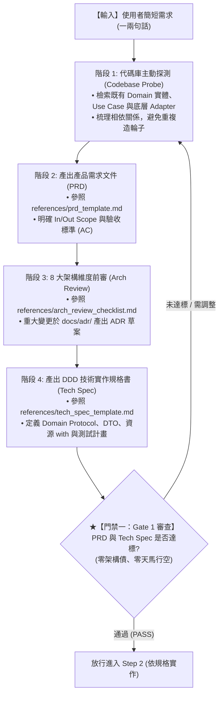

# 需求規格化與架構技術設計技能 (Feature Design & Arch Spec)

本技能提供本專案在實施 **「門禁一：架構與規格審查 (Gate 1)」** 時的標準作業程序。
用以杜絕 AI 助理在接收到簡短使用者指令時「天馬行空、想到哪寫到哪」的通病，確保每一項新功能或缺陷修復在動工撰寫程式碼前，均經過**充分代碼探測**、**結構化 PRD 需求細化**、**8 大架構維度衝擊評估**與**嚴謹的 DDD 技術規格書 (Tech Spec) 產出**。

---

## 作業流程 (Feature Design Workflow)

當進入閉環流程的 **Step 1（規劃與架構前審階段 - Gate 1）** 時，必須嚴格依序執行以下 5 個階段：

---

### 階段 1：代碼庫主動探測 (Codebase Exploration)
在接獲使用者簡短指令時，**嚴禁立即修改代碼**，必須先使用工具探查現有代碼：
1. 檢索 `src/domain/models.py` 與 `src/domain/interfaces.py`：確認是否有現成可復用的業務模型或契約。
2. 檢索 `src/application/`：確認是否有相關的 Use Case 或 DTO。
3. 檢索 `src/infrastructure/`：確認現有外部工具整合方式（如 Redis 索引結構、PDF/Word 解析器）。
4. 檢索 `convert_to_md.py` 或相關 CLI：確認現有參數命名與調用方式。

### 階段 2：產出產品需求文件 (PRD)
參照 [prd_template.md](./references/prd_template.md)，將使用者簡短需求展開為完整的 PRD：
* **使用者情境與目標**：界定觸發時機與商業痛點。
* **範疇界定 (Scope)**：嚴格劃分 In-Scope 與 Out-of-Scope，防止無節制膨脹。
* **輸入與輸出合約**：定義參數型別、必填性與回傳格式。
* **驗收標準 (Acceptance Criteria)**：以條列或 Given-When-Then 明確定義正常情境、極限邊界與錯誤處理。

### 階段 3：8 大架構維度前審 (Architecture Review)
對照 [arch_review_checklist.md](./references/arch_review_checklist.md) 進行衝擊評估：
1. **PII 隱私**：是否涉及敏感個資上雲或未脫敏儲存？
2. **容量與極限**：Redis 記憶體是否會 OOM？切片擴展性如何？
3. **非同步演進**：Use Case 是否具備無狀態特性？
4. **成本與熔斷**：Gemini API 預算與 429 熔斷機制。
5. **可抽換性**：是否 100% 透過 Protocol 抽象，更換底層零改動？
6. **惡意輸入硬上限**：是否防範 Zip Bomb（大小/頁數/膨脹比上限）與 Prompt 圍欄隔離？
7. **向量索引演進遷移**：Redis 索引鍵是否支援版本平滑遷移？
8. **分散式併發與可觀測性**：多 worker 冪等性與全鏈路 Trace ID。
> [!IMPORTANT]
> 若評估為 **重大架構變更 (Deep Track)**，必須於 [`docs/adr/`](../../../docs/adr/) 先撰寫 ADR 草案。

### 階段 4：產出技術實作規格書 (Technical Specification)
參照 [tech_spec_template.md](./references/tech_spec_template.md)，產出工程實作藍圖：
* **【領域層】**：定義 Entity 與 Protocol 介面（零外部 SDK 依賴）。
* **【應用層】**：定義 Command/Result DTO，並設計依賴注入結構。
* **【基礎設施層】**：外部套件串接方式、資源釋放（強制 Context Manager `with`）、例外鏈保留（`raise ... from err`）與日誌脫敏。
* **【表現層】**：CLI 旗標設計，保證 100% 向下相容。
* **【測試計畫】**：規劃單元測試清單（正常情境 + 負面故障注入情境）。

### 階段 5：Gate 1 門禁放行 (Gate 1 Sign-Off)
出具 PRD 與 Tech Spec，向使用者或在工作區呈現清晰架構藍圖。
確認方向明確、無架構隱患後，方可放行進入 **Step 2 依規格實作**。

---

## 相關參考資料
* [產品需求文件範本 (PRD Template)](./references/prd_template.md)
* [技術實作規格書範本 (Tech Spec Template)](./references/tech_spec_template.md)
* [8 大架構維度檢核清單 (Arch Review Checklist)](./references/arch_review_checklist.md)
