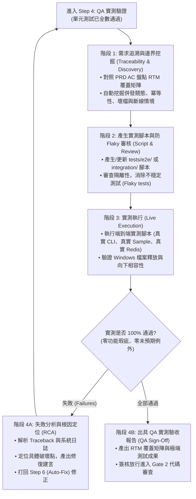

# QA 實測與智能驗收測試技能 (Intelligent QA Testing & Verification)

本技能提供本專案在實施 **「Step 4：黑箱/灰箱 QA 實測驗證」** 時的最高作業規範。
用以彌補「白箱單元測試 (Unit Test, 100% Mock)」無法驗證真實環境交互的盲點。AI 將作為自主 QA 專家，負責**需求追溯**、**對抗式邊界挖掘**、**腳本生成與 Flaky 審核**、**實測執行**以及**失敗根因定位 (RCA)**。

---

## 一、QA 核心能力四大支柱 (4 Core Pillars)

### 1. 需求對齊與 100% 驗收覆蓋 (Traceability & Coverage)
* **需求追溯矩陣 (Requirements Traceability Matrix, RTM)**：
  - 自動交叉比對前期產出的「PRD」與「Tech Spec」，逐一盤點每一條 **Acceptance Criteria (AC)**。
  - 強制保證：**每一條業務驗收條件（AC）至少具備一組對應的測試案例覆蓋**，嚴禁遺漏任何需求邊界。

### 2. 邊界與異常情境對抗挖掘 (Edge Case Discovery & Adversarial Scenarios)
發掘人類工程師容易忽略的極限盲區，自動補充以下對抗式測試案例：
* **併發競態危害 (Concurrency & Race Conditions)**：多 Worker 或多執行緒同時轉檔/更新同位候選人時的狀態衝突防護。
* **重複請求與操作冪等性 (Idempotency)**：重複執行批次轉檔或重覆寫入 Redis 時，切片不會重複堆疊或污染。
* **網路抖動與服務斷線 (Network Glitches & Reconnection)**：模擬 Redis 離線、Gemini API 429 配額用罄或連線超時的平滑降級與熔斷重連。
* **惡意與畸形輸入注入 (Adversarial Injections)**：傳入 0-byte 空檔案、損毀 ZIP、超大 PDF 頁數、特殊字元路徑與提示詞注入攻擊（Resume Jailbreak）。

### 3. 測試腳本自動生成與防 Flaky 審查 (Script Generation & Anti-Flaky Review)
* **自動轉化執行腳本**：將自然語言的測試情境自動轉化為標準 Python 測試代碼（存於 `tests/e2e/` 或 `tests/integration/`）。
* **Flaky Tests（不穩定測試）審核**：
  - 嚴禁測試間存在執行順序依賴（Order Dependency）。
  - 強制使用 `tempfile.TemporaryDirectory` 進行磁碟隔離，並在 teardown 確保完整釋放控制代碼，防止 Windows 檔案殘留鎖定。
  - 對非同步或網路呼叫設定合理超時上限，避免測試無止盡懸掛（Hang）。

### 4. 失敗分析與自動根因定位 (Automated Failure Analysis & RCA)
* 當測試執行失敗（`FAIL` / `ERROR`）時，AI 自動介入：
  - 深度研讀測試報告、標準輸出、系統 Log 與 Traceback。
  - 執行根因分析（RCA）：精準定位是哪一個模組、哪一行程式碼或哪一處邏輯不相容引發問題。
  - 產出具體修復建言，直接回饋給「Step 6 (Auto-Fix)」進行閉環修復，修復後自動重新驗證。

---

## 二、QA 實測作業流程 (QA Testing Workflow)



---

## 三、執行指令與交付規範

### 執行端到端實測指令：
```bash
python -m unittest discover -s tests/e2e -p "test_*.py"
```

### 驗收放行標準 (Sign-Off Criteria)：
1. **100% AC 覆蓋**：PRD 定義之驗收條件全數通過。
2. **零阻斷型缺陷 (Zero P0/P1 Defects)**：無崩潰、無未受控例外。
3. **Windows 資源清潔度**：測試執行完畢後無控制代碼殘留，暫存檔乾淨卸載。
4. **向下相容性保持**：既有 CLI 命令引數與回傳格式 100% 保持穩定。

---

## 相關參考資料
* [QA 測試個案設計範本 (Test Case Specification)](./references/test_case_template.md)
* [QA 實測驗收報告範本 (QA Report Template)](./references/qa_report_template.md)
