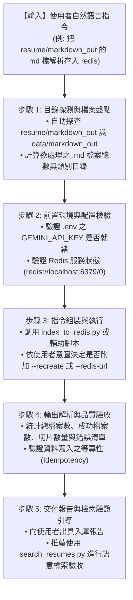

# 履歷向量化與 Redis 索引建置技能 (Resume Vector Indexing)

本技能指導 AI 助理如何根據使用者的自然語言需求，自動定位位於 `resume/markdown_out`（或 `data/markdown_out`）的 Markdown 履歷檔案，進行語意切片、文本 Embedding 向量化，並透過專案內建的 [`index_to_redis.py`](../../../index_to_redis.py) 入庫至 Redis RediSearch 向量索引。

---

## 觸發情境 (When to Activate)

當使用者以自然語言提出以下意圖時，應啟動本技能：
* 「把現在位於 resume/markdown_out 資料夾裡的 md 檔都進行向量解析儲存到 redis」
* 「把履歷切片並向量化存入 Redis」
* 「幫我把 markdown_out 的履歷建立向量索引」
* 「重建 Redis 履歷向量資料庫（--recreate）」
* 「將特定目錄或候選人的 Markdown 履歷入庫」

---

## 標準執行作業程序 (SOP Workflow)



---

## 詳細執行步驟

### 步驟 1：目錄探測與檔案盤點 (Path Resolution)
1. 檢查使用者提及之路徑。若使用者指定 `resume/markdown_out`，依序探查以下優先順序：
   * `resume/markdown_out`（若存在）
   * `data/markdown_out`（專案實際儲存目錄）
2. 盤點目錄結構，確認各專業子目錄（如 `BE/`, `FE/`, `PA/`, `PS/`, `SQA/`）下的 `.md` 檔案清單。
3. 若目標目錄為空或不存在，應主動向使用者回報並確認是否需先執行 `convert_to_md.py` 產出 Markdown。

### 步驟 2：前置環境與配置檢核 (Prerequisites Check)
在啟動向量化前，確認以下相依服務：
1. **API Key**：讀取根目錄 `.env`，確認 `GEMINI_API_KEY` 已配置。
2. **Redis 連線**：確認 Redis Stack 或 RediSearch 服務正常運作（預設 `localhost:6379`）。
3. 可使用技能輔助工具先行驗證：
   ```bash
   python .agents/skills/resume-vector-indexing/scripts/run_resume_indexing.py --skip-precheck=false
   ```

### 步驟 3：調度執行 `index_to_redis.py` (Command Execution)
根據使用者需求，在工作區根目錄執行 [`index_to_redis.py`](../../../index_to_redis.py)：

* **基本批次入庫**（增量寫入，具等冪性自動覆蓋舊切片）：
  ```bash
  python index_to_redis.py data/markdown_out/
  ```

* **強制重建索引**（當使用者要求「清空重建」或升級索引結構時）：
  ```bash
  python index_to_redis.py data/markdown_out/ --recreate
  ```

* **指定自訂 Redis 連線或 API Key**：
  ```bash
  python index_to_redis.py data/markdown_out/ --redis-url <redis_url> --api-key <gemini_key>
  ```

* **限制處理筆數（採樣或部分測試）**：
  ```bash
  python index_to_redis.py data/markdown_out/ --limit 10
  # 亦可直接透過 Skill 輔助腳本自動探測並限制筆數：
  python .agents/skills/resume-vector-indexing/scripts/run_resume_indexing.py --limit 10
  ```


### 步驟 4：執行結果統計與審查 (Result Review)
執行完成後，解析終端輸出結果，記錄：
* **總掃描 Markdown 檔數**
* **成功處理檔案數**
* **總切片存入數量 (Resume Chunks)**
* **失敗清單與錯誤訊息**（若有，需進行根因分析）

### 步驟 5：交付與檢索驗證建議 (Verification & Next Steps)
向使用者匯報入庫統計，並提供後續自然語言搜尋指令範例供其測試：
```bash
# 驗證檢索
python search_resumes.py "三年以上資深後端，熟悉分散式架構與 Redis 快取"
```

---

## 相關參考資源 (References)
* [向量化與 Redis 索引架構指南](./references/indexing_guide.md)
* [輔助執行腳本](./scripts/run_resume_indexing.py)
* [核心索引工具 (index_to_redis.py)](../../../index_to_redis.py)
* [核心搜尋工具 (search_resumes.py)](../../../search_resumes.py)
