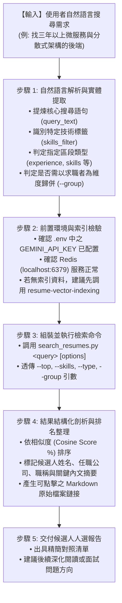

# 履歷語意向量檢索技能 (Resume Vector Search)

本技能指導 AI 助理如何根據使用者的自然語言招聘需求或人才搜尋條件，調度專案核心檢索工具 [`search_resumes.py`](../../../search_resumes.py)，在 Redis 向量資料庫（RediSearch `idx:resumes:v1`）中執行語意向量檢索與標籤混合篩選，並將最佳匹配之候選人與段落結構化回報給使用者。

---

## 觸發情境 (When to Activate)

當使用者以自然語言提出以下意圖時，應啟動本技能：
* 「幫我找熟悉 Python 與高並發微服務的後端工程師」
* 「搜尋履歷庫中有沒有做過 Kubernetes 與 AWS 容器化架構的人選」
* 「篩選具備 Go 語言經驗的工作經歷」
* 「搜尋特定技能標籤的候選人（例如: `--skills fastapi,redis`）」
* 「在 Redis 檢索履歷切片並依候選人分組」
* 「啟動履歷互動檢索模式」

---

## 標準執行作業程序 (SOP Workflow)



---

## 詳細執行步驟

### 步驟 1：自然語言解析與參數提煉
從使用者之自然語言對話中提煉出以下檢索引數：
* **`query`**：主要語意搜尋語句（保持完整情境描述，避免只剩關鍵字）。
* **`--skills`**：若提及明確程式語言或工具（如 Python, Redis, K8s），加入逗號分隔標籤。
* **`--type`**：若使用者限定只看特定區段（如「看他以前做過的工作」設為 `experience`；「看學歷」設為 `education`）。
* **`--group`**：若使用者希望「以人選為單位彙整清單」，加入 `--group`。
* **`--top`**：回傳筆數（預設 5）。

### 步驟 2：前置環境檢驗
確認 Redis 向量資料庫與 Embedding API 連線：
```bash
python .agents/skills/resume-vector-search/scripts/run_resume_search.py --skip-precheck=false
```
* 若 Redis 未啟動或無資料，提示使用者先啟動 Redis 服務或調用 [`resume-vector-indexing`](../resume-vector-indexing/SKILL.md) 技能完成入庫。

### 步驟 3：調度執行 `search_resumes.py`
在工作區根目錄執行檢索指令：

* **自然語言搜尋（依切片呈現）**：
  ```bash
  python search_resumes.py "三年以上資深後端，具備分散式微服務架構經驗" --top 5
  ```

* **結合技術標籤與工作經歷篩選**：
  ```bash
  python search_resumes.py "設計過金流串接系統" --type experience --skills golang,redis
  ```

* **依求職者整合分組呈現**：
  ```bash
  python search_resumes.py "熟悉 Kubernetes 容器編排與 AWS 雲端維運" --group --top 10
  ```

### 步驟 4：結果解析與可點擊鏈接生成
解析 CLI 標準輸出：
* 提取候選人名稱（`candidate_name`）、候選人 ID（`candidate_id`）。
* 相似度百分比（如 `92.4%`）。
* 命中之區段標題（`section_title`）與公司職稱（`company`, `job_title`）。
* 來源 Markdown 檔案路徑：回覆時將實際存在的來源檔案路徑轉為 Markdown 可點擊連結；本文件以行內程式碼顯示本機輸出路徑範例，該目錄不納入 Git。

### 步驟 5：交付人選推薦摘要
以結構化表格或條列清單向使用者呈現：
1. 候選人排名與綜合匹配分數。
2. 關鍵經歷佐證（包含匹配切片內文摘要）。
3. 提示使用者可點擊檔案鏈接查看完整履歷，或進行下一步面試問題發想。

---

## 相關參考資源 (References)
* [檢索架構與查詢指南](./references/search_guide.md)
* [輔助執行腳本](./scripts/run_resume_search.py)
* [核心搜尋工具 (search_resumes.py)](../../../search_resumes.py)
* [入庫工具技能 (resume-vector-indexing)](../resume-vector-indexing/SKILL.md)
