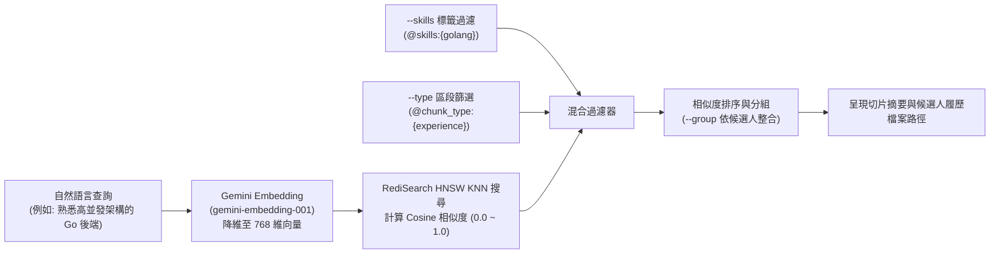

# 履歷語意向量檢索架構與查詢指南 (Resume Vector Search Guide)

本指南為 `resume-vector-search` 技能的參考文檔，詳細說明基於 RediSearch 與 Gemini Embedding 的語意搜尋原理、篩選策略與調校建議。

---

## 1. 檢索架構與搜尋原理

本系統採用 **RediSearch KNN 向量檢索 + Tag/Text 混合過濾 (Hybrid Search)**：



* **索引名稱**：`idx:resumes:v1`
* **距離算法**：`COSINE`（Cos 距離 $d \in [0.0, 2.0]$，系統自動轉為相似度 $1 - d$）
* **回傳欄位**：`candidate_id`, `candidate_name`, `chunk_type`, `section_title`, `company`, `job_title`, `skills`, `content`, `file_path`, `score`

---

## 2. 核心 CLI 指令與使用範例 (`search_resumes.py`)

### 1. 純自然語言語意檢索
適用於模糊需求或綜合職能搜尋：
```bash
python search_resumes.py "三年以上資深後端，熟悉分散式系統與微服務架構"
```

### 2. 結合技術標籤精確篩選 (`--skills`)
同時具備向量語意相關性，並強制要求特定技術棧：
```bash
python search_resumes.py "設計過高流量金流微服務" --skills golang,redis
```

### 3. 限定區段類型 (`--type`)
限制只檢索特定大綱段落，排除自我介紹或學歷干擾：
* 可選值：`experience`（工作經歷）、`skills`（技能清單）、`education`（學歷）、`project`（專案成就）、`profile`（基本自傳）
```bash
python search_resumes.py "主導過跨國跨團隊技術專案" --type experience
```

### 4. 依求職者整合分組呈現 (`--group`)
將同位求職者的多個命中切片整合，並列出最高相似度與彙整技能清單，極適合 HR 初步人選篩選：
```bash
python search_resumes.py "熟悉 Kubernetes 與 AWS 雲端維運架構" --group --top 10
```

### 5. 啟動終端互動模式
若未指定 `query`，將自動進入終端互動問答，可連續發問：
```bash
python search_resumes.py
```

---

## 3. 查詢提示詞設計最佳實踐 (Prompt Best Practices)

為獲得最高的 Cosine 相似度命中率，建議引導使用者依以下原則撰寫查詢詞：
1. **情境化描述優於單一名詞**：
   - 佳：`"設計過大型電商微服務架構，具備 MySQL 讀寫分離與 Redis 快取調優經驗"`
   - 差：`"MySQL Redis"`（單字查詢建議搭配 `--skills`）
2. **具體年資與職級角色**：
   - `"資深架構師，負責 CI/CD 自動化建置與 Kubernetes 叢集維運"`
3. **區段匹配**：
   - 若尋找特定學歷背景，查詢詞宜為 `"國立大學 資訊工程學系 碩士"` 並加上 `--type education`。
