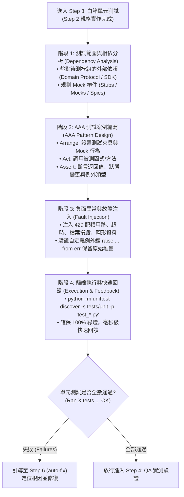

# 白箱單元測試規範技能 (White-Box Unit Testing & Isolation)

本技能提供本專案實施 **「Step 3：白箱單元測試驗證 (Unit Testing)」** 時的最高作業規範。
單元測試是快速發現實作缺陷的第一道白箱防線。本技能要求所有單元測試必須具備 **「100% 離線 Mock 獨立性」**、**嚴謹的 AAA 架構**、**高覆蓋率的負面情境與故障注入**，並保證毫秒級的執行回饋。

---

## 一、單元測試四階段作業流程 (4-Phase Workflow)



---

## 二、四大核心不可變規範 (4 Inviolable Rules)

### 1. 100% 離線 Mock 獨立性 (Pure Offline Isolation)
* **紅線禁令**：單元測試檔案（`tests/unit/test_*.py`）中**嚴禁發送真實 HTTP 請求、嚴禁調用真實 Gemini API、嚴禁連接真實 Redis 資料庫**。
* 所有對外介面一律使用 `unittest.mock.Mock` 或 `MagicMock` 模擬：
  - 模擬 Embedding 服務：回傳預設長度之零向量或特定固定維度向量（如 768 維）。
  - 模擬 Redis 客戶端：以內建 dictionary 或假物件模擬 `hset`, `hgetall`, `ft().search`。
  - 模擬 LLM 回應：回傳預設之 JSON 結構字串或 mock response。

### 2. AAA 結構與語義化命名 (Arrange-Act-Assert)
* 每個測試方法名稱必須清晰表達意圖，命名範式：
  `test_<被測功能>_<測試情境>_<預期結果>()`
  - 例如：`test_clean_text_with_control_characters_should_strip_invalid_bytes()`
  - 例如：`test_judge_when_quota_exhausted_should_fallback_to_rules()`
* 每個測試函式內部劃分清楚的三個區塊：
  ```python
  # 1. Arrange (準備測試資料與 Mock)
  # 2. Act (執行被測目標)
  # 3. Assert (驗證結果與邊界)
  ```

### 3. 必備負面情境與故障注入 (Negative & Fault Injection)
* 每個新功能模組必須包含**至少 1 組正常流程（Happy Path）與 2 組異常流程（Negative Paths）**：
  - **超時與中斷**：模擬外部網路斷線拋出 `TimeoutError`。
  - **配額耗盡**：模擬 Gemini API 回傳 `ResourceExhausted` (429)。
  - **損毀與畸形**：傳入非預期的零長度檔案、破壞的結構字串。
  - **例外鏈檢核**：使用 `with self.assertRaises(ExpectedDomainError) as ctx:` 斷言例外，並驗證 `ctx.exception.__cause__` 不為空。

### 4. 資源清理與防 Windows 鎖定 (Teardown Purity)
* 若單元測試需要涉及磁碟操作，強制使用 `tempfile.TemporaryDirectory` 或 `unittest.mock.mock_open`。
* 測試結束時確保所有 context 釋放乾淨，不殘留任何暫存檔案。

---

## 三、執行指令

### 執行單元測試全集：
```bash
python -m unittest discover -s tests/unit -p "test_*.py"
```

### 執行單一測試檔案：
```bash
python -m unittest tests/unit/test_cleaner.py
```

---

## 四、參考資料與範本
* [Mock 隔離模式與範本 (Mocking Patterns)](./references/mocking_patterns.md)
* [單元測試品質檢核清單 (Unit Test Checklist)](./references/unit_test_checklist.md)
