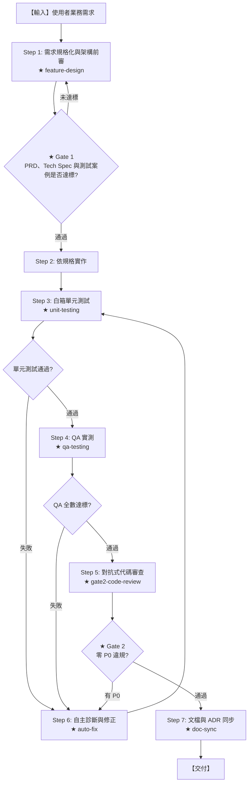

# 功能開發流程 (Feature Track)

> **適用**：新增或變更系統行為；或「正確行為」需要重新定義（含 Bug 軌升級而來的案件）。
> **本檔只寫編排**（何時、先後、要不要、失敗退回哪裡）；各步驟怎麼做，以對應 Skill 為準。

## 流程圖

## 步驟與 Skill

| 步驟 | 角色 | Skill | 放行條件 / 產出物 |
| :--- | :--- | :--- | :--- |
| **1** 需求規格化與架構前審 *(Gate 1)* | architect | [feature-design](../skills/feature-design/SKILL.md)；宣告屬品質評測範圍時加 [quality-evaluation](../skills/quality-evaluation/SKILL.md) | PRD、DDD Tech Spec 與 QA 驗收矩陣，寫入 `docs/specs/XXXX-*.md`；通過 Gate 1 |
| **2** 依規格實作 | developer | *(DDD 架構約制)* | 遵循 Tech Spec；`with` 資源保護、例外鏈 `raise ... from err`、API 降級、日誌零洩漏 |
| **3** 白箱單元測試 | developer | [unit-testing](../skills/unit-testing/SKILL.md) | `tests/unit/` 100% 離線 Mock，含負面與故障注入；全數綠燈 |
| **4** 黑箱/灰箱 QA 實測 | gatekeeper | [qa-testing](../skills/qa-testing/SKILL.md)；宣告屬品質評測範圍時加 [quality-evaluation](../skills/quality-evaluation/SKILL.md) | `tests/e2e/` 實測；RTM 100% 覆蓋 AC；QA 報告寫入 `docs/qa_reports/XXXX-*.md` |
| **5** 對抗式代碼審查 *(Gate 2)* | gatekeeper | [gate2-code-review](../skills/code-review/SKILL.md) | `audit_guardrails.py` + Checklist 覆核；零 P0；紀錄追加至 QA 報告第 9 節 |
| **6** 自主診斷與修正 | developer | [auto-fix](../skills/auto-fix/SKILL.md) | RCA、嚴禁削弱斷言；三振熔斷依 auto-fix 技能 |
| **7** 文檔與 ADR 同步 | architect | [doc-sync](../skills/doc-sync/SKILL.md) | 同步 `REQUIREMENTS.md`、`ARCHITECTURE.md`；歸檔 `docs/adr/`；更新 `docs/README.md`；`verify_doc_sync.py` 通過 |

## 退回路徑

| 失敗點 | 退回 |
| :--- | :--- |
| Gate 1 未達標 | Step 1 |
| Step 3 單元測試失敗 | Step 6 → Step 3 |
| Step 4 QA 未達標 | Step 6 → Step 3 |
| Gate 2 有 P0 | Step 6 → Step 3 |
| Step 6 觸發三振熔斷 | 停止閉環，出具 RCA 報告交由使用者決定 |

## 由 Bug 軌升級而來的案件
* Step 1 規格的背景章節引用原缺陷報告的重現步驟與根因，不重做。
* 原紅燈回歸測試轉為新規格的 AC。
* 三振計數自本流程起重新計算。
* 詳見 [bug.md](./bug.md)「升級回 Feature 軌」。
