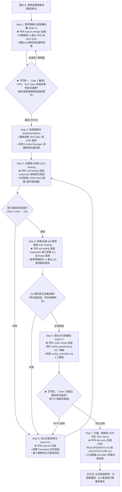

# 專案開發規範與 AI 閉環總調度指引 (Project Guidelines & Dispatcher)

本文件為 **所有 AI 開發助理（Claude Code、Google Antigravity 等）與開發團隊在進行本專案開發時的最高準則（憲法級規範）**，亦為跨工具共用之唯一正本（Single Source of Truth）。
各工具專屬差異僅記載於對應之薄層檔案（[CLAUDE.md](CLAUDE.md)、[GEMINI.md](GEMINI.md)），以 `@AGENTS.md` 匯入本文件，嚴禁複製本文內容造成多份分歧。
接收到任何需求或任務時，AI 必須嚴格遵循架構紅線與雙門禁 7 步驟閉環工作流，調度對應之專屬技能完成任務。

### 閉環角色與 Skill 預設執行方式
- 功能開發與缺陷修復時，由目前的助理依閉環階段依序切換 `architect`、`developer`、`gatekeeper` 角色視角；每個階段開始前讀取對應的 `.agents/<role>/AGENT.md`，並使用下表指定的 Skill。
- 預設不建立或啟動子 Agent。角色切換是同一助理依不同職責檢查與執行；只有使用者明確要求多代理協作時，才分派子 Agent。
- 階段交接仍依標準 Context Handoff Schema 記錄，作為同一助理內部的工作交接；Gatekeeper 階段須以獨立審查視角檢視 Developer 的變更。
- 一般問答、解說與不涉及功能或缺陷修改的簡單文件任務，不啟動完整閉環。

---

## 1. 專案核心定位與架構紅線 (Architecture Guardrails)

本專案採用 **領域驅動設計 (Domain-Driven Design, DDD)** 與 **整潔架構 (Clean Architecture)**。
系統四層結構有嚴格的單向依賴關係，內層抽象絕不可依賴外層技術細節：

```
src/
├── domain/            # 【領域層】：純業務模型與契約介面。嚴禁 import 任何第三方外部 SDK (如 google-genai, redis, fitz 等)
├── application/       # 【應用層】：Use Cases 與流程調度。依賴 Domain 介面，以 DTO 進行輸入/輸出，協調核心業務
├── infrastructure/    # 【基礎設施層】：外部技術實作。負責實作 Domain 介面 (如 Gemini API, RediSearch, PyMuPDF, python-docx 等)
└── interfaces/        # 【表現層】：對外進入點。CLI 呼叫轉接器與 Web API 路由，不含任何核心轉檔邏輯
```

### 核心不可變紅線
1. **依賴反轉 (DIP)**：Use Case 只能呼叫 `src/domain/interfaces.py` 定義的 Protocol 契約，外部實體工具必須透過依賴注入（Dependency Injection）組裝傳入。
2. **向下相容性 (Backward Compatibility)**：根目錄的 [`convert_to_md.py`](convert_to_md.py) 作為 CLI 主要入口點，必須 100% 維持既有指令與引數相容。
3. **無損與容錯性 (Fail-Safe & Idempotency)**：
   - 轉檔過程中絕不篡改磁碟上的原始檔案（Word 破圖採用記憶體自動補樁）。
   - 向量索引寫入具備冪等性（入庫前清除同候選人舊切片）。
4. **四層品管防線不可繞過**：所有檔案轉換產出必須經過確定性品管閥（`MarkdownQualityValidator`）檢核，低於 65 分必須自動隔離（Quarantine）。
5. **Token 能效與無效重複呼叫防禦 (Token Economics & Zero-Waste)**：批次向量化或轉檔必須具備內容 Hash 增量比對，未變更檔案重複執行時嚴禁調用外部 API（達成 0 Token 消耗）；健康文字文件優先採 Text-First 策略，嚴禁無條件渲染圖片浪費多模態 Token。
6. **Twelve-Factor 配置治理與零硬編碼防線 (No Hardcoding & Config Decoupling)**：所有外部服務連線、機密憑證、安全配額、重試策略與演算法閥值，嚴禁在業務程式碼中硬編碼；金鑰嚴禁納入 Git 版控；連線字串統一由 `AppConfig` 與 `.env` 注入；代碼嚴禁寫死本機絕對路徑；Gate 2 代碼審查時強制執行 AST 掃描阻斷。
7. **Git 版控衛生、零個資 (Zero-PII) 與跨平台路徑防線 (Git Hygiene & Privacy Guardrails)**：
   - **零真實個資與真實企業名殘留**：程式碼、API 參數說明（如 Swagger `description`）、單元測試、CLI `--help` 範例、Prompt 模板（`prompts/*.md`）與工程文檔（`docs/`）中，**嚴禁出現任何真實求職者姓名、聯絡資訊、真實履歷檔名或源自真實履歷案例之特定企業名稱**（一律使用通用虛構名稱如 `王小明`、`sample_resume.md` 或通用工程術語）。單元測試嚴禁讀取本機 `data/` 或 `resume/` 實體檔案，必須 100% 於記憶體動態建構（如 `BytesIO`）。
   - **零本機絕對路徑與文檔相對路徑化**：代碼、測試與專案內文檔（`docs/`、`.agents/`、根目錄 `.md`）嚴禁寫死本機磁碟絕對路徑，代碼一律使用 `Path(__file__).resolve()` 動態定位，版控文檔一律使用專案相對路徑鏈接。
   - **`.gitignore` 與 `.env.example` 強制同步**：任何新增之輸入/輸出資料夾或資料庫檔案（如 `resume/`、`markdown_out/`、`dump.rdb`）必須列入 `.gitignore`；`AppConfig` 新增任何環境變數必須 100% 同步記載於 `.env.example`。

---

## 2. 雙門禁 7 步驟自主閉環工作流 (Dual-Gate Closed-Loop Lifecycle)

任何功能需求或缺陷修復，AI 必須嚴格執行以下閉環工作流：



### 步驟與專屬技能調度矩陣 (Skills Dispatcher)

| 步驟 | 階段名稱 | 專屬 Skill 與呼叫指令 | 核心放行條件 / 產出物 |
| :--- | :--- | :--- | :--- |
| **Step 1** | **需求規格化與架構前審** *(Gate 1)* | [feature-design](.agents/skills/feature-design/SKILL.md) | 產出 PRD、DDD Tech Spec 與 QA 驗收矩陣（雙寫：生成 Artifact 並同步持久化至 `docs/specs/XXXX-*.md`）；通過 **Gate 1** 審查 |
| **Step 2** | **依規格實作** | *(DDD 架構核心約制)* | 遵循 Tech Spec，強制 `with` 資源保護、例外鏈 `raise ... from err`、API 降級、日誌零洩漏 |
| **Step 3** | **白箱單元測試** | [unit-testing](.agents/skills/unit-testing/SKILL.md) | 在 `tests/unit/` 實作；**100% 離線 Mock 獨立性**，負面/故障注入；`unittest` 全數綠燈 |
| **Step 4** | **黑箱/灰箱 QA 實測** | [qa-testing](.agents/skills/qa-testing/SKILL.md) | 在 `tests/e2e/` 實測真實 CLI/Redis/樣本檔；RTM 100% 覆蓋 AC；產出 **QA 實測驗收報告**（雙寫：生成 Artifact 並同步持久化至 `docs/qa_reports/XXXX-*.md`） |
| **Step 5** | **對抗式代碼審查** *(Gate 2)* | [code-review](.agents/skills/code-review/SKILL.md) | 執行 `audit_guardrails.py` AST 靜態掃描 + Checklist 覆核；**Gate 2 零 P0 違規** |
| **Step 6** | **自主診斷與修正** *(閉環中樞)* | [auto-fix](.agents/skills/auto-fix/SKILL.md) | 五步法根因定位 (RCA)，**嚴禁削弱斷言**；**三振熔斷機制（最多嘗試 3 輪，超額強制停機求助人類）** |
| **Step 7** | **文檔與 ADR 同步** | [doc-sync](.agents/skills/doc-sync/SKILL.md) | 同步 `REQUIREMENTS.md`、`ARCHITECTURE.md`；歸檔 `docs/adr/` 與更新 `docs/README.md` 中樞索引；執行 `verify_doc_sync.py` 驗證 |

---

## 3. 多 Agent 協作與 Token 能效防護守則 (Multi-Agent Token Economics)

當涉及多 Agent 協同、調用子 Agent 或長對話任務時，必須強制遵守以下防線（各工具之子 Agent 呼叫語法與模型名稱詳見其薄層檔案）：

1. **三振熔斷機制 (Max 3 Attempts & Arbitration)**：
   - 同一測試失敗、QA 缺陷或 Gate 2 違規，Step 6 (auto-fix) 最多連續嘗試修復 **3 輪**。
   - 若第 3 次修復仍未通過，**嚴禁無休止重試燃燒 Token**，必須立即終止閉環，出具《根因分析與決策求助報告》請求人類仲裁。
2. **Subagent 階梯式模型調度 (Model Tiering)**：
   - **機械化探索、檔案清單掃描、語法檢查、測試執行**：子 Agent 強制明確指定**輕量快速模型**。
   - **複雜架構前審 (Gate 1)、對抗式代碼審查 (Gate 2)、深度 RCA**：始得調用**主力推論模型**。
3. **最小上下文隔離 (Principle of Least Context)**：
   - 呼叫子 Agent 時，Prompt **嚴禁粘貼主對話歷史與大段原始代碼**，僅傳送「具體任務目標」與「目標檔案路徑」（專案相對路徑），確保子 Agent 處於純淨輕量上下文。
4. **Artifact-First 共享黑板與專案雙寫持久化 (Dual-Persistence Guardrail)**：
   - 凡超過 30 行的分析報告、PRD、Tech Spec、測試報告，**一律寫入獨立 Markdown 檔案**（工具支援 Artifact 時同步生成 Artifact 供 UI 快速展開檢視）。
   - **專案持久化同步 (Project Tree Mirroring)**：為確保版本控制與工程透明度，Step 1 的 PRD/Tech Spec 同步寫入 `docs/specs/XXXX-*.md`，Step 4 的 QA 驗收報告同步寫入 `docs/qa_reports/XXXX-*.md`，並登錄於 `docs/README.md` 中樞索引，杜絕產物散落遺失。
   - 對話訊息（包含主子 Agent 通訊）**嚴禁全文傾倒**，一律僅回報可點擊鏈接（如 `docs/specs/<id>-<feature>.md`）與 3 行核心摘要。
5. **通訊去客套化與日誌在地蒸餾 (Compact Protocol & Log Distillation)**：
   - Agent-to-Agent 訊息禁止任何寒暄客套與自我反省文字，統一採用結構化 JSON、Diff patches 或精準條列。
   - 執行命令後，僅向對話傳遞退出碼、統計摘要與關鍵 Traceback，嚴禁將數千行無效終端日誌重複倒入上下文。
6. **狀態記憶三態治理矩陣 (Memory Management: Retain / Summarize / Discard)**：
   - **保留 (Retain)**：PRD、技術規格書、最終審計報告等契約文件，強制以可點擊鏈接形式保留引用，零重複拷貝。
   - **總結 (Summarize)**：失敗根因、對抗測試結論、品質評分，由當前 Agent 提煉為 3~5 行結構化摘要，捨棄流水帳日誌。
   - **捨棄 (Discard)**：中間測試腳本、PDF 頁面 PNG 二進位圖、歷史會話中的修辭、無關除錯 print，任務結束立即解構釋放。
7. **標準狀態交接 DTO (Context Handoff Schema)**：
   - Agent 之間（如 `architect` ➔ `developer` ➔ `gatekeeper`）派工與回報，統一採用緊湊結構化交接包：
     ```json
     {
       "trace_id": "<任務識別碼，如 step6_autofix_round1>",
       "from_agent": "<architect | developer | gatekeeper>",
       "to_agent": "<architect | developer | gatekeeper>",
       "action": "<implement | review | auto_fix | doc_sync>",
       "summary": "<3-5 行精準摘要>",
       "artifacts": ["docs/specs/<id>-<feature>.md"],
       "delta_context": {
         "error_signature": "<最新錯誤訊息或最後一幀堆疊>",
         "root_cause_hypothesis": "<根因假設>",
         "discarded_attempts": ["<已驗證無效的解法，防重蹈覆轍>"]
       },
       "constraints": ["<絕對不可破壞之約束>"]
     }
     ```
8. **Step 6 (Auto-Fix) 增量日誌防禦 (Delta-only Traceback)**：
   - 在自動修復的三振輪次中，每次重試僅保留最新一輪的失敗影格 (Last Frame Traceback) 與失敗假設，徹底捨棄前幾輪累積的舊錯誤日誌與終端流水帳，防範上下文雪崩。
9. **規範與角色檔零重複讀取 (No Redundant Context Loading)**：
   - 本文件（AGENTS.md）由各工具於主對話與子 Agent 啟動時**自動載入**，嚴禁再以讀檔工具重複讀取。
   - 角色檔（`.agents/<role>/AGENT.md`）與 Skill 檔（`SKILL.md`）於同一上下文中已讀過者不重讀；僅於上下文壓縮致內容遺失時重新讀取。
   - 各工具之原生轉接層（如 `.claude/skills/`、`.claude/agents/`）僅含 frontmatter 與指向正本之讀取指示，嚴禁複製正本內容；一致性由 `verify_doc_sync.py` 自動校驗。

---

## 4. 編程風格與交付規範

1. **環境標準**：Python 3.13 on Windows。路徑處理一律使用 `pathlib.Path` 物件，檔案編碼一律為 UTF-8。
2. **對話溝通**：回覆一律採用**繁體中文（正體中文）**。
3. **鏈接格式**：所有引用的檔案路徑或代碼符號，必須使用 Markdown 可點擊鏈接格式（如 `[runner.py](src/interfaces/cli/runner.py)`）。
4. **交付報告**：交付時必須附帶標準的 **QA 實測摘要** 與 **Code Review 雙門禁審查結果摘要**。
