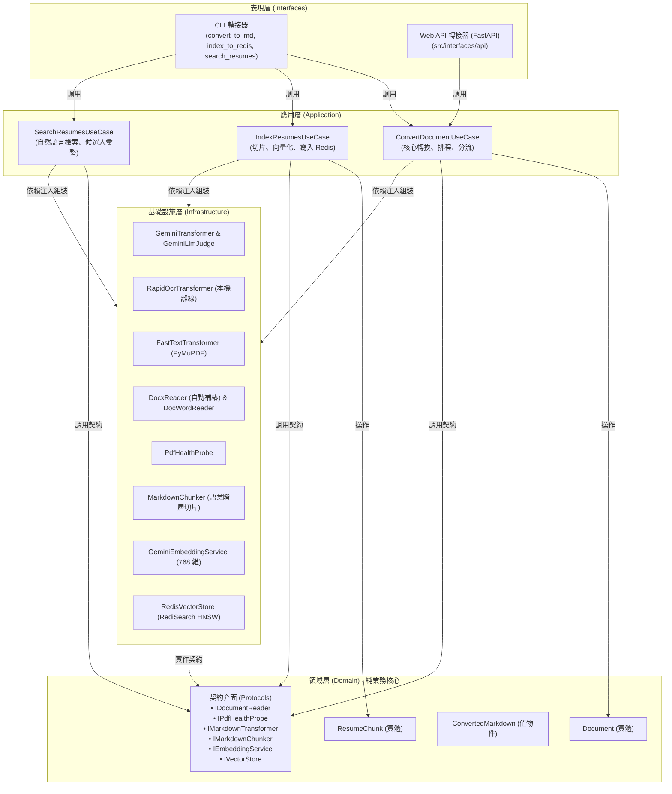
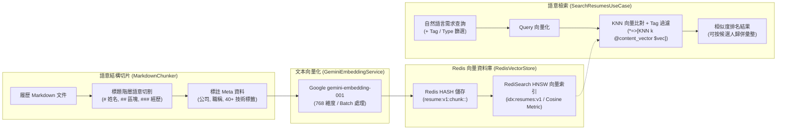
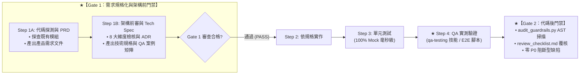

# 文件與履歷轉 Markdown 系統架構規格書 (DDD Architecture)

本專案採用 **領域驅動設計 (Domain-Driven Design, DDD)** 與 **整潔架構 (Clean / Hexagonal Architecture)** 模式進行架構設計。

將系統劃分為四個具備嚴格依賴關係的層級，確保「核心業務邏輯」完全獨立於外部技術細節（如 Google GenAI SDK、PyMuPDF、Word COM 元件）與呈現管道（CLI / Web API），具備極高的可維護性、可測試性與未來擴充彈性。

---

## 1. 系統架構分層與目錄結構

```
resume-to-markdown/
│
├── prompts/                            # 【提示詞資產庫】：Prompt Engineering 一級資產 (vision_convert.md, self_review.md, judge_system.md, judge_vision_prompt.md, judge_text_prompt.md, text_convert.md, text_review.md)
│
├── src/
│   ├── domain/                         # 【領域層】：純業務模型與契約介面 (無外部技術依賴)
│   │   ├── models.py                   # Document, ConvertedMarkdown, QualityReport, JudgeScorecard, ResumeChunk, SearchResultItem, SearchQuery, CandidateSummary, AuditRecord, DashboardSummary, LogRecord
│   │   ├── enums.py                    # DocumentType, DocumentHealth, ConversionMode, ChunkType
│   │   ├── interfaces.py               # IDocumentReader, IPdfRenderer, IPdfHealthProbe, IMarkdownTransformer, IQualityValidator, ILlmJudge, IMarkdownChunker, IEmbeddingService, IVectorStore, IAuditLogReader, ISystemLogReader, IExperienceExtractor
│   │   └── exceptions.py               # DomainError, DocumentNotFoundError, UnsupportedDocumentTypeError, FileQuotaExceededError
│   │
│   ├── application/                    # 【應用層】：使用案例 (Use Cases) 與流程協調
│   │   ├── dto.py                      # ConversionCommand, ConversionResult, IndexCommand, IndexResult, DashboardQueryDTO, WebSearchQueryDTO, WebSearchResultDTO
│   │   ├── convert_document_use_case.py # ConvertDocumentUseCase (核心分流、調度、品管檢核與獨立評審，無外部 SDK 污染)
│   │   ├── index_resumes_use_case.py    # IndexResumesUseCase (履歷切片、向量化、SHA-256 增量比對與延遲串流寫入)
│   │   ├── search_resumes_use_case.py   # SearchResumesUseCase (KNN 語意搜尋、年資/技術標籤複合過濾與全文安全讀取)
│   │   └── dashboard_use_case.py        # GetDashboardDataUseCase (轉檔品管稽核統計與系統日誌查詢協調)
│   │
│   ├── infrastructure/                 # 【基礎設施層】：外部技術、SDK 串接與 I/O 實作
│   │   ├── config.py                   # AppConfig (Twelve-Factor 讀取 .env 與環境變數)
│   │   ├── logging.py                  # 集中式滾動日誌配置與外部 API 耗時裝飾器 (RotatingFileHandler)
│   │   ├── prompts/                    # Prompt 載入器模組 (__init__.py，具備 LRU 快取與 Fallback)
│   │   ├── chunkers/                   # 語意切片與過短區塊合併實作 (markdown_chunker.py)
│   │   ├── embeddings/                 # 向量化實作 (gemini_embedding.py，gemini-embedding-001 768維)
│   │   ├── parsers/                    # 結構化年資正則解析器 (experience_parser.py)
│   │   ├── stores/                     # 向量儲存實作 (redis_vector_store.py，RediSearch HNSW idx:resumes:v1)
│   │   ├── readers/                    # 文件與日誌解析實作 (docx_reader, doc_word_reader, pdf_renderer, pdf_text_reader, csv_audit_reader, file_log_reader)
│   │   ├── probes/                     # 健康度診斷實作 (pdf_probe)
│   │   ├── transformers/               # Markdown 轉換器實作 (gemini, rapid_ocr, fast_text)
│   │   └── validators/                 # 品管檢核與評判員實作 (quality_validator, llm_judge)
│   │
│   └── interfaces/                     # 【表現層 / 輸入轉接器】：對外管道
│       ├── cli/                        # 命令列介面 (args.py, runner.py)
│       ├── api/                        # 路由接入範例 (dto.py, router_example.py)
│       └── web/                        # 雙引擎視覺化 Web 儀表板與智能履歷搜尋服務 (fastapi_server.py, server.py, static/dashboard.html)
│
├── tests/                              # 【測試套件】：顆粒化單元測試 (26 檔 / 129 項) 與端到端實測 (4 檔 / 19 項)
│   ├── unit/                           # 白箱單元測試 (100% 離線 Mock / BytesIO 記憶體隔離)
│   │   ├── test_domain_models.py       # 測試領域模型與值物件
│   │   ├── test_cleaner.py             # 測試 Markdown 清洗與格式化
│   │   ├── test_pdf_probe.py           # 測試 104 混淆字型與刪除線探測
│   │   ├── test_docx_reader.py         # 測試 Word 表格段落讀取與缺少關聯媒體自動補樁容錯
│   │   ├── test_use_case.py            # 測試核心分流邏輯 (100% Mock 隔離)
│   │   ├── test_quality_validator.py   # 測試品質檢核閥 (H1、大綱、雜訊、保留率、實體召回)
│   │   ├── test_batch_runner.py        # 測試目錄掃描探索、遞迴處理與批次品管隔離
│   │   ├── test_llm_judge.py           # 測試獨立評審員 JSON 評分卡解析與隔離保護連動
│   │   ├── test_markdown_chunker.py    # 測試語意切片階層、公司職稱解析與技術標籤提取
│   │   ├── test_embedding_service.py   # 測試 Gemini 批次向量化與重試機制
│   │   ├── test_redis_vector_store.py  # 測試 Redis HNSW 向量索引與 Tag 混合過濾
│   │   ├── test_search_use_cases.py    # 測試索引建置與候選人分組搜尋應用邏輯
│   │   ├── test_security_quotas.py     # 測試 25MB、30 頁、Zip Bomb 與 Prompt 圍欄安全防禦
│   │   ├── test_chunker_merging.py     # 測試過短切片智慧合併與跨大綱保護
│   │   ├── test_incremental_indexing.py # 測試 SHA-256 增量略過與強制覆寫
│   │   ├── test_pdf_text_first.py      # 測試健康 PDF Text-First 優先與降級防線
│   │   ├── test_app_config.py          # 測試 Twelve-Factor 環境變數載入與安全型別轉換
│   │   ├── test_prompt_loader.py       # 測試外部提示詞載入、快取與 Fallback
│   │   ├── test_hardcode_extractions.py # 測試零硬編碼閥值注入與 AST 守門員防線
│   │   ├── test_streaming_and_memory.py # 測試延遲串流索引與長篇文件自適應視覺審核節流
│   │   ├── test_logging_and_latency.py # 測試集中式滾動日誌與 API 延遲追蹤
│   │   ├── test_web_dashboard.py       # 測試轉檔品管統計與系統日誌 Web 服務邏輯
│   │   ├── test_resume_web_search.py   # 測試智能履歷搜尋、年資解析與路徑遍歷防禦
│   │   ├── test_resume_indexing_skill.py # 測試向量入庫技能調度腳本
│   │   ├── test_resume_search_skill.py # 測試語意檢索技能調度腳本
│   │   └── test_github_pre_publish_hygiene.py # 測試 .gitignore、.env.example 同步與 SHA-256 零個資防線
│   │
│   └── e2e/                            # 黑箱/灰箱 QA 端到端實測 (真實 CLI、Web 與 Redis 環境相容性)
│       ├── test_cli_workflow.py        # 測試 CLI 流程、向下相容性與 Windows 資源釋放
│       ├── test_token_optimization_e2e.py # 測試真實 CLI 增量入庫與切片存儲相容性
│       ├── test_web_dashboard_e2e.py   # 測試雙引擎 Web 儀表板端點與並行請求
│       └── test_resume_web_search_e2e.py # 測試智能履歷複合檢索與全文預覽 E2E 流程
│
├── docs/                               # 【全生命週期持久化工程文檔庫】
│   ├── README.md                       # 文檔導覽中樞與四向追溯矩陣
│   ├── adr/                            # 架構決策紀錄庫 (0001 ~ 0016 共 16 篇正式 ADR 與 README 索引)
│   ├── specs/                          # 需求規格與 DDD 技術實作規格書 (0005 ~ 0016 共 12 篇)
│   ├── qa_reports/                     # 黑箱/灰箱 QA 實測驗收報告 (0005 ~ 0016 共 12 篇)
│   └── templates/                      # 標準 PRD、Tech Spec、Test Case 與 QA 報告範本
│
├── .agents/                            # 【多代理協同與專屬技能體系】
│   ├── README.md                       # 多代理協同總章程與交接協議
│   ├── architect/                      # 架構師代理定義 (AGENT.md)
│   ├── developer/                      # 核心開發者代理定義 (AGENT.md)
│   ├── gatekeeper/                     # 對抗式 QA 與資安審查官代理定義 (AGENT.md)
│   └── skills/                         # 8 大專屬技能庫 (feature-design, unit-testing, qa-testing, code-review, auto-fix, doc-sync, resume-vector-indexing, resume-vector-search)
│
├── convert_to_md.py                    # CLI 主啟動進入點 (保持既有命令 100% 向下相容)
├── index_to_redis.py                   # 履歷切片、向量化入庫 Redis 專用 CLI
├── search_resumes.py                   # 自然語言與條件混合語意檢索 CLI (含互動終端)
├── web_dashboard.py                    # 轉檔品管統計與履歷智能檢索雙引擎 Web 儀表板入口點
├── requirements.txt                    # Python 相依套件清單
├── .env.example                        # Twelve-Factor 環境變數配置範本
├── .gitignore                          # Git 版控邊界與敏感資料隔離規則
├── LICENSE                             # MIT 開源授權條款
├── AGENTS.md                           # 多代理人協作與跨平台通用規範手冊
├── GEMINI.md                           # Google Antigravity 專案開發規範指引
├── CLAUDE.md                           # Anthropic Claude Code 專案開發規範指引
├── README.md                           # 專案開源導覽與快速上手手冊
├── REQUIREMENTS.md                     # 產品需求規格書
└── ARCHITECTURE.md                     # 本架構技術手冊
```

---

## 2. 核心架構分層依賴圖

遵循 **依賴反轉原則 (Dependency Inversion Principle, DIP)**，外層依賴內層，內層抽象絕不依賴外層細節：



---

## 3. 處理流程時序圖 (Sequence Diagram)

```mermaid
sequenceDiagram
    autonumber
    actor User as 使用者 (CLI 或 Web API)
    participant UC as ConvertDocumentUseCase (應用層)
    participant Probe as PdfHealthProbe (探測器)
    participant Renderer as PdfRenderer / WordReader (解析器)
    participant Transformer as Gemini / RapidOCR (轉換器)

    User->>UC: execute(ConversionCommand)
    Note over UC: 根據副檔名建立 Document 實體<br>(支援檔案路徑或記憶體 Bytes)

    alt 是 Word 檔案 (.docx / .doc)
        UC->>Renderer: extract_text(doc)
        Renderer-->>UC: 回傳結構化段落與表格文字
        opt 有配置 GEMINI_API_KEY
            UC->>Transformer: transform_text(raw_text, enable_review)
            Transformer-->>UC: 回傳語意 Markdown
        end
    else 是 PDF 檔案 (.pdf)
        UC->>Probe: probe(doc)
        Probe-->>UC: 回傳健康狀態 (HEALTHY / SCANNED / OBFUSCATED)
        
        alt 掃描檔 或 104 防爬混淆檔
            UC->>Renderer: render_pages_to_png(doc, dpi=150)
            Renderer-->>UC: 回傳頁面高解析影像列表
            alt 有配置 GEMINI_API_KEY
                UC->>Transformer: transform_vision(pngs, enable_review)
                Note over Transformer: 若開啟 --review，啟動 Chat 兩階段自我審核
                Transformer-->>UC: 回傳修復後的語意 Markdown
            else 離線無金鑰
                UC->>Transformer: RapidOCR 本機光學辨識
                Transformer-->>UC: 回傳 OCR 純文字 Markdown
            end
        else 正常健康文字 PDF
            opt 有配置 GEMINI_API_KEY
                UC->>Transformer: transform_vision(pngs, enable_review)
                Note over Transformer: 若遇 Google RECITATION 版權攔截，<br>自動降級走 transform_text(raw_text)
            else 離線模式
                UC->>Transformer: 提取原生 Markdown (PyMuPDF4LLM)
            end
        end
    end

    UC-->>User: 回傳 ConversionResult DTO (包含內容、模式、審核狀態)
```

---

## 4. Web API 接入設計（零成本擴充）

本架構在設計領域模型 `Document` 時，已加入 **「記憶體位元組串流（In-Memory BytesIO）」** 抽象支援：

```python
# 示範：FastAPI 路由接入範本 (位於 src/interfaces/api/router_example.py)
from fastapi import APIRouter, UploadFile, File
from src.application.dto import ConversionCommand
from src.interfaces.cli.runner import build_use_case
from src.infrastructure.config import AppConfig

router = APIRouter()

@router.post("/api/v1/convert")
async def convert_resume(file: UploadFile = File(...), review: bool = False):
    # 1. 直接讀取上傳檔案的記憶體 bytes (不需寫入磁碟暫存檔！)
    content_bytes = await file.read()
    
    # 2. 載入配置並建構 Use Case
    config = AppConfig.load(override_review=review)
    use_case = build_use_case(config)
    
    # 3. 封裝指令並執行
    command = ConversionCommand(
        file_bytes=content_bytes,
        filename=file.filename,
        enable_review=config.gemini_review
    )
    result = use_case.execute(command)
    
    # 4. 直接以 JSON 回應給前端 SPA 網頁或微服務
    return {
        "success": result.success,
        "filename": file.filename,
        "markdown": result.markdown,
        "health_status": result.health.value,
        "reviewed": result.reviewed,
        "model_used": result.model_used
    }
```

> **關鍵價值**：未來將專案發布為微服務或 Web API 時，**核心應用層與基礎設施層完全不需要改動任何一行代碼**！

---

## 5. 多層次品管防護閥 (Quality Guardrails) 設計

針對企業大量自動化解析情境，若完全依賴 LLM 自審，仍有成本與機率性遺漏風險。本架構在應用層加入了**確定性品管檢核閥（Deterministic Quality Guardrails）**：

```
[原始輸入文字/影像] ──> [LLM/OCR 轉換] ──> [ConvertedMarkdown]
                                                    │
                                                    ▼
                                     ┌─────────────────────────────┐
                                     │  MarkdownQualityValidator   │
                                     │  (IQualityValidator 介面)   │
                                     ├─────────────────────────────┤
                                     │ 1. 結構骨架檢驗 (H1、核心大綱) │
                                     │ 2. 雜訊禁令 (Page X, \ufffd)│
                                     │ 3. 篇幅保留率 (0.35 ~ 3.50) │
                                     │ 4. 關鍵實體召回 (Email、手機)│
                                     │ 5. 語法與表格健康度         │
                                     └──────────────┬──────────────┘
                                                    │
                                                    ▼
                                           [QualityReport]
                                    (評分 0-100 / 狀態 / 警告清單)
                                                    │
                      ┌─────────────────────────────┴─────────────────────────────┐
                      ▼                                                           ▼
         【評分合格 (>= 65)】                                            【評分未達標 (< 65)】
        輸出至目標 output.md                                      若帶有 --quarantine，
        記錄於 CSV 稽核日誌 (PASS/WARNING)                         自動隔離至 quarantine/ 目錄
                                                                  防止瑕疵檔案污染下游 RAG 資料庫
```

### 5.1 領域層契約 (`src/domain/`)
- **`QualityReport` (值物件 - 防線一)**：
  - `is_passed: bool`（分數 $\ge 65$ 為合格）
  - `score: int`（$0 \sim 100$ 分）
  - `warnings: List[str]`（扣分項目與潛在風險說明）
  - `checks: Dict[str, bool]`（細部檢核項狀態）
  - `retention_ratio: Optional[float]`（篇幅保留率）
  - `missing_entities: List[str]`（遺漏的關鍵實體，如 Email、手機電話）
  - `summary_status: str`（`PASS`、`WARNING`、`FAIL`）
- **`JudgeScorecard` (值物件 - 防線二)**：
  - `overall_score: int`（綜合總分 0-100）
  - `completeness_score: int`（資訊完整度 0-100）
  - `fidelity_score: int`（真實度 0-100，每處幻覺扣 20）
  - `structure_score: int`（結構規範度 0-100）
  - `verdict: str`（`PASS` / `WARNING` / `FAIL`）
  - `critique: str`（評判評語）
  - `missing_items: List[str]`（具體遺漏項）
  - `hallucinations: List[str]`（具體幻覺項）
- **契約介面 (Protocols)**：
  - `IQualityValidator`：定義 `validate(markdown, raw_text, doc) -> QualityReport`。
  - `ILlmJudge`：定義 `judge_document(markdown, doc, page_pngs, raw_text) -> JudgeScorecard`。

### 5.2 基礎設施實作
- **`MarkdownQualityValidator` (防線一)**：
  - **零 API 成本、毫秒級執行**。
  - 精準標題偵測：僅在 Markdown 階層標題（`#`, `##`, `###`）或粗體大綱列檢核大綱區塊，避免內文提及關鍵字造成誤判。
  - 支援對照原始文字層提取 Regex 實體（Email、臺灣手機格式），確保聯絡資訊 100% 留存。
- **`GeminiLlmJudge` (防線二)**：
  - **獨立客觀評判員**：以獨立第三者角色提示詞，對照原圖與 Markdown 進行比對。
  - **標準 JSON 評分卡**：利用 `response_mime_type="application/json"` 強制輸出結構化評分卡，支援 `--save-scorecard` 獨立儲存為 JSON。
  - **連動隔離**：若評審裁定為 `FAIL`，同樣觸發 `--quarantine` 隔離保護。

### 5.3 Word 封裝層容錯補樁 (In-Memory Auto-Healing)
針對實務招募情境中常見的「Word 破圖或殘留關聯缺陷」（例如求職者履歷關聯檔引用 `image4.jpeg` 但封裝包內缺失，引發 `KeyError: There is no item named ... in the archive`）：
- **自動補樁**：[`DocxReader`](src/infrastructure/readers/docx_reader.py) 內建 `_heal_docx_stream`，自動掃描 `.rels` 關聯與實體 ZIP 檔案清單差異。
- **動態填補**：遇缺失媒體元件時，自動於記憶體位元組串流中注入虛擬微型佔位符，使 `python-docx` 順暢跳過破圖並 100% 完整解析自傳、段落與跨欄表格。
- **零磁碟副作用**：全流程於記憶體中修復，絕不修改或破壞磁碟上的原始履歷檔案。

### 5.4 Google RECITATION 版權安全過濾阻斷與自審防漂移保護 (Anti-Hallucination Guard)
針對履歷內包含標準專業教材內容（例如 PMP/PMBOK 專案管理指南標準流程條目）的情境：
- **問題背景**：Gemini Vision 多模態在輸出大量標準教科書語句時，會觸發 Google API 底層的 `FinishReason.RECITATION`（防範大模型逐字背誦有版權文獻的過濾機制），導致第 1 輪影像初稿被官方攔截作廢（輸出為 `None`）。若此時繼續發送第 2 輪 Chat 自審，模型會因失去前文而在第 2 輪依據 Prompt 示範例子（如 Hangfire、微服務）憑空捏造出虛構候選人（嚴重幻覺）。
- **雙重防護機制**：
  1. **阻斷自審情境漂移**：在 [`GeminiTransformer`](src/infrastructure/transformers/gemini_transformer.py) 中，一旦偵測到 `FinishReason.RECITATION` 或輸出為空，立即拋出例外阻斷流程，嚴禁盲目進入第 2 輪 Chat 自審，徹底杜絕無中生有的角色幻覺。
  2. **智慧平滑降級 (Graceful Fallback)**：在 [`ConvertDocumentUseCase`](src/application/convert_document_use_case.py) 中，當健康文字 PDF 的視覺多模態遭 Google 版權攔截時，自動平滑降級改走文字語意轉換（`transform_text`），繞過圖檔版權過濾，達成 100/100 滿分、零遺漏產出。
  3. **品管防線實戰查驗**：即使發生極端的大模型安全阻斷，確定性品管閥（`MarkdownQualityValidator`）也能即時透過保留率檢驗與關鍵 Email/手機實體對比，當場判定 40 分 (FAIL) 並隔離入庫，保證不污染正式資料庫。

---

## 6. 單元測試 (Unit Testing) 設計

透過依賴反轉，核心決策邏輯不需要連上真實網路、不需要真實的 Gemini API Key，即可進行 100% 離線測試：

### 6.1 測試套件架構
- **`test_domain_models.py`**：測試實體狀態轉換、副檔名解析、位元組提取與字數統計。
- **`test_cleaner.py`**：測試 Markdown 圍欄（````markdown`）清除與空白正規化。
- **`test_pdf_probe.py`**：測試 104 人力銀行混淆字型探測器與健康度診斷。
- **`test_docx_reader.py`**：測試 Word 表格提取、去重邏輯，以及針對缺失內部媒體檔案（如 image4.jpeg）的記憶體自動補樁容錯。
- **`test_use_case.py`**：使用 Mock 模擬所有外部技術元件，測試自動分流、降級回退（Fallback）與自我審核參數傳遞。
- **`test_quality_validator.py`**：測試確定性品質檢核閥（完美滿分、缺少一級標題、缺少經歷/學歷大綱、殘留 Page/亂碼雜訊、Email/電話實體遺漏、文字嚴重截斷等邊界情境）。
- **`test_batch_runner.py`**：測試目錄檔案探索（過濾暫存檔與隱藏檔）、遞迴子目錄結構解析、批次品管分流、429 配額耗盡日誌登記與快速記錄機制。
- **`test_llm_judge.py`**：測試獨立評判員 JSON 評分卡解析（標準 JSON、帶代碼框 JSON、錯誤格式降級容錯）、評判員與 Use Case 整合調度、評判員裁定 FAIL 與隔離區儲存。
- **`test_markdown_chunker.py`**：測試語意切片階層切分、候選人姓名提取、任職公司與職稱拆解、技術關鍵標籤提取與空標題過濾。
- **`test_embedding_service.py`**：測試 Gemini 向量化批次處理、降維 768 維設定、空輸入邊界防護與暫時性例外重試機制。
- **`test_redis_vector_store.py`**：測試 Redis RediSearch HNSW 向量索引建立、Pipeline HSET 寫入、KNN 向量與 Tag 混合檢索語法、Cosine 相似度轉換與使用者切片刪除。
- **`test_search_use_cases.py`**：測試 IndexResumesUseCase 索引組裝（Markdown 文本與檔案路徑）、SearchResumesUseCase 自然語言查詢與候選人層級聚合歸併。
- **`test_security_quotas.py`、`test_chunker_merging.py`、`test_incremental_indexing.py`、`test_pdf_text_first.py`**：測試安全配額硬上限、過短切片智慧合併、SHA-256 指紋增量入庫與健康 PDF Text-First 優先策略。
- **`test_app_config.py`、`test_prompt_loader.py`、`test_hardcode_extractions.py`**：測試 Twelve-Factor 環境變數載入、外部提示詞快取與零硬編碼 AST 防線。
- **`test_streaming_and_memory.py`、`test_logging_and_latency.py`**：測試延遲串流索引、長篇文件自適應視覺審核節流與集中式滾動日誌。
- **`test_web_dashboard.py`、`test_resume_web_search.py`、`test_github_pre_publish_hygiene.py`**：測試雙引擎 Web 儀表板、智能履歷年資/標籤複合檢索與 Git 版控零個資防線。

### 6.2 執行單元測試指令
```bash
python -m unittest discover -s tests -p "test_*.py"
```
*測試執行成果：129 項白箱單元測試（約 7 秒）+ 19 項端到端 E2E 實測全部通過（OK）。*

---

## 7. 履歷語意向量化與 Redis 檢索架構 (Vector Architecture)



### 7.1 HNSW 索引超參數設定規格 (Index Hyperparameters)

| 參數名稱 | 數學符號 | RediSearch 參數鍵值 | 目前設定 | 效能與設計考量 |
| :--- | :---: | :--- | :---: | :--- |
| **最大邊連接數** | $M$ | `M` | **`16`** | 節點雙向連線數。在 768 高維下兼顧圖拓撲連通性與壓低記憶體消耗（RAM Footprint）。 |
| **建圖探索範圍** | $efConstruction$ | `EF_CONSTRUCTION` | **`200`** | 索引建置時近鄰探索深度，耗時稍多但產出高品質多層圖，顯著拉高檢索召回率（Recall）。 |
| **搜尋探索範圍** | $efSearch$ | `ef_runtime` | **`10`** | 查詢執行階段的候選集大小（預設 10 為極速毫秒級，亦支援於查詢時動態帶入自訂值）。 |
| **向量維度** | - | `DIM` | **`768`** | 符合 Google `gemini-embedding-001` 降維規範，精準表達中英文語意。 |
| **距離指標** | - | `DISTANCE_METRIC` | **`COSINE`** | 餘弦相似度度量（相似度計算公式為 $1.0 - \text{distance}$）。 |

---

## 8. 向下相容性與 CLI 使用指引

雖然內部已經完全拆分為標準 DDD 模組，但根目錄的 `convert_to_md.py` 依然作為 CLI 入口點，保持使用習慣與參數指令 **100% 向下相容**：

```bash
# 1. 一般轉換 (智慧自動判定格式、文字層健康度與品管評分)
python convert_to_md.py document.pdf
python convert_to_md.py document.docx

# 2. 轉檔成功後自動將 Markdown 履歷切片、向量化存入 Redis
python convert_to_md.py resume.pdf --index-to-redis

# 3. 獨立履歷入庫工具：單一檔案或整個目錄批次切片向量化
python index_to_redis.py output_md/
python index_to_redis.py "output_md/sample_resume.md" --recreate

# 4. 履歷語意檢索 CLI (自然語言 + 技術標籤篩選 + 候選人彙總)
python search_resumes.py "分散式微服務架構與 High Traffic 高並發處理"
python search_resumes.py "設計過金流系統" --type experience --skills golang,redis
python search_resumes.py "AWS 雲端架構設計" --group

# 5. 終端機互動式問答檢索
python search_resumes.py

# 6. 啟用防線二：獨立客觀評審員 (LLM-as-a-Judge) 與 JSON 評分卡
python convert_to_md.py resume.pdf --judge --save-scorecard "scorecard.json"

# 7. 完整四層防線企業級批次轉檔 (目錄批次 + 兩階段自修 + 獨立評判員 + 品質隔離 + 批量 CSV 稽核)
python convert_to_md.py "resume" -o "markdown_out" -r --review --judge --quarantine "quarantine" --audit-report "batch_audit.csv"

# 8. 啟動視覺化 Web 儀表板與智能履歷搜尋服務 (支援 CLI 雙引擎與標準 Uvicorn ASGI 啟動)
python web_dashboard.py --port 8080 --open
python -m uvicorn src.interfaces.web.fastapi_server:app --reload --port 8080
python -m uvicorn src.interfaces.web.fastapi_server:create_default_app --factory --reload --port 8080
python -m uvicorn web_dashboard:app --reload --port 8080

# 9. 執行全套單元測試與 E2E 測試 (共 135 項單測 + 20 項 E2E)
python -m unittest discover -s tests

# 10. 執行架構防線與 DDD 邊界靜態稽核 (AST Code Review)
python .agents/skills/code-review/scripts/audit_guardrails.py
```

---

## 9. 代碼審查與架構防線技能 (`.agents/skills/code-review/`)

為杜絕 AI 助理在開發過程中產生「自我認證（Self-Certification）」與盲目閉環，本專案將標準閉環流程升級為 **雙門禁 7 步驟閉環**，並建立獨立的 `code-review` 技能。

### 9.1 審查檢核清單與阻斷等級

| 嚴重等級 | 判定條件 | 處置方式 |
| :--- | :--- | :--- |
| **P0 阻斷型 (Blockers)** | 1. `src/domain/` 引入外部套件或外層依賴<br>2. `src/application/` 違反依賴反轉 (DIP)<br>3. 篡改原始磁碟輸入檔案<br>4. Redis 入庫未實施冪等性清理<br>5. 單元測試未 100% Mock 隔離或依賴本機真實檔案<br>6. 殘留真實個資 (PII)/真實企業案例、寫死本機工作區絕對路徑，或 `.gitignore`/`.env.example` 未同步 | **一票否決**。禁止交付，強制進入 Step 6 診斷並打回 Step 2 重構。 |
| **P1 高風險 (Warnings)** | 1. 盲目 `except: pass` 吞噬未預期錯誤<br>2. 外部 API 缺乏 429 或 RECITATION 降級保護<br>3. 檔案未安全使用 `with` 語句導致資源洩漏 | 原則上必須修正；若有特殊情境需保留，必須附帶清楚架構決策說明。 |
| **P2 建議優化 (Info)** | 1. 公開方法型別標註 (Type Hints) 不完整<br>2. 缺乏清晰 Docstring | 建議優化，不阻斷交付。 |

### 9.2 自動化靜態架構掃描工具 (`audit_guardrails.py`)
使用 Python 內建 `ast` 模組直接解析語法樹，確保：
1. **Domain 層純潔性**：驗證 `src/domain/` 內所有檔案僅能使用標準庫 (`sys.stdlib_module_names`) 與本層模組。
2. **Application 層 DIP 驗證**：驗證使用案例嚴禁直接 import `infrastructure` 或 `interfaces`。
3. **安全防線掃描**：掃描全專案是否出現裸吞 Exception 的情況。
4. **Git 版控衛生與個資/路徑防線掃描**：自動檢驗全專案零真實個資/企業雜湊指紋、零寫死本機絕對路徑、以及 `.gitignore` 與 `.env.example` 對 `AppConfig` 的 100% 同步性。

---

## 10. 雙重門禁機制 (Dual-Gate) 與架構決策紀錄 (ADR)

本專案採行 **「前後雙門禁 (Dual-Gate) 7 步驟」細化品管體系**，將架構前審（Gate 1）、白箱單元測試、黑箱 QA 實測與代碼審查（Gate 2）循序整合，確保系統在戰略方向、需求規格、功能驗證與代碼架構上皆具備工業級防護。



### 10.1 兩階段需求規格化 (Two-Stage Specification)
使用者提出的需求通常僅有一至兩句簡短指示。為杜絕實作者「天馬行空」或破壞既有設計：
1. **Step 1A (PRD 產品需求文件)**：由 AI 主動探測相關代碼庫，釐清相依關係，產出涵蓋使用者場景、In-Scope/Out-of-Scope、資料合約與驗收標準 (AC) 的產品需求文件。
2. **Step 1B (Tech Spec 技術規格書)**：依據 PRD 進行 8 大架構維度衝擊評估，產出涵蓋 Domain 實體與協定、Application DTO 與調度時序、Infrastructure 資源釋放 (Context Manager) 與例外鏈保留、CLI 向下相容參數、單元測試計畫以及 **QA 驗收測試案例矩陣** 的工程實作規格書。

### 10.2 智能 QA 實測驗證四大支柱 (Intelligent QA Live Testing)
不同於單元測試的全面 Mock，QA 實測環節（由 [`.agents/skills/qa-testing/`](.agents/skills/qa-testing/SKILL.md) 技能調度）在真實 CLI 執行緒、真實本機 sample 檔案與真實 Redis 服務下運行端到端腳本（`tests/e2e/`），落實四大核心能力：
1. **需求雙向追溯 (Traceability & Coverage)**：盤點需求追溯矩陣 (RTM)，保證每一條 Acceptance Criteria (AC) 達到 100% 測試覆蓋，絕不遺漏任何業務需求。
2. **對抗式邊界與異常挖掘 (Adversarial Edge Cases)**：自動窮舉極限盲區，覆蓋高併發競態危害（Race Conditions）、Redis 向量操作冪等性、網路斷線重連與惡意畸形輸入注入。
3. **實測腳本自動生成與防 Flaky 審核 (Script Generation & Anti-Flaky)**：自動生成可執行之端到端測試代碼，嚴格審查隔離性與超時機制，根除不穩定測試（Flaky tests）。
4. **失敗分析與自動根因定位 (Automated RCA)**：當實測失敗時，自動介入分析 Log 與 Traceback，精準定位故障代碼並產出修復建言，回饋至 Step 6 閉環修復。
5. **產出結論**：出具正式的 **QA 實測驗收報告** 後才放行進入 Gate 2 代碼審查。

### 10.3 8 大架構審查維度 (Architecture Review Dimensions)
重大架構演進（Deep Track）動工前必須通過 8 大維度檢核：
1. **[PII 個資隱私]**：敏感資料在傳送至外部 API 前的脫敏機制，以及資料庫加密安全。
2. **[容量與極限]**：Redis HNSW 記憶體預算（RAM Footprint）試算與橫向分片擴展性。
3. **[非同步與演進]**：Use Case 與對外協定的解耦度，能否隨時包裝為 Celery 或 FastAPI 背景佇列。
4. **[成本與熔斷]**：外部 LLM Token 預算評估與 429 配額用罄熔斷器（Circuit Breaker）。
5. **[可抽換性]**：嚴格依賴反轉，確保底層模型與向量資料庫具備零成本抽換彈性。
6. **[惡意輸入與配額硬上限]**：檔案上限（25MB）、頁數（30 頁）與 DOCX 解壓縮膨脹比（10x）防 Zip Bomb；Prompt 圍欄標籤防注入。
7. **[向量索引演進遷移]**：Redis 向量索引具備版本標記（`v1`），更換 Embedding 模型時支援藍綠平滑切換。
8. **[分散式併發與全鏈路可觀測性]**：多 worker 任務冪等性；全鏈路 Trace ID 與結構化日誌追蹤。

### 10.4 現行 ADR 歸檔清單 (`docs/adr/`)
* [ADR-0001: 採用 Clean Architecture 與 DDD 四層依賴反轉架構](docs/adr/0001-clean-architecture-and-ddd.md)
* [ADR-0002: 文件轉檔智慧自動判別管線與兩階段自我審核修復](docs/adr/0002-dual-routing-and-self-refinement.md)
* [ADR-0003: 採用 Redis HNSW 向量庫與 768 維語意切片檢索](docs/adr/0003-redis-hnsw-vector-store.md)
* [ADR-0004: 建立確定性品管閥與獨立評審員四層品管防線](docs/adr/0004-four-tier-quality-guardrails.md)
* [ADR-0005: 全面安全性防禦、可觀測性演進與代碼治理規範升級](docs/adr/0005-security-observability-and-code-governance.md)
* [ADR-0006: Token 消耗最佳化、增量指紋入庫與切片語意合併](docs/adr/0006-token-optimization-and-incremental-indexing.md)
* [ADR-0007: Twelve-Factor 全盤環境變數提取與配置治理](docs/adr/0007-twelve-factor-configuration-and-env-extraction.md)
* [ADR-0008: Prompt Engineering 獨立檔案化與運行時演算法配置治理](docs/adr/0008-prompt-engineering-externalization-and-runtime-config.md)
* [ADR-0009: 全面硬編碼提取、配置貫通與文字轉檔提示詞資產解耦](docs/adr/0009-comprehensive-hardcode-extraction-and-config-penetration.md)
* [ADR-0010: 全面提示詞外部化與評判模板資產化治理](docs/adr/0010-comprehensive-prompt-externalization-and-template-governance.md)
* [ADR-0011: 多 Agent 狀態記憶治理、延遲串流索引與視覺審核 Token 節流](docs/adr/0011-agent-memory-management-and-streaming-token-governance.md)
* [ADR-0012: 集中式系統技術日誌與外部 API 請求耗時可觀測性治理](docs/adr/0012-centralized-system-logging-and-api-latency-tracking.md)
* [ADR-0013: 專案全景文檔體系與持久化歸檔](docs/adr/0013-full-lifecycle-doc-archiving-and-governance.md)
* [ADR-0014: 輕量化轉檔稽核日誌與統計摘要 Web 儀表板架構](docs/adr/0014-web-dashboard-and-audit-observability.md)
* [ADR-0015: 智能履歷搜尋 Web 介面與工作年資/技術標籤複合檢索](docs/adr/0015-resume-search-web-interface.md)
* [ADR-0016: GitHub 上庫前全方位安全脫敏、個資 (PII) 清零與跨平台路徑治理](docs/adr/0016-github-pre-publish-security-and-pii-governance.md)
* [ADR-0017: 上庫前個資掃描與文件連結防線補強](docs/adr/0017-publish-privacy-scanner-hardening.md)
* [ADR-0018: 支援 Uvicorn 標準 ASGI 啟動、App Factory 與 Web 依賴注入組裝收斂](docs/adr/0018-uvicorn-standard-asgi-entrypoint-and-di-bootstrap.md)

### 10.5 專案全景文檔導覽與雙重持久化體系 (`docs/`)
為確保全生命週期之工程透明度與版本控制追溯性，專案落地四向關聯之文檔持久化架構：
* **[文檔導覽中樞]**：[`docs/README.md`](docs/README.md) 提供 ADR、規格書、測試套件與 QA 報告之全景對齊矩陣。
* **[需求與 DDD 技術規格]**：[`docs/specs/`](docs/specs/) 收錄每次功能變更在 Step 1 (Gate 1) 產出的 PRD 與 Tech Spec（如 `0005-*.md` ~ `0014-*.md`）。
* **[黑箱/灰箱 QA 實測報告]**：[`docs/qa_reports/`](docs/qa_reports/) 收錄每次功能變更在 Step 4 (QA Testing) 產出的驗收矩陣與極端情境實測報告。
* **[自動化同步檢驗]**：執行 `python .agents/skills/doc-sync/scripts/verify_doc_sync.py` 自動確保 100% 格式合法且無遺漏索引。


