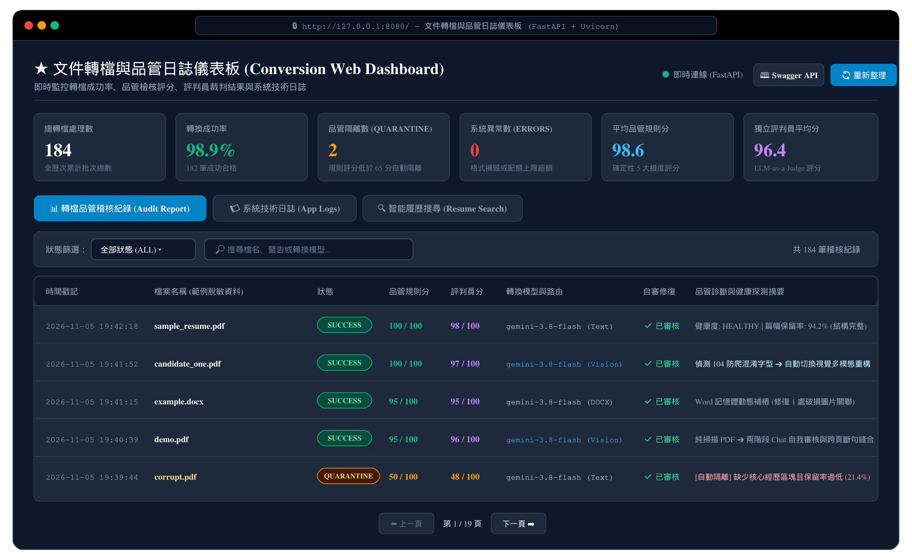
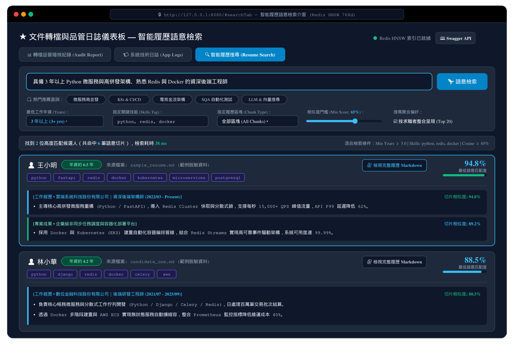
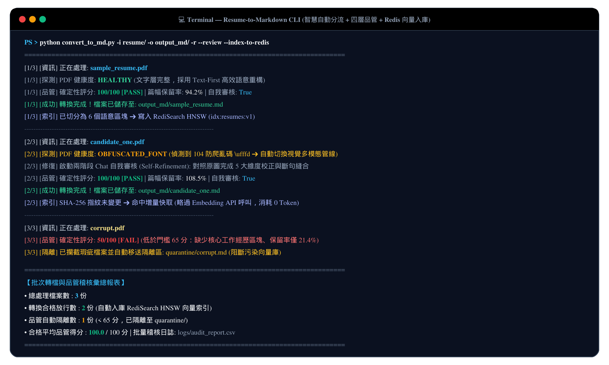
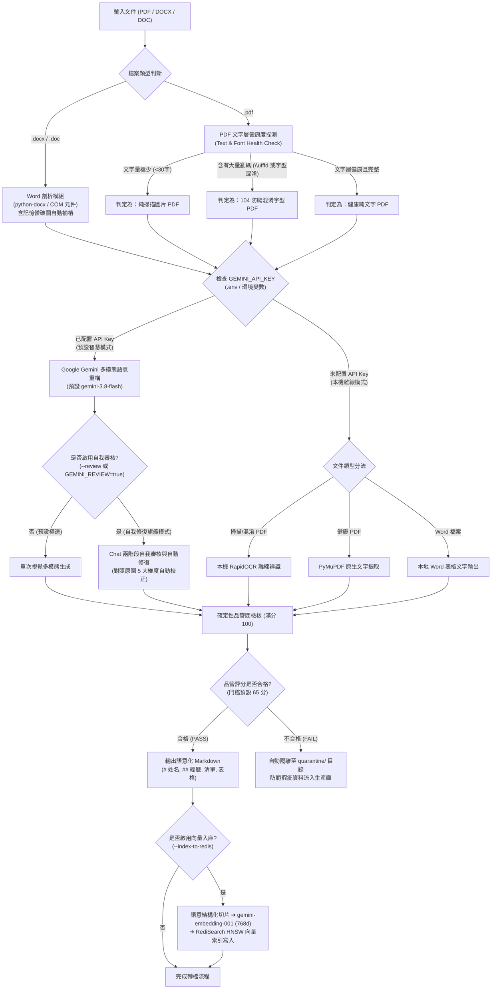
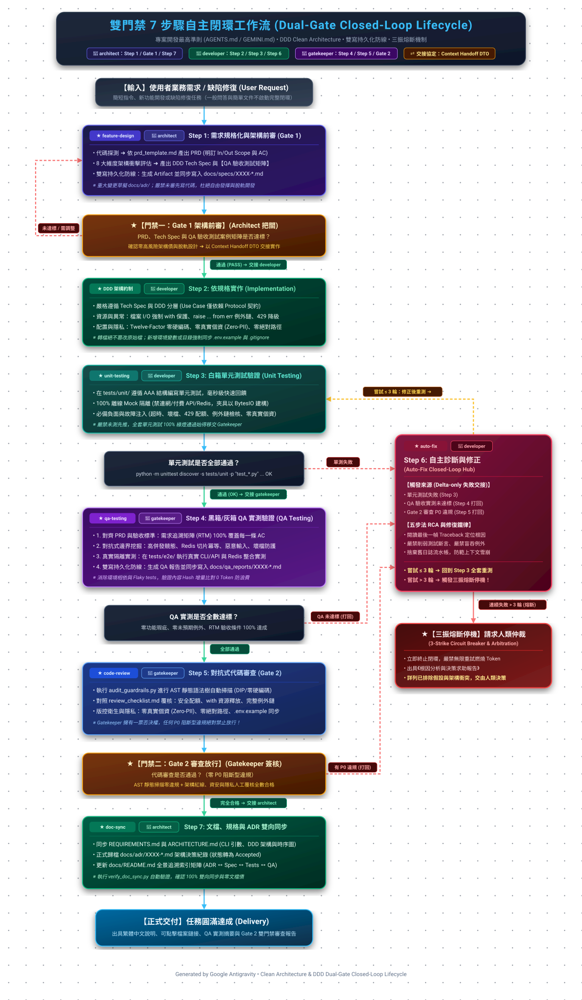

# 🚀 Resume-to-Markdown & Semantic Search Engine
### 智慧履歷轉檔、多模態自我修復與 Redis 向量檢索系統

[](https://www.python.org/)
[](#系統架構與分流決策管線)
[](https://ai.google.dev/)
[](https://redis.io/)
[](#四層品管防線與批量自動隔離)
[](LICENSE)

本專案是一套專為企業招募系統（ATS）與人才檢索設計的**工業級履歷解析與向量語意檢索系統**。
採用 **領域驅動設計 (Domain-Driven Design, DDD)** 與 **整潔架構 (Clean Architecture)**，整合 **Google Gemini 最新多模態大模型** 與 **RediSearch HNSW 向量索引**，徹底解決非結構化履歷文件的格式混雜、亂碼防爬、破圖損毀、跨頁斷句與檢索斷章取義等痛點。

---

## 🌟 解決的核心痛點

| 實務痛點 | 本系統之解決方案 |
| :--- | :--- |
| **104 防爬蟲字型混淆（大量 `\ufffd` 亂碼）** | 內建 **PDF 健康度探測閥 (Health Probe)**，自動辨識亂碼特徵並靜默切換為視覺多模態解析管道。 |
| **Word 破圖與關聯殘留導致程式崩潰** | **記憶體動態補樁 (In-Memory Auto-Healing)**，在串流中注入虛擬佔位符，100% 萃取文字與表格，磁碟原始檔案零篡改。 |
| **純掃描 PDF 缺乏文字層** | 自動偵測字元密度，無縫轉交視覺多模態模型或本機離線 RapidOCR 進行高精度重構。 |
| **多欄位排版標題與內文脫鉤、跨頁句子斷裂** | **兩階段 Chat 自我審核與自動修復 (Self-Refinement)**，模型對照原圖進行 5 大維度自動校正與斷句縫合。 |
| **批次轉檔無法保證品質與真實性** | **四層確定性品管閥 (Deterministic Linting)** + **獨立客觀評審員 (LLM-as-a-Judge)**，瑕疵檔案自動隔離（Quarantine）並輸出 CSV 稽核日誌。 |
| **傳統固定長度切片造成 RAG 語意破碎** | **Markdown 語意結構化切片 (Semantic Chunking)**，依階層識別姓名、經歷、技能、學歷，支援相鄰短區塊智慧合併。 |
| **重複入庫浪費高額 Token 與 API 費用** | **SHA-256 內容指紋增量快取**，未變更檔案重複執行達成 **0 次 API 呼叫與 0 Token 消耗**。 |

---

## 📸 系統畫面展示 (System Showcase)

### 1. 轉檔品管與統計摘要 Web 儀表板 (`web_dashboard.py`)
直觀監控全批次轉檔成功率、確定性品管規則得分、LLM-as-a-Judge 獨立評審員評分、104 防爬字型自動分流與瑕疵檔案自動隔離（Quarantine）明細：



### 2. 智能履歷語意檢索與混合過濾介面 (`#searchTab`)
支援自然語言職缺描述檢索（RediSearch HNSW 768 維 Cosine 相似度），結合最低工作年資篩選、關鍵技能 Tag 過濾、求職者層級聚合與一鍵檢視原始 Markdown：



### 3. CLI 智慧轉檔、兩階段自我審核與增量向量入庫 (`convert_to_md.py`)
終端機自動完成 PDF/Word 健康度探測、多模態轉檔、確定性品管評分與 SHA-256 零 Token 增量快取索引：



---

## 🏗️ 系統架構與分流決策管線

### 1. 整潔架構分層 (Clean Architecture)
```
src/
├── domain/            # 【領域層】：純業務模型與契約介面 (無外部 SDK 依賴，100% 純 Python)
├── application/       # 【應用層】：Use Cases 與流程協調 (Conversion, Indexing, Semantic Search)
├── infrastructure/    # 【基礎設施層】：外部技術實作 (Gemini API, Redis HNSW, PyMuPDF, python-docx)
└── interfaces/        # 【表現層】：CLI 命令列工具與 Web API / 儀表板服務
```

### 2. 智慧自動判別與處理管線 (Auto-Routing Pipeline)


---

## ✨ 核心功能特色

### 1. 智慧自動判別與自適應路由 (Zero Configuration)
使用者無需事先探查檔案是純文字、掃描檔還是加密混淆，程式自動於毫秒級完成文字層健康診斷，自動選擇最適當的解析引擎。

### 2. 兩階段視覺自我審核與修復 (Self-Refinement & Repair)
利用多輪會話保留第 1 輪傳入的**原始頁面影像上下文**，根據嚴格檢核表進行 5 大維度覆核：
- **資訊完整性**：對照原圖確認零缺漏（公司、學歷、聯絡方式）。
- **標題一致性**：規範職稱與公司層級（`### 公司名稱｜職稱`）。
- **跨頁平滑度**：自動縫合頁尾斷句與跨頁段落。
- **術語校正**：根據工程與產業領域知識修復 OCR 雜訊。
- **格式純淨度**：去除外層代碼塊與 `## Page X` 雜訊。

### 3. 四層品管防線與批量自動隔離 (Quality Guardrails)
- **防線一（確定性規則閥）**：毫秒級規則引擎，檢核結構骨架（H1、核心區塊）、雜訊、篇幅保留率（$35\% \sim 350\%$）與聯絡電話/Email 召回。
- **防線二（獨立客觀評審員）**：LLM-as-a-Judge 輸出結構化 JSON 評分卡，逐項檢視 `missing_items` 與 `hallucinations`。
- **自動隔離防線**：評分 $<65$ 分之檔案自動移至隔離目錄，確保正式知識庫純淨。
- **CSV 批量稽核報表**：每次轉換即時記錄格式、字數、保留率、分數與警示訊息。

### 4. 語意結構化切片與 Redis HNSW 向量檢索
- **語意結構切片**：以 Markdown 標題邊界切分（姓名 $\rightarrow$ 大綱分類 $\rightarrow$ 各段工作經歷/專案），保留完整語意脈絡。
- **過短切片智慧合併**：自動將過短區塊與相鄰同類切片合併，並落實跨大綱領域保護（如技能與學歷互不混淆）。
- **混合條件檢索 (Hybrid Search)**：結合 768 維 Cosine 向量相似度搜尋與 Tag 屬性篩選（支援依工作經歷、專業技能標籤、任職公司、職稱複合過濾）。
- **候選人層級聚合**：自動整合同一候選人之多個匹配切片，呈現最佳匹配度與代表性經歷。

### 5. 雙引擎 Web 視覺化儀表板
- **雙引擎架構**：支援 **FastAPI 高性能非同步引擎** 與 **Python 內建標準庫零外部依賴引擎**，自適應降級。
- **品管日誌與統計儀表板**：直觀視覺化轉檔總數、合格率、評分分佈、各檔案保留率與錯誤 Traceback。
- **履歷智能語意檢索介面**：提供即時自然語言查詢、最小相似度門檻、工作年資篩選、技能標籤過濾與一鍵展開原始 Markdown 檔案。

---

## ⚡ 快速開始

### 1. 系統需求
- **Python**: 3.10 以上（原生相容 Python 3.13）
- **作業系統**: Windows / macOS / Linux（舊版 `.doc` 格式需在 Windows 環境並安裝 Microsoft Word）
- **Redis**: Redis Stack 或具備 RediSearch 模組的 Redis 服務（選用，向量檢索所需）

### 2. 下載專案與建立虛擬環境
```bash
# 複製專案庫
git clone https://github.com/your-username/resume-to-markdown.git
cd resume-to-markdown

# 建立並啟動 Python 虛擬環境
python -m venv .venv

# Windows PowerShell 啟動虛擬環境:
.venv\Scripts\Activate.ps1

# Linux / macOS 啟動虛擬環境:
source .venv/bin/activate
```

### 3. 安裝依賴套件
```bash
pip install -r requirements.txt
```

### 4. 配置環境變數 (`.env`)
複製專案範例設定檔：
```bash
cp .env.example .env
```
編輯 `.env` 並填入您的 Google Gemini API 金鑰：
```env
# Google AI Studio API Key: https://aistudio.google.com/app/apikey
GEMINI_API_KEY=AIzaSy...

# 指定轉檔多模態模型 (預設 gemini-3.8-flash)
GEMINI_MODEL=gemini-3.8-flash

# 指定 Embedding 向量模型 (預設 gemini-embedding-001)
GEMINI_EMBEDDING_MODEL=gemini-embedding-001

# 是否預設開啟兩階段自我審核修復 (true / false)
GEMINI_REVIEW=true

# Redis 連線位址
REDIS_URL=redis://localhost:6379/0
```

### 5. 啟動 Redis 容器（選用，若需使用向量檢索）
使用 Docker 快速啟動支援 RediSearch 的 Redis Stack：
```bash
docker run -d --name redis-stack -p 6379:6379 -p 8001:8001 redis/redis-stack:latest
```

---

## 💻 命令列操作手冊 (CLI Usage)

### 1. 文件轉檔 (`convert_to_md.py`)

```bash
# 智慧自動判別 (最常用：自動判斷 Word/PDF、自動探測 104 防爬混淆字型、自動調用 Gemini)
python convert_to_md.py "resume/sample.pdf"
python convert_to_md.py "resume/sample.docx" "output/sample.md"

# 啟用旗艦模式：兩階段視覺自我審核與自動修復 (Self-Refinement)
python convert_to_md.py "resume/sample.pdf" --review

# 轉檔完成後自動切片、向量化並存入 Redis
python convert_to_md.py "resume/sample.pdf" --index-to-redis

# 目錄批次轉檔 (自動遞迴掃描、自動品質隔離未達標檔案、輸出 CSV 稽核日誌)
python convert_to_md.py "resume/" -o "output_md/" -r --quarantine "quarantine/" --audit-report "logs/audit.csv"

# 啟用獨立客觀評審員 (LLM-as-a-Judge) 並產出評分卡
python convert_to_md.py "resume/sample.pdf" --judge --save-scorecard "scorecards/sample.json"

# 本機離線模式 (不調用 Gemini API，無資料隱私上傳疑慮)
python convert_to_md.py "resume/sample.pdf" --ocr     # 強制使用本機 RapidOCR 離線辨識
python convert_to_md.py "resume/sample.pdf" --fast    # 強制使用快速純文字提取
```

### 2. 向量索引建置 (`index_to_redis.py`)

```bash
# 索引單一 Markdown 履歷檔案 (內建 SHA-256 增量快取，內容未變更時 0 Token 消耗)
python index_to_redis.py "output_md/sample.md"

# 批次索引整個目錄下的所有 Markdown 履歷
python index_to_redis.py output_md/

# 重建 Redis 索引 (清除原有索引定義並重新建置)
python index_to_redis.py output_md/ --recreate

# 強制重新計算所有切片向量 (忽略 Hash 快取)
python index_to_redis.py output_md/ --force

# 自訂切片合併最小字數門檻 (預設 80 字元)
python index_to_redis.py output_md/ --min-chunk-size 100
```

### 3. 履歷自然語言語意檢索 (`search_resumes.py`)

```bash
# 基本自然語言語意檢索
python search_resumes.py "熟悉微服務架構與高並發高負載處理的後端工程師"

# 混合條件檢索：限制只搜尋「工作經歷」區塊，且必須具備特定技能標籤
python search_resumes.py "設計過電商金流與購物車系統" --type experience --skills golang,redis

# 搜尋結果依求職者整合分組，回傳前 10 筆最相關結果
python search_resumes.py "AWS 雲端架構設計與 Kubernetes 容器化" --top 10 --group

# 啟動終端機互動式問答模式 (連續輸入問題，即時檢索)
python search_resumes.py
```

### 4. 視覺化 Web 儀表板 (`web_dashboard.py`)

```bash
# 啟動雙引擎 Web 儀表板 (優先使用 FastAPI，自動開啟預設瀏覽器)
python web_dashboard.py --port 8080 --open

# 指定使用 Python 內建零依賴標準庫引擎
python web_dashboard.py --port 8080 --engine builtin

# 自訂品管日誌路徑與監聽 IP
python web_dashboard.py --host 0.0.0.0 --port 8080 --audit-file logs/audit.csv

# 亦支援標準 Uvicorn ASGI 直接啟動 (適合容器化部署與開發熱重載；Windows 建議加上 python -m)
python -m uvicorn src.interfaces.web.fastapi_server:app --reload --port 8080
python -m uvicorn src.interfaces.web.fastapi_server:create_default_app --factory --reload --port 8080
python -m uvicorn web_dashboard:app --reload --port 8080
```

---

## ⚙️ 環境變數配置說明 (`.env`)

系統全面貫徹 **Twelve-Factor 外部化配置治理**，主要參數如下：

| 配置項 | 預設值 | 說明 |
| :--- | :---: | :--- |
| `GEMINI_API_KEY` | *(必填)* | Google Gemini API Key |
| `GEMINI_MODEL` | `gemini-3.8-flash` | 多模態語意轉檔模型名稱 |
| `GEMINI_EMBEDDING_MODEL`| `gemini-embedding-001` | 文本向量化模型名稱 (768 維) |
| `GEMINI_TEMPERATURE` | `0.2` | 生成採樣溫度 (建議 0.0 ~ 0.2，降低幻覺) |
| `GEMINI_REVIEW` | `true` | 是否預設啟用兩階段自我審核與自動修復 |
| `GEMINI_JUDGE` | `false` | 是否預設啟用獨立評審員評分卡 (LLM Judge) |
| `QUALITY_THRESHOLD` | `65` | 品管閥放行門檻 (滿分 100，低於此值自動隔離) |
| `QUALITY_MIN_RETENTION_RATIO` | `0.35` | 篇幅保留率下限 (防過度截斷或偷懶) |
| `QUALITY_MAX_RETENTION_RATIO` | `3.5` | 篇幅保留率上限 (防異常無限重複文字) |
| `MAX_FILE_SIZE_MB` | `25` | 單一檔案大小上限 (MB) |
| `MAX_PDF_PAGES` | `30` | 單一 PDF 最大處理頁數 (防範 DoS 攻擊) |
| `MAX_DOCX_EXPANSION_RATIO` | `10.0` | DOCX 解壓縮膨脹比上限 (防範 Zip Bomb) |
| `REDIS_URL` | `redis://localhost:6379/0`| 生產環境 Redis 連線字串 |
| `REDIS_INDEX_NAME` | `idx:resumes:v1` | RediSearch HNSW 向量索引名稱 |
| `MIN_CHUNK_SIZE` | `80` | 切片相鄰合併最小字元門檻 |
| `WEB_HOST` / `WEB_PORT` | `127.0.0.1` / `8080` | Web 儀表板監聽 IP 與埠號 |

---

## 🧪 測試與架構防線驗證

本專案遵循嚴格的軟體工程門禁（Dual-Gate Lifecycle），提供完整的自動化檢驗工具：

```bash
# 1. 執行 129+ 顆粒化白箱單元測試 (100% 離線 Mock 隔離，秒級回饋)
python -m unittest discover -s tests/unit -p "test_*.py"

# 2. 執行端到端 (E2E) 整合驗證 (真實 CLI 引數、批次輸出與 Windows 資源釋放)
python -m unittest discover -s tests/e2e -p "test_*.py"

# 3. 執行 DDD 架構紅線與零硬編碼 AST 靜態代碼稽核 (Gate 2 後門禁)
python .agents/skills/code-review/scripts/audit_guardrails.py

# 4. 執行全生命週期持久化文檔與 ADR 同步檢驗 (Doc-Sync Automation)
python .agents/skills/doc-sync/scripts/verify_doc_sync.py
```

### 雙門禁 7 步驟自主閉環開發流程 (Dual-Gate Closed-Loop Lifecycle)


---

## 📁 專案目錄結構導覽

```
.
├── src/
│   ├── domain/               # 純領域層：模型 (models.py), 列舉 (enums.py), 契約 (interfaces.py), 例外 (exceptions.py)
│   ├── application/          # 應用層：轉檔 (convert_document_use_case.py), 索引 (index_resumes_use_case.py), 檢索 (search_resumes_use_case.py)
│   ├── infrastructure/       # 基礎設施層：Gemini API, Redis HNSW, PyMuPDF, python-docx, 品管驗證閥, 提示詞載入器
│   └── interfaces/           # 表現層：CLI 轉接器與 Web 儀表板伺服器
├── prompts/                  # 提示詞資產庫 (100% 外部化治理，包含多模態轉檔、自審修復、LLM Judge 評審員模板)
├── tests/
│   ├── unit/                 # 129+ 單元測試案例 (100% 離線 Mock 隔離)
│   └── e2e/                  # 端到端 CLI 與 Web 儀表板實測腳本
├── docs/                     # 持久化工程文檔庫
│   ├── adr/                  # 18 篇正式架構決策紀錄 (Architecture Decision Records)
│   ├── specs/                # 歷次功能 PRD 需求規格與 DDD 技術規格書
│   ├── qa_reports/           # 歷次黑箱/灰箱 QA 實測驗收報告
│   └── images/               # 系統展示截圖與雙門禁閉環架構流程圖 (PNG / SVG)
├── convert_to_md.py          # 主要轉檔 CLI 入口點
├── index_to_redis.py         # 向量切片與索引入庫 CLI 入口點
├── search_resumes.py         # 履歷自然語言語意檢索 CLI 入口點
├── web_dashboard.py          # 轉檔品管與履歷檢索 Web 儀表板入口點
├── requirements.txt          # Python 依賴清單
├── .env.example              # 環境變數設定範本
└── .gitignore                # Git 版控忽略清單 (已嚴密隔離機密金鑰、本機日誌與履歷資料)
```

---

## 🔒 開源安全性與隱私提醒 (Security & Privacy)

在將本專案推送到 GitHub 或公開 Repository 之前，請務必確認：
1. **機密憑證防護**：`.env` 檔案中包含您的 `GEMINI_API_KEY` 與資料庫連線密碼，專案 `.gitignore` 已預設將 `.env` 排除，**切勿將真實 `.env` 推送至 Git**。
2. **個資 (PII) 防護**：請勿將企業內部求職者的真實履歷檔案（PDF / Word）推送到公開版控。專案已將 `data/`、`resume/`、`quarantine/` 與 `logs/` 列入 `.gitignore`。
3. **安全審查通過**：本專案已通過 AST 靜態掃描，業務代碼中無任何寫死之 API Key 或本機絕對路徑。

---

## 📄 開源授權條款 (License)

本專案採用 [MIT License](LICENSE) 授權開放使用。
