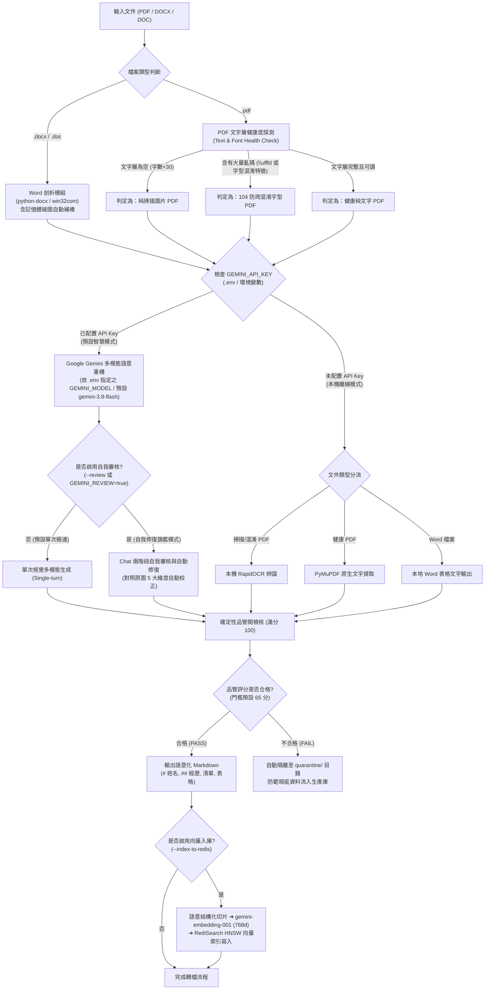

# 履歷與文件轉語意化 Markdown 工具需求與架構規格書

## 1. 專案背景與目標

本專案旨在建置一個具備**智慧自動判別（Auto-Routing）**與**兩階段自我審核修復（Self-Refinement）**的多格式文件轉 Markdown 解析工具。

主要處理企業內部招募系統收集到的各式求職者履歷（涵蓋 104 人力銀行、CakeResume、自行排版之 PDF 以及 Microsoft Word 格式的 `.docx`、`.doc` 檔案）。

透過多層次的自動判定與 Google Gemini 最新多模態大模型（`gemini-3.8-flash`），徹底解決「Word/PDF 格式混雜」、「104 防爬蟲字型混淆（亂碼）」、「掃描檔缺乏文字層」、「多欄排版標題與內文脫鉤」以及「生硬無語意標題（如 `## Page 1`）」等痛點，自動產生符合人類直覺且利於 RAG 檢索的語意化 Markdown 檔案。

---

## 2. 核心架構與智慧自動判別管線 (Auto-Routing Pipeline)

系統具備智慧自動偵測能力，使用者無需手動判斷文件格式或文字層是否損壞，程式將依下列決策流程自動選擇最佳處理路徑：



---

## 3. 詳細功能需求規格

### 需求一：支援 Word 格式（.docx 與 .doc）
1. **`.docx` 處理**：
   - 採用 `python-docx` 模組，完整解析履歷中的所有文字段落（Paragraphs）與表格（Tables）。
   - 保留表格內的欄位對應關係（例如：左欄為「最高學歷」、右欄為「國立臺灣科技大學」）。
2. **`.doc` 處理（舊版二進位格式）**：
   - 在 Windows 環境下，無縫調用 `win32com.client` (Microsoft Word COM 物件) 進行背景讀取與文字結構轉換。
3. **語意輸出**：
   - Word 內容提取後，可直接交付 Gemini 進行專業履歷標題重整，將表格與零散項目整理為標準 Markdown。
4. **破圖與殘留關聯自動補樁 (In-Memory Auto-Healing)**：
   - 針對實務中常見的 Word 文件破圖或關聯殘留缺陷（例如 `_rels` 關聯檔記載引用 `image4.jpeg` 但 ZIP 包內遺失該圖檔，導致 `KeyError: There is no item named ... in the archive`）。
   - 系統於記憶體位元組串流中動態掃描並填補微型虛擬佔位符，使 `python-docx` 能夠順暢忽略破圖，100% 完整萃取所有文字段落與表格，絕不更動或損壞磁碟上的原始檔案。

### 需求二：智慧自動判別 (Auto-Detection & Health Check)
使用者執行指令時，原則上無需指定參數，系統自動偵測並調度處理器：
1. **格式自動辨識**：自動由副檔名區分 Word 與 PDF。
2. **PDF 文字層品質自動診斷 (Quality Health Check)**：
   - 探測 PDF 抽出的文字流：
     - 若抽出的文字極少（$< 30$ 字）且含有影像 $\rightarrow$ 自動判定為**純掃描檔**。
     - 若抽出的文字含有超過容許閾值的 `\ufffd` 或異常字元 $\rightarrow$ 自動判定為 **104 防爬蟲混淆字型**。
   - 一旦判定為文字層損壞或掃描檔，系統**自動靜默切換為視覺多模態 / OCR 影像管道**，徹底擺脫手動試錯。
3. **健康文字 PDF 之多模態安全阻斷自動降級 (Auto-Fallback)**：
   - 當文字層健康的 PDF 在多模態視覺模式下遭 Google API 版權/安全過濾（如 `FinishReason.RECITATION`）攔截時，系統自動啟動智慧降級，無縫切換為文字語意轉換模式（`transform_text`）或原生提取（`fast_transformer`），避免檔案因外部安全誤判而失敗，確保 100 分滿分高保留率產出。

### 需求三：支援在 `.env` 中預先指定模型 (Model Configuration)
1. **設定檔化管理**：
   - 支援在專案目錄下的 `.env` 檔案中同時設定 API 金鑰、模型名稱與自我審核開關：
     ```env
     GEMINI_API_KEY=AIzaSy...
     GEMINI_MODEL=gemini-3.8-flash
     GEMINI_REVIEW=true
     ```
2. **參數優先級 (Hierarchy of Precedence)**：
   - **最高**：CLI 命令列顯式指定 `--model <model_name>`
   - **次高**：`.env` 檔案或系統環境變數中的 `GEMINI_MODEL`
   - **預設**：若皆未指定，預設採用 `gemini-3.8-flash`（高性價比、多模態解析優良）

### 需求四：彈性指定輸入與輸出檔案
1. 支援標準位置引數（`python convert_to_md.py input.docx output.md`）。
2. 支援具名引數（`-i` / `--input`、`-o` / `--output`）。
3. 未指定輸出檔名時，自動推導為 `<檔名>.md`。
4. 目標資料夾不存在時自動遞迴建立。
5. 終端未帶任何參數時提供友善的互動輸入引導。

### 需求五：真正語意區塊化 (Semantic Markdown)
1. **禁止無意義頁碼**：徹底摒棄 `## Page 1` 等生硬標記。
2. **標準階層**：
   - `# 姓名`（總標題）
   - `## 個人資料`、`## 工作經歷`、`## 學歷背景`、`## 專長技能`、`## 自傳`
   - `### 公司名稱｜職務`（職歷細節）
3. **自動修復 OCR 錯別字**：針對視覺辨識瑕疵自動語意校正為標準繁體中文（如將「微服霧」校正為「微服務」、「HangÕre」校正為「Hangfire」）。

### 需求六：兩階段自我審核與自動修復機制 (Self-Refinement & Repair)
1. **問題背景**：單次生成可能偶爾發生標題層級微小跳號、多欄位疏漏或連字號誤判。
2. **技術架構**：
   - 利用 `client.chats.create()` 建立多輪對話會話，保留第 1 輪傳入的**原始頁面影像上下文**。
   - 第 1 階段：模型根據視覺輸入產生 Markdown 初稿。
   - 第 2 階段：系統發布**嚴格審核檢核表 (Review Checklist)**，指示模型自我對照原始圖像，進行 5 大維度的稽核與自我修復。
3. **5 大審核維度檢核清單**：
   - **維度 1【資訊完整性】**：逐一對照原圖，檢查是否遺漏任一公司經歷、任職時間、電話/Email 或專案細節。
   - **維度 2【標題層級一致性】**：確認所有任職公司統一採用同級標題（如 `### 公司名稱｜職稱`），絕無遺漏降為普通內文的情況。
   - **維度 3【跨頁銜接平滑度】**：自動縫合剛好斷在頁尾的句子或專案描述，消除跨頁斷裂感。
   - **維度 4【領域術語與錯字校正】**：運用軟體與產業領域知識修復 OCR 識別雜訊（如技術名詞、框架拼寫）。
   - **維度 5【格式純淨度】**：清除外層代碼塊包裹、頁碼雜訊，保持 Markdown 語法規範。
4. **觸發方式**：
   - 命令列帶入 `--review` 或 `--self-heal`。
   - 或在 `.env` 中設定 `GEMINI_REVIEW=true` 設為常態開啟。
5. **Google RECITATION 版權過濾阻斷與自審防漂移保護**：
   - 若履歷內含標準教材長文（如 PMP/PMBOK 國際專案管理規範條目），Gemini 視覺解析可能觸發官方 `FinishReason.RECITATION` 安全機制，使第一輪回傳為空。
   - 系統強制檢驗第 1 輪狀態：一旦遭 RECITATION 阻斷或文字為空，立即拋出例外阻斷流程，嚴禁盲目執行第 2 輪 Chat 自審，防止模型因缺少前文上下文而依據提示詞範例產生離譜的人物角色幻覺。

### 需求七：高可靠品管檢核閥與批量稽核隔離 (Quality Guardrail & Quarantine Audit)
1. **問題背景**：大量批次轉換成千上萬份履歷時，人工逐篇檢查不切實際。需有零成本、客觀、可量化之防護網，保證產出 Markdown 的語意與完整性。
2. **確定性規則品管閥 (Deterministic Quality Linting)**：
   - **零 API 成本、毫秒級執行**：不依賴 LLM，透過規則引擎即時檢核。
   - **5 大檢核維度**：
     - **結構骨架**：是否具備一級標題 (`# 姓名`) 及至少 2 個核心履歷區塊（經歷、學歷、技能、聯絡）。
     - **雜訊防線**：嚴格阻擋殘留的 `## Page X` 分頁標記、`\ufffd` 亂碼與外層未拆除代碼框。
     - **篇幅保留率 (Retention Ratio)**：嚴密對照原始文字量（$35\% \le \text{保留率} \le 350\%$），防止 LLM 偷懶過度精簡摘要或截斷。
     - **關鍵實體召回 (Entity Recall)**：使用正規表達式檢查原始文件內的 Email、手機電話號碼是否於 Markdown 中 100% 留存。
     - **語法健康度**：檢查表格管道線對齊與基本語法閉合。
3. **量化評分與警示等級**：
   - 滿分 100 分，依據瑕疵權重扣分（如遺漏 H1 扣 20、缺少大綱區塊扣 25、遺漏重要聯絡電話扣 20、文字截斷扣 25）。
   - 評級劃分：
     - $\ge 85$ 分：`PASS`（優良合格）
     - $65 \sim 84$ 分：`WARNING`（尚可，附帶警告原因）
     - $< 65$ 分：`FAIL`（嚴重瑕疵，不合格）
4. **自動隔離機制 (`--quarantine <dir>`)**：
   - 批次轉檔時若指定 `--quarantine <dir>`，評分 $< 65$ 分之檔案將**自動被轉移至隔離區**，防止瑕疵檔案流入正式知識庫或 RAG 向量資料庫。
   - **實戰防護案例**：曾有履歷因觸發 Google RECITATION 導致模型幻覺輸出虛構候選人，確定性品管閥即時偵測出保留率過低（24.4%）與真實 Email/電話遺漏，當場判定 40 分 (FAIL) 並隔離入庫，成功防範假履歷污染下游檢索系統。
5. **CSV 批量稽核日誌 (`--audit-report <csv_path>`)**：
   - 每次轉換自動將文件名稱、格式、字數、篇幅保留率、品管得分、狀態、各項檢查細部結果與警告訊息追加寫入 CSV，方便企業進行大規模數據儀表板監控。
6. **獨立客觀評審員 (LLM-as-a-Judge) 與 JSON 評分卡 (防線二)**：
   - **獨立第三方視角**：不依賴生成模型的自我維護，而是由獨立提示詞以「嚴格品管稽核員」身分，逐一對比原始影像/文字與產出的 Markdown。
   - **4 大量化評審維度**：
     - `completeness_score`（資訊完整度 0-100）：是否有任何經歷、學歷、電話/Email 或專案缺漏。
     - `fidelity_score`（事實真實度 0-100）：嚴格抓出憑空捏造的經歷、未提及的名詞或虛構時間（幻覺）。
     - `structure_score`（結構規範度 0-100）：標題階層規範、清單結構化與雜訊清除度。
     - `overall_score`（總體綜合得分 0-100）。
   - **結構化 JSON 評分卡 (Scorecard)**：
     - 輸出包含總分、裁決等級（`PASS` / `WARNING` / `FAIL`）、評語摘要、具體遺漏清單 (`missing_items`) 與幻覺清單 (`hallucinations`)。
   - **調用與連動**：
     - 命令列帶入 `--judge` 或於 `.env` 設定 `GEMINI_JUDGE=true` 啟用。
     - 支援 `--save-scorecard <path>` 輸出獨立 JSON 評分卡檔。
     - 若評判員裁定為 `FAIL`，自動觸發 `--quarantine` 隔離保護。

### 需求八：支援目錄輸入與批次轉檔 (Directory Batch Processing)
1. **輸入參數自適應**：
   - 命令列的第一引數（或 `-i` / `--input`）支援傳入**目錄路徑**或**單一檔案**。
   - 若為目錄，系統自動辨識並進入批次處理模式。
2. **智慧文件探索 (Document Discovery)**：
   - 自動掃描目標目錄下所有支援格式（`.pdf`, `.docx`, `.doc`，大小寫無關）。
   - 自動過濾暫存鎖定檔案（如 Word 的 `~$...`）與隱藏檔案。
   - 支援 `--recursive` / `-r` 參數以遞迴掃描所有階層子目錄。
3. **輸出目錄鏡像與隔離**：
   - 若指定 `-o` / `--output <dir>`，轉出之 `.md` 檔案自動存放於該輸出目錄；若搭配遞迴搜尋，自動保持對應的相對子目錄階層。
   - 若未指定輸出目錄，預設於各來源檔案同目錄產出同名 `.md`。
   - 支援結合 `--quarantine <dir>`：批次轉換時評分未達標（$<65$ 分）的檔案自動轉移至隔離目錄，維持生產資料夾純淨。
4. **容錯續行與彙總報表**：
   - 單一檔案損毀或例外不會中斷整個批次佇列，錯誤會被攔截並記錄於日誌中，持續執行剩餘文件。
   - 批次結束後於終端輸出【批次轉檔彙總報表】：顯示處理總數、成功數、隔離數、失敗數與平均品質得分。
5. **API 配額耗盡 (429 RESOURCE_EXHAUSTED) 稽核記錄**：
   - 當批次呼叫遇到 Google API 免費額度耗盡（如 Free Tier 20 RPD 限制）時，系統維持使用者指定的解析模式（不切換其他離線模式），精確攔截 429 配額錯誤。
   - 該檔案自動以狀態 `RESOURCE_EXHAUSTED`、得分 `0`、附帶配額耗盡警告訊息，直接寫入 CSV 稽核日誌。
   - 後續未處理之檔案自動觸發快速日誌登記（Fast-Record），避免浪費時間重複發送注定被阻斷的網路請求。
   - 彙總報表清晰標示 429 失敗檔案筆數，並給出建議處置指引。

---

## 4. 系統解析模式比較表

| 模式 | 觸發方式 | 適用格式 | 處理核心 | 優勢特點 |
| :--- | :--- | :--- | :--- | :--- |
| **旗艦自我審核模式**<br>*(最嚴密、品質最佳)* | `--review`<br>（或 `GEMINI_REVIEW=true`） | `.pdf`<br>`.docx`<br>`.doc` | **Gemini 3.8 Flash**<br>(兩階段 Chat 反思機制) | - 對照原圖二次校驗<br>- 零遺漏、零跳號<br>- 自動縫合跨頁斷句<br>- 100% 格式規範 |
| **智慧自動模式**<br>*(預設推薦)* | 自動判別<br>（有 `.env`） | `.pdf`<br>`.docx`<br>`.doc` | **Gemini 3.8 Flash**<br>(單次視覺多模態) | - 全自動分流<br>- 解決 104 防爬混淆<br>- 速度極快、成本極低<br>- 自動處理 Word 表格 |
| **本機離線 OCR 模式** | `--ocr`<br>（或無金鑰時遇混淆檔） | `.pdf` | **RapidOCR** | - 完全本機離線、無隱私上傳疑慮<br>- 適合純掃描或文字層毀損的 PDF |
| **本機快速文字模式** | `--fast` | 健康 `.pdf`<br>`.docx` | `pymupdf4llm`<br>`python-docx` | - 毫秒級處理速度<br>- 保留原始文字與基本排版 |

---

## 5. 環境設定與相依套件

### 5.1 Python 環境與套件清單
- Python 3.10+ (目前環境: Python 3.13)
- `google-genai`：Gemini 多模態 API 調用與 `gemini-embedding-001` 文本向量化
- `pymupdf` (PyMuPDF)：PDF 影像渲染與文字檢測
- `pymupdf4llm`：本機快速 Markdown 轉換
- `python-docx`：Microsoft Word (`.docx`) 解析
- `pywin32` (`win32com`)：舊版 Microsoft Word (`.doc`) COM 呼叫
- `rapidocr-onnxruntime`：本機離線 OCR 引擎
- `python-dotenv`：讀取 `.env` 配置
- `pillow`：影像格式處理
- `redis`：Redis 客戶端 (RediSearch 與 HNSW 向量索引)
- `numpy`：向量陣列處理與二進位序列化
- `fastapi` / `uvicorn` / `httpx`：Web 儀表板高效能 API 引擎與整合測試客戶端
- `langgraph` / `langchain-core` / `langchain-google-genai`（4.x，需 `google-genai>=2.20`）：HR 多輪對話招募助手之意圖路由固定節點圖與 Gemini 結構化輸出（僅限 `src/infrastructure/`，延遲匯入，未安裝時 CLI 不受影響）
- `langgraph-checkpoint-redis`（選用）：`CHAT_CHECKPOINTER_BACKEND=redis` 時之對話狀態持久化
- `langsmith`（選用，`langchain-core` 之相依）：`RECRUIT_TRACING_ENABLED=true` 時之招募助手遮蔽式效能追蹤（[ADR-0020](docs/adr/0020-recruitment-chat-langsmith-masked-tracing.md)）

### 5.2 環境配置範例 (.env)
完整參數與詳細預設值請直接參閱專案根目錄之 [`.env.example`](.env.example) 範本檔案（由 [`AppConfig`](src/infrastructure/config.py) 統一解析注入）：

```env
# 1. Google Gemini 模型與 API 金鑰設定
GEMINI_API_KEY=AIzaSy...
GEMINI_MODEL=gemini-3.8-flash
GEMINI_EMBEDDING_MODEL=gemini-embedding-001

# 2. 轉檔與品質審查控制
GEMINI_REVIEW=true
GEMINI_JUDGE=false
QUALITY_THRESHOLD=65
VISION_REVIEW_MAX_PAGES=4

# 3. Redis 向量資料庫與索引配置
REDIS_URL=redis://localhost:6379/0
REDIS_TEST_URL=redis://localhost:6379/15
REDIS_INDEX_NAME=idx:resumes:v1
REDIS_PREFIX=resume:v1:chunk:
REDIS_HASH_PREFIX=resume:v1:hash:

# 4. 系統日誌與 Web 查詢儀表板配置
LOG_LEVEL=INFO
LOG_FORMAT=json
WEB_HOST=127.0.0.1
WEB_PORT=8080
WEB_ENGINE=auto
```

---

## 6. 需求九：履歷語意切片、文本向量化與 Redis 檢索系統

為支援人資招聘與人才搜尋（HR / Recruiting Semantic Search），系統將轉換後的 Markdown 履歷進一步進行**語意結構化切片**、**768 維向量化**，並存入具備 **RediSearch HNSW 向量索引** 的 Redis 容器。

### 6.1 核心切片策略 (Markdown Semantic Chunking)
- **語意結構邊界**：拒絕固定字數（如 500 字）粗暴切斷，改以 Markdown 標題階層為邊界：
  - 一級標題（`#`）：提取求職者姓名與個人基本資料。
  - 二級標題（`##`）：歸類大綱分區（個人簡介、工作經歷、專業技能、學歷背景、專案成就）。
  - 三級標題（`###`）：獨立切分每段工作經歷或專案（如 `### 某某科技｜資深後端工程師`）。
- **過短切片智慧合併 (Chunk Merging)**：
  - 內建過短區塊語意合併機制（門檻預設 80 字元，可透過 `--min-chunk-size` 調整），自動將過短切片與鄰近同類區塊合併，消弭微小碎片，提升向量語意密度並減少 23%~40% 的 Embedding 呼叫量。
  - 嚴格落實跨大綱領域保護：核心業務大類（如 `SKILLS` 與 `EDUCATION`）即使字數較短亦維持獨立，不進行跨領域混淆合併。
- **元資料自動萃取**：
  - 任職公司（`company`）與職位職稱（`job_title`）。
  - 技術關鍵字比對標籤（`skills`，自動識別 Python, Golang, FastAPI, Docker, Kubernetes, Redis, Kafka 等 40+ 種關鍵技能）。

### 6.2 文本向量化 (Embedding) 與增量快取 (Incremental Indexing)
- 採用 Google `gemini-embedding-001` 模型。
- 設定 `output_dimensionality=768`（768 維度，具備高精準度與快取記憶體友善平衡）。
- **SHA-256 內容指紋增量入庫**：
  - 每次入庫自動計算 Markdown 內容指紋與 Redis 舊指紋比對；若內容未變更則直接跳過向量化，重複入庫時達成 **0 次 API 呼叫與零 Token 消耗**。
  - 支援使用 `--force` 旗標強制全量重新向量化與覆寫。
- 支援批次處理（Batch Embedding）與暫時性網路抖動重試機制。
- 切片文本組裝採用 `候選人姓名 - 區段標題\n段落內文`，強化向量語意代表性。

### 6.3 Redis 向量儲存與 RediSearch 索引
- 資料格式：Redis HASH (`resume:v1:chunk:<candidate_id>:<chunk_idx>`) 與指紋快取 (`resume:v1:hash:<candidate_id>`)。
- 索引名稱：`idx:resumes:v1`。
- 索引欄位：
  - `candidate_id` (TAG)
  - `candidate_name` (TEXT)
  - `chunk_type` (TAG: profile, experience, skills, education, project)
  - `skills` (TAG, 支援逗號分隔過濾)
  - `company` (TEXT)
  - `job_title` (TEXT)
  - `content` (TEXT)
  - `content_vector` (VECTOR HNSW FLOAT32 DIM 768 DISTANCE_METRIC COSINE)

### 6.4 語意檢索能力
1. **自然語言語意比對**：以 Cosine 相似度計算（相似度 $1.0 - \text{distance}$）。
2. **混合條件篩選 (Hybrid Filter)**：
   - 區段類型限制（例如只檢索「工作經歷」區塊：`--type experience`）。
   - 必要技能過濾（例如要求同時具備 `redis,docker`：`--skills redis,docker`）。
3. **候選人層級彙整 (Group by Candidate)**：將各切片結果按候選人整合，顯示最高匹配度與匹配區段。
4. **終端互動模式 (Interactive Mode)**：直接執行 `python search_resumes.py` 即可連續輸入查詢。

### 6.5 Twelve-Factor 全盤環境變數提取與配置治理
1. **全面提取硬編碼常數**：系統全面將檔案大小 (`MAX_FILE_SIZE_MB`)、PDF 頁數 (`MAX_PDF_PAGES`)、DOCX 膨脹比 (`MAX_DOCX_EXPANSION_RATIO`)、渲染解析度 (`PDF_RENDER_DPI`)、API 重試退避 (`API_MAX_RETRIES`, `API_RETRY_DELAY`)、切片長度 (`MIN_CHUNK_SIZE`, `MAX_CHUNK_SIZE`)、向量維度 (`EMBEDDING_DIM`)、檢索回傳筆數 (`SEARCH_DEFAULT_TOP_K`) 等常數自核心業務中抽離，統一由 `AppConfig` 與 `.env` 管理。
2. **安全容錯與型別安全**：實作 `_safe_int` 與 `_safe_float` 容錯解析機制，在環境變數缺失、非數字字串或異常輸入時，平穩退回預設安全值。
3. **測試隔離庫**：配置 `REDIS_TEST_URL`（預設 DB 15），杜絕測試與驗收腳本對生產資料庫（DB 0）造成資料污染。

### 6.6 提示詞工程 (Prompt Engineering) 外部資產治理與零硬編碼防線
1. **100% 提示詞外部化**：系統所有與大語言模型（LLM）互動之提示詞均由 Python 代碼抽離，獨立存放於專案根目錄 `prompts/` 規範 Markdown 檔案中，並由 `src/infrastructure/prompts/` 載入器透過 `@lru_cache` 安全讀取：
   - `vision_convert.md`：多模態視覺圖像轉 Markdown 結構化指引。
   - `self_review.md`：兩階段視覺自我審核與自動修復指引。
   - `text_convert.md`：純文字層與表格重構 Markdown 提示詞模板。
   - `text_review.md`：文字模式自我審核提示詞。
   - `judge_system.md`：獨立客觀評審員（LLM-as-a-Judge）系統評分規格。
   - `judge_vision_prompt.md`：影像比對評審使用者提示詞模板。
   - `judge_text_prompt.md`：純文字對照評審使用者提示詞模板。
2. **依賴注入與安全隔離**：`GeminiTransformer` 與 `GeminiLlmJudge` 建構子支援注入自訂提示詞文字與模板；外部不可信履歷內容一律使用 `<resume_content>` 標籤圍欄隔離，防止 Prompt Injection。
3. **AST 靜態阻斷防線**：`audit_guardrails.py` 嚴密防守，防止未來代碼重新硬編碼提示詞文字。

### 6.7 需求十：HR 多輪對話招募助手（JD 媒合 + 多輪追問，[ADR-0019](docs/adr/0019-recruitment-assistant-langgraph-chat.md) / [Spec-0019](docs/specs/0019-recruitment-assistant-chat-spec.md)）
1. **JD 媒合**：於 Web 儀表板「招募助手」分頁貼上 JD，系統以 LLM 抽取必要/加分條件（類別限定 `SKILL / YEARS / LEADERSHIP / TEAM_SIZE / SENIORITY`），檢索語意候選池 Top-N（`RECRUIT_CANDIDATE_POOL_SIZE`，預設 15、上限 30），回傳前 K 位人選（預設 3，可於訊息中指定「挑 5 個」）。
2. **確定性比對與條件瓶頸**：條件比對（MET / UNMET / UNKNOWN 三態）、排序與「哪個條件太嚴格」（逐一放寬必要條件之 leave-one-out 合格人數）全部由程式計算；LLM 只負責敘述。放寬統計僅涵蓋語意候選池，回覆會明確揭露。
3. **證據引用與未提及**：推薦理由與追問回答引用之原文須通過逐字比對驗證（正規化：NFKC、壓縮空白、去除 Markdown 符號 `* _ ` + "`" + ` # > | ~`；只確認子字串存在，不做語意/否定判斷）；履歷未提及時明說「履歷未提及」。
4. **多輪對話**：「第 N 位 / N 號 / #N / 他 / 這位」由程式解析為名單中之 candidate_id；支援單輪複合意圖（如「追問 + 出面試題」）；面試題對應該人選之未達成或未提及條件。
5. **查詢期延遲抽取與 0 Token 快取**：候選池內每位人選之結構化檔案（年資 / 是否帶人 / 團隊規模 / 職級 / 核心技能）以內容 Hash + `extractor_version` 快取於 Redis（`recruit:v1:profile:*`，TTL 30 天）；未變更履歷重複查詢 0 次抽取。抽取失敗者寫入行程內短期負快取（`RECRUIT_PROFILE_NEGATIVE_CACHE_TTL_SECONDS`），避免重複消耗 Token。
6. **安全與公平**：履歷與 JD 視為不可信資料並以圍欄標籤隔離；受保護屬性（年齡/性別/生日/婚姻/照片等，詞表 `RECRUIT_PROTECTED_ATTR_TERMS`）不進入條件、檔案與排序，送 LLM 前整行/表格整欄遮蔽；敘述 LLM 僅接收「候選人 #N」代稱，對話歷史亦以代稱保存。
7. **Session 治理**：Checkpointer 可抽換（`CHAT_CHECKPOINTER_BACKEND=memory|redis`），含 Session TTL、歷史裁切（輪數/字元）、LRU 上限與 Session 鎖（並行請求回 `409`）。Redis 後端受 RediSearch 限制僅能使用 db0，以 `chat:v1:*` 前綴隔離。
8. **API**：`POST /api/chat`（`session_id` 選填、`message` 必填）、`GET /api/chat/{session_id}`、`DELETE /api/chat/{session_id}`；錯誤碼 400/409/413/422/429/503/504。僅 FastAPI 引擎提供，內建 HTTPServer 回 `501`；無 API Key 或未安裝 LangGraph 時回 `503`，不影響其他分頁。
9. **向下相容**：`convert_to_md.py` 與既有 CLI 指令、引數零改動。
10. **技能比對（Rev2）**：SKILL 條件支援 OR 多選項（「Python 或 Go」任一命中即 MET）；比對容忍版本與別名（`Python3`、`PostgreSQL 12`、`k8s`）。三態規則：結構化技能命中或履歷全文詞面命中（非歧義）→ MET 並附原文證據片段；歧義短詞（如單獨 `go`）或未驗證宣稱 → UNKNOWN；全文可得且零命中 → UNMET。全部必要條件放寬後合格人數皆無增加時，回覆改指出通過率最低之條件與符合人數。相關設定：`RECRUIT_SKILL_ALIASES`、`RECRUIT_SKILL_LEXICAL_MIN_CHARS`、`RECRUIT_SKILL_MENTION_SNIPPET_CHARS`、`RECRUIT_SKILL_VERSION_STRIP_EXEMPT`、`RECRUIT_SKILL_LEXICAL_ALIAS_DENYLIST`。
11. **敘述完整性（Rev2）**：長文輸出使用 `RECRUIT_NARRATIVE_MAX_OUTPUT_TOKENS`（預設 8192），可選 `RECRUIT_LLM_THINKING_BUDGET`；偵測到截斷（`MAX_TOKENS`、解析失敗、括號不成對）時改用系統模板並附警告，不重試。引文驗證僅作用於 LLM 生成段落，系統模板固定用語不再被誤刪。

### 6.8 需求十一：招募助手 LangSmith 遮蔽式效能追蹤（[ADR-0020](docs/adr/0020-recruitment-chat-langsmith-masked-tracing.md) / [Spec-0020](docs/specs/0020-recruitment-chat-langsmith-masked-tracing-spec.md)）
1. **選用、預設關閉**：`RECRUIT_TRACING_ENABLED=true` 且設定 `LANGSMITH_API_KEY` 後，每輪對話於 LangSmith 呈現「圖 → 節點 → LLM 呼叫」追蹤樹（含執行緒池內之 Profile 抽取），可觀測延遲、token 用量與錯誤類型。
2. **零內容上傳**：輸入/輸出一律隱藏；metadata 僅保留白名單（token 用量、模型、節點、`trace_id`、`session_hash`）；錯誤僅留例外類別名。
3. **可對照**：根追蹤之 `trace_id` / `session_hash` 與 `chat_turn` 日誌一致。
4. **失效安全**：缺金鑰、套件或端點不可達時，追蹤停用或略過，對話不受影響；關閉服務時上傳等待上限 `RECRUIT_TRACING_FLUSH_TIMEOUT_SECONDS`（預設 5 秒）。
5. **配置**：`LANGSMITH_ENDPOINT`（留空用 SDK 預設）、`LANGSMITH_PROJECT`、`RECRUIT_TRACING_SAMPLING_RATE`（0~1）；勿設定全域 `LANGSMITH_TRACING`（會繞過遮蔽，啟動時警告）。

### 6.9 需求十二：候選人不足時自動擴大檢索（[ADR-0021](docs/adr/0021-recruitment-adaptive-candidate-search-loop.md) / [Spec-0021](docs/specs/0021-recruitment-adaptive-candidate-search-spec.md)）
1. **觸發與邊界**：JD 媒合時完全符合必要條件之人數少於 K，系統先自動擴大**語意檢索範圍**再重新以程式比對；**絕不放寬任何招募條件**（放寬條件屬用人決策，仍由放寬報告交給使用者）。
2. **擴大方式**：每輪候選池目標 +`RECRUIT_SEARCH_EXPANSION_POOL_STEP`（總評估人數上限 `RECRUIT_SEARCH_EXPANSION_POOL_MAX`），檢索切片數等比例放大（上限 `RECRUIT_SEARCH_EXPANSION_TOP_K_CHUNKS_MAX`）；上一輪回傳人數少於目標（飽和）時相似度門檻降低 `RECRUIT_SEARCH_EXPANSION_MIN_SCORE_STEP`，不低於 `RECRUIT_SEARCH_EXPANSION_MIN_SCORE_FLOOR`。
3. **停止條件**：人數已足（SATISFIED）、達輪數上限 `RECRUIT_SEARCH_EXPANSION_MAX_ROUNDS`（預設 2，0 停用）、達人數上限（POOL_CAP）、下限仍飽和（EXHAUSTED）、LLM 預算僅剩保留額度 `RECRUIT_SEARCH_EXPANSION_LLM_RESERVE`（BUDGET）、剩餘秒數低於 `RECRUIT_SEARCH_EXPANSION_MIN_REMAINING_SECONDS`（DEADLINE）。
4. **成本**：只對新進人選抽取 Profile，已評估或已快取者 0 Token；保留額度確保推薦理由不因擴大而降級；每輪多 1 次查詢 embedding。
5. **揭露與觀測**：發生擴大時回覆附「檢索擴大紀錄」表（每輪門檻、目標、回傳、新增、累計合格與停止原因），放寬報告 `scope_note` 註明擴大輪數；API `usage` 與 `chat_turn` 日誌含 `search_rounds`、`search_stop_reason`、`pool_evaluated`。
6. **向下相容**：基準輪已足夠時回覆與停用時逐字相同；`MAX_ROUNDS=0` 完全回到原行為；CLI 不受影響。

### 6.10 需求十三：放寬條件之人工決策（[ADR-0022](docs/adr/0022-recruitment-relaxation-human-in-the-loop.md) / [Spec-0022](docs/specs/0022-recruitment-relaxation-human-in-the-loop-spec.md)）
1. **暫停等待決定**：自動擴大檢索後合格人數仍少於 K、且必要條件 ≥ 2 時，流程以 LangGraph `interrupt()` 暫停；回應帶 `pending_decision`（每條必要條件單獨放寬後之合格人數、推薦檢討項、最多可選數 = 必要條件數 − 1）。
2. **只接受 UI 勾選**：「招募助手」分頁之條件瓶頸面板勾選後按「放寬並重新比對」，送出 `POST /api/chat` 之 `relax_requirement_ids`；文字訊息一律視為一般對話，待決定時送出文字即放棄本次決定。
3. **放寬語意**：所選必要條件降為加分條件（ID 不變），在已評估之候選池內以程式重新比對與排序（0 次 Profile 抽取，推薦理由重新敘述 1 次）；不重新檢索。
4. **多輪與重置**：仍不足時可再決定（排除已放寬者），上限 `RECRUIT_RELAXATION_MAX_ROUNDS`（預設 2）；新 JD 重置。`RECRUIT_RELAXATION_HITL_ENABLED=false` 時只顯示放寬報告。
5. **驗證與錯誤碼**：不在選項中、重複、為空或全部放寬 → `422 INVALID_RELAXATION_DECISION`；無待決定 → `422 NO_PENDING_DECISION`；錯誤時待決定狀態保留。同一 Session 並行決定回 `409`。
6. **稽核**：`relaxation_decision` 日誌記錄輪次、放寬之條件 ID 與合格人數前後（零個資）；`GET /api/chat/{session_id}` 回傳 `pending_decision` 與 `relaxed_requirement_ids` 供頁面還原；Redis Checkpointer 下待決定可跨實例恢復。

---

## 7. 命令列使用指南

```bash
# 1. 智慧自動解析 (最常用：自動判別 Word/PDF、自動檢測是否需要視覺 OCR、自動套用 .env 模型)
python convert_to_md.py "resume/sample_resume.pdf"
python convert_to_md.py "resume/sample_resume.docx"

# 2. 啟用兩階段自我審核與自動修復 (排版最嚴密、對照原圖 5 大維度自動糾錯)
python convert_to_md.py "resume/sample_resume.pdf" --review
python convert_to_md.py "resume/sample_resume.docx" --review

# 3. 明確指定輸出路徑與覆蓋模型
python convert_to_md.py "resume/sample_resume.pdf" "output_md/sample_resume.md"
python convert_to_md.py input.pdf --model gemini-2.5-pro

# 4. 本機離線模式 (強制使用 RapidOCR 或快速純文字提取，不呼叫 Gemini)
python convert_to_md.py input.pdf --ocr
python convert_to_md.py input.pdf --fast

# 5. 啟用品質防護、自動隔離與 CSV 批量稽核日誌 (評分低於 65 分自動隔離至 quarantine/)
python convert_to_md.py input.pdf --quarantine "quarantine" --audit-report "audit_logs.csv"

# 6. 目錄批次轉檔與遞迴子目錄掃描
python convert_to_md.py "resume/BE" -o "markdown_output"
python convert_to_md.py "resume" -o "markdown_output" -r --quarantine "quarantine" --audit-report "batch_audit.csv"

# 7. 轉檔成功後自動切片、向量化並存入 Redis
python convert_to_md.py "resume/sample_resume.pdf" --index-to-redis

# 8. 獨立索引單一或批次 Markdown 檔案至 Redis (預設自動 Hash 增量略過未變更檔案)
python index_to_redis.py "output_md/sample_resume.md"
python index_to_redis.py output_md/
python index_to_redis.py output_md/ --recreate
python index_to_redis.py output_md/ --force  # 強制重新計算向量
python index_to_redis.py output_md/ --min-chunk-size 100  # 自訂最小切片合併門檻

# 9. 履歷自然語言語意檢索與混合條件過濾
python search_resumes.py "分散式微服務架構與 High Traffic 高並發處理"
python search_resumes.py "設計過金流串接系統" --type experience --skills golang,redis
python search_resumes.py "AWS 雲端架構設計與 Kubernetes 容器化" --top 10 --group

# 10. 終端機互動式問答檢索 (免重啟腳本連續問答)
python search_resumes.py

# 11. 啟動履歷智能語意檢索與品管日誌 Web 儀表板 (支援 CLI 雙引擎或標準 Uvicorn ASGI 啟動)
python web_dashboard.py --port 8080 --host 127.0.0.1
python web_dashboard.py --port 8080 --engine fastapi --open
python -m uvicorn src.interfaces.web.fastapi_server:app --reload --port 8080
python -m uvicorn src.interfaces.web.fastapi_server:create_default_app --factory --reload --port 8080
python -m uvicorn web_dashboard:app --reload --port 8080
#     → 啟動後於儀表板「招募助手」分頁進行 HR 多輪對話（需 GEMINI_API_KEY + Redis 向量索引；僅 FastAPI 引擎）

# 12. 執行全套白箱單元測試 (離線 100% Mock 隔離驗證)
python -m unittest discover -s tests/unit -p "test_*.py"

# 13. 執行端到端 (E2E) QA 實測驗證 (真實 CLI 參數、環境相容性與 Windows 資源釋放)
python -m unittest discover -s tests/e2e -p "test_*.py"

# 14. 執行 DDD 架構防線與 Git 版控衛生靜態稽核 (Gate 2 AST Code Review)
python .agents/skills/code-review/scripts/audit_guardrails.py

# 15. 執行全生命週期文檔、規格與 ADR 同步檢驗 (Doc-Sync 驗證)
python .agents/skills/doc-sync/scripts/verify_doc_sync.py
```

---

## 8. 前後雙門禁 (Dual-Gate) 7 步驟自主閉環治理體系

系統嚴格落實「前後雙門禁」細化自主閉環流程：
1. **Gate 1: 架構與規格審查 (兩階段需求規格化、8 大維度前審與 QA 測試案例矩陣)**：
   * **Step 1A【代碼探測與 PRD 需求細化】**：AI 探測既有代碼，產出包含 In/Out Scope 與驗收標準 (AC) 之產品需求文件。
   * **Step 1B【8 大維度架構前審與 Tech Spec】**：進行 PII、容量、演進、成本、解耦、惡意防禦、遷移、併發審查，產出 DDD 技術規格書與 **QA 測試案例矩陣**。
   * **雙寫持久化要求**：產生物件同時輸出為 Artifact 與專案目錄 `docs/specs/XXXX-*.md`，確保版本控制透明度。
   * **門禁一放行判定**：PRD、Tech Spec 與 QA 案例驗收通過後，始得進入實作。
2. **Step 2: 規範化實作 (Implementation)**：遵循 Tech Spec 與 DDD 分層實作。
3. **Step 3: 白箱單元測試 (Unit Testing)**：`tests/unit/` 100% Mock 毫秒級驗證。
4. **Step 4: 黑箱/灰箱 QA 實測驗證 (QA Testing)**：
   * 啟動 `qa-testing` 技能，執行 `tests/e2e/` 或 `tests/integration/` 端到端實測腳本。
   * 驗證真實 CLI 參數、真實 sample 檔案與真實 Redis 服務，驗收通過後出具 **QA 實測驗收報告**（同時輸出為 Artifact 並持久化存檔於 `docs/qa_reports/XXXX-*.md`）。
5. **Gate 2: 對抗式代碼審查 (AST 靜態掃描 + Checklist)**：
   * 運行 `audit_guardrails.py`，強制驗證 Domain 零外部依賴、Application DIP 依賴反轉、檔案 open 100% 受 Context Manager 保護（防 Windows 檔案鎖死）、零盲目吞噬例外、自訂例外完整保留 `raise ... from err` 原始呼叫堆疊。
   * 人工/對抗式比對 `review_checklist.md`，杜絕任何 P0 阻斷型缺陷流出。
6. **Step 6: 自主診斷與修正 (Auto-Fix)**：任一測試或代碼審查未過，自主閉環定位修復。
7. **Step 7: 文檔、規格與 ADR 雙向同步 (Doc Sync)**：同步最新命令、架構、ADR、規格書與 QA 報告至 `docs/README.md`，並執行 `verify_doc_sync.py` 驗證。

