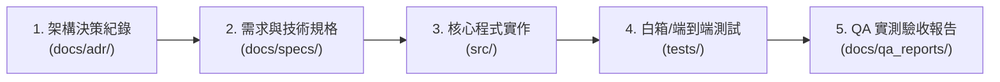

# 專案文檔與工程規範中樞 (Project Documentation Hub)

本目錄為專案的**正式持久化文檔庫**。
記錄了系統自初始架構、歷次演進、各階段產品需求（PRD）、DDD 技術實作規格書（Tech Spec）至真實 QA 驗收實測報告的全生命週期資訊，確保程式碼與設計決策具備 **100% 雙向可追溯性**。

---

## 快速導航矩陣 (Documentation Navigation Matrix)



---

## 一、歷次功能規格、決策與驗收追溯清單

| 功能標號 | 功能主題 | 架構決策 (ADR) | 需求與技術規格書 (Spec) | 實體測試套件 (Tests) | QA 實測驗收報告 (QA Report) |
| :---: | :--- | :---: | :---: | :---: | :---: |
| **0001** | Clean Architecture 與 DDD 四層架構 | [ADR-0001](./adr/0001-clean-architecture-and-ddd.md) | [ARCHITECTURE.md](../ARCHITECTURE.md) | `tests/unit/test_domain_models.py` | [QA 基礎驗證](./adr/0001-clean-architecture-and-ddd.md) |
| **0002** | 智慧自動判別分流與自我審核修復 | [ADR-0002](./adr/0002-dual-routing-and-self-refinement.md) | [REQUIREMENTS.md](../REQUIREMENTS.md) | `tests/unit/test_use_case.py` | [QA 分流驗證](./adr/0002-dual-routing-and-self-refinement.md) |
| **0003** | Redis HNSW 向量庫與 768 維語意檢索 | [ADR-0003](./adr/0003-redis-hnsw-vector-store.md) | [ARCHITECTURE.md](../ARCHITECTURE.md) | `tests/unit/test_redis_vector_store.py` | [QA 檢索驗證](./adr/0003-redis-hnsw-vector-store.md) |
| **0004** | 確定性品管閥與獨立評審員防線 | [ADR-0004](./adr/0004-four-tier-quality-guardrails.md) | [ARCHITECTURE.md](../ARCHITECTURE.md) | `tests/unit/test_quality_validator.py` | [QA 品管驗證](./adr/0004-four-tier-quality-guardrails.md) |
| **0005** | 全面安全防禦與代碼治理升級 | [ADR-0005](./adr/0005-security-observability-and-code-governance.md) | [Spec-0005](./specs/0005-security-observability-remediation-spec.md) | `tests/unit/test_security_quotas.py` | [QA-0005](./qa_reports/0005-architecture-code-review-audit-report.md) |
| **0006** | Token 能效最佳化與增量比對 | [ADR-0006](./adr/0006-token-optimization-and-incremental-indexing.md) | [Spec-0006](./specs/0006-token-optimization-spec.md) | `tests/unit/test_incremental_indexing.py` | [QA-0006](./qa_reports/0006-token-optimization-qa-report.md) |
| **0007** | Twelve-Factor 配置與環境變數提取 | [ADR-0007](./adr/0007-twelve-factor-configuration-and-env-extraction.md) | [Spec-0007](./specs/0007-env-extraction-spec.md) | `tests/unit/test_app_config.py` | [QA-0007](./qa_reports/0007-env-extraction-qa-report.md) |
| **0008** | Prompt Engineering 獨立與運行時配置 | [ADR-0008](./adr/0008-prompt-engineering-externalization-and-runtime-config.md) | [Spec-0008](./specs/0008-prompt-versioning-and-extended-env-spec.md) | `tests/unit/test_prompt_loader.py` | [QA-0008](./qa_reports/0008-prompts-and-extended-env-qa-report.md) |
| **0009** | 全面硬編碼提取與配置貫通 | [ADR-0009](./adr/0009-comprehensive-hardcode-extraction-and-config-penetration.md) | [Spec-0009](./specs/0009-hardcode-extraction-spec.md) | `tests/unit/test_hardcode_extractions.py` | [QA-0009](./qa_reports/0009-hardcode-extraction-qa-report.md) |
| **0010** | 全面提示詞外部化與評判模板治理 | [ADR-0010](./adr/0010-comprehensive-prompt-externalization-and-template-governance.md) | [Spec-0010](./specs/0010-prompt-externalization-and-template-governance-spec.md) | `tests/unit/test_llm_judge.py` | [QA-0010](./qa_reports/0010-prompt-extraction-qa-report.md) |
| **0011** | 狀態記憶治理與串流延遲索引 | [ADR-0011](./adr/0011-agent-memory-management-and-streaming-token-governance.md) | [Spec-0011](./specs/0011-agent-memory-and-streaming-token-spec.md) | `tests/unit/test_streaming_and_memory.py` | [QA-0011](./qa_reports/0011-agent-memory-and-streaming-token-qa-report.md) |
| **0012** | 集中式技術日誌與 API 耗時監控 | [ADR-0012](./adr/0012-centralized-system-logging-and-api-latency-tracking.md) | [Spec-0012](./specs/0012-centralized-logging-and-api-latency-spec.md) | `tests/unit/test_logging_and_latency.py` | [QA-0012](./qa_reports/0012-centralized-logging-and-api-latency-qa-report.md) |
| **0013** | 專案全景文檔體系與持久化歸檔 | [ADR-0013](./adr/0013-full-lifecycle-doc-archiving-and-governance.md) | [Spec-0013](./specs/0013-doc-archiving-and-governance-spec.md) | `.agents/skills/doc-sync/scripts/verify_doc_sync.py` | [QA-0013](./qa_reports/0013-doc-archiving-and-governance-qa-report.md) |
| **0014** | 轉檔日誌與統計摘要 Web 儀表板 | [ADR-0014](./adr/0014-web-dashboard-and-audit-observability.md) | [Spec-0014](./specs/0014-conversion-web-dashboard-spec.md) | `tests/e2e/test_web_dashboard_e2e.py` | [QA-0014](./qa_reports/0014-conversion-web-dashboard-qa-report.md) |
| **0015** | 履歷智能搜尋 Web 介面與年資過濾 | [ADR-0015](./adr/0015-resume-search-web-interface.md) | [Spec-0015](./specs/0015-resume-search-web-interface-spec.md) | `tests/e2e/test_resume_web_search_e2e.py` | [QA-0015](./qa_reports/0015-resume-search-web-interface-qa-report.md) |
| **0016** | GitHub 上庫前安全脫敏、個資清零與路徑治理 | [ADR-0016](./adr/0016-github-pre-publish-security-and-pii-governance.md) | [Spec-0016](./specs/0016-github-pre-publish-sanitization-spec.md) | `tests/unit/test_github_pre_publish_hygiene.py` | [QA-0016](./qa_reports/0016-github-pre-publish-sanitization-qa-report.md) |
| **0017** | 上庫隱私掃描與文件連結防線補強 | [ADR-0017](./adr/0017-publish-privacy-scanner-hardening.md) | [Spec-0017](./specs/0017-github-publish-privacy-and-link-hardening-spec.md) | `tests/unit/test_github_pre_publish_hygiene.py` | [QA-0017](./qa_reports/0017-github-publish-privacy-hardening-qa-report.md) |
| **0018** | Uvicorn 標準 ASGI 啟動與 Web 依賴組裝收斂 | [ADR-0018](./adr/0018-uvicorn-standard-asgi-entrypoint-and-di-bootstrap.md) | [Spec-0018](./specs/0018-uvicorn-asgi-factory-and-web-entrypoint-spec.md) | `tests/unit/test_web_dashboard.py` | [QA-0018](./qa_reports/0018-uvicorn-asgi-factory-and-web-entrypoint-qa-report.md) |
| **0019** | HR 多輪對話招募助手（JD 媒合 + 多輪追問） | [ADR-0019](./adr/0019-recruitment-assistant-langgraph-chat.md) | [Spec-0019](./specs/0019-recruitment-assistant-chat-spec.md) | `tests/unit/test_recruitment_*.py`、`tests/e2e/test_recruitment_chat_e2e.py` | [QA-0019](./qa_reports/0019-recruitment-assistant-chat-qa.md) |
| **0020** | 招募助手 LangSmith 遮蔽式效能追蹤 | [ADR-0020](./adr/0020-recruitment-chat-langsmith-masked-tracing.md) | [Spec-0020](./specs/0020-recruitment-chat-langsmith-masked-tracing-spec.md) | `tests/unit/test_langsmith_tracing.py`、`tests/e2e/test_recruitment_tracing_e2e.py` | [QA-0020](./qa_reports/0020-recruitment-chat-langsmith-tracing-qa.md) |
| **0021** | 招募助手候選人不足時自動擴大檢索 | [ADR-0021](./adr/0021-recruitment-adaptive-candidate-search-loop.md) | [Spec-0021](./specs/0021-recruitment-adaptive-candidate-search-spec.md) | `tests/unit/test_recruitment_search_expansion.py`、`tests/e2e/test_recruitment_search_expansion_e2e.py` | [QA-0021](./qa_reports/0021-recruitment-adaptive-candidate-search-qa.md) |
| **0022** | 招募助手放寬條件之人工決策 | [ADR-0022](./adr/0022-recruitment-relaxation-human-in-the-loop.md) | [Spec-0022](./specs/0022-recruitment-relaxation-human-in-the-loop-spec.md) | `tests/unit/test_recruitment_relaxation_hitl.py`、`tests/e2e/test_recruitment_relaxation_hitl_e2e.py` | [QA-0022](./qa_reports/0022-recruitment-relaxation-hitl-qa.md) |
| **0023** | 檢索與抽取品質指標計算模組 | — | [Spec-0023](./specs/0023-retrieval-quality-metrics-spec.md) | `tests/unit/test_evaluation_metrics.py` | [QA-0023](./qa_reports/0023-retrieval-quality-metrics-qa.md) |

---

## 二、目錄劃分與職責說明

### 1. `docs/adr/` (架構決策紀錄)
- 記錄關鍵架構設計、技術選型、評估替代方案與 8 大架構維度衝擊評估。
- 索引清單參閱：[`docs/adr/README.md`](./adr/README.md)。

### 2. `docs/specs/` (需求規格與 DDD 技術規格書)
- 收錄各項功能在 **Step 1 (Gate 1)** 階段產出的 PRD（商業背景、範疇界定、Acceptance Criteria）與 Tech Spec（Entity/DTO、Protocol 契約、異常鏈設計、測試計畫）。
- 每次新功能開發時，嚴格對齊編號入庫（如 `0014-*.md`）。

### 3. `docs/qa_reports/` (黑箱/灰箱 QA 實測驗收報告)
- 收錄各項功能在 **Step 4 (QA Testing)** 階段產出的實測報告。
- 包含需求追溯矩陣（RTM 100% 覆蓋 AC）、對抗式極端情境實測結果與驗收簽核紀錄。

### 4. `docs/templates/` (工程標準範本庫)
為方便在檔案樹直接查閱，已將 AI 閉環專屬範本同步鏡像至本目錄：
- 需求規格範本：[`prd_template.md`](./templates/prd_template.md)
- 技術設計規格範本：[`tech_spec_template.md`](./templates/tech_spec_template.md)
- QA 測試個案設計範本：[`test_case_template.md`](./templates/test_case_template.md)
- QA 實測驗收報告範本：[`qa_report_template.md`](./templates/qa_report_template.md)

*(內部技能來源存放於 `.agents/skills/feature-design/references/` 與 `.agents/skills/qa-testing/references/`)*

---

## 三、自動化文檔同步檢驗 (Doc-Sync Automation)

執行以下指令可隨時檢驗所有 ADR、規格書與 QA 報告之檔案命名、連續性與 README 索引雙向同步狀態：
```bash
python .agents/skills/doc-sync/scripts/verify_doc_sync.py
```
