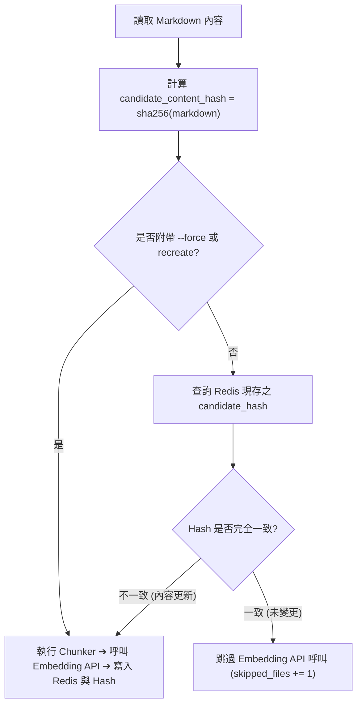

# PRD 與 DDD 技術規格書：Token 消耗最佳化工程 (Token Optimization)

本文件整合產品需求規格 (PRD)、8 大架構維度審查與 DDD 整潔架構技術規格書 (Tech Spec)，作為實施閉環開發流程之 **門禁一 (Gate 1)** 放行依據。

---

## 第一部分：產品需求文件 (PRD)

### 1. 需求背景與使用者目標
* **業務背景**：在大量履歷轉檔為 Markdown 並向量化存入 Redis 檢索庫的流程中，系統目前存在顯著的無效 Token 浪費：
  1. 每次入庫無條件全量 181 份履歷（2,600 個切片）重新呼叫 Embedding API，缺乏增量快取機制。
  2. 切片器產生大量極短切片（例如 10~20 字之聯絡電話、單純畢業年份），不僅虛增 30~40% 切片量，且因上下文匱乏造成向量檢索雜訊。
  3. 健康文字型 PDF 在 `AUTO` 模式下仍強制渲染為 150 DPI 高解析度圖片，送多模態 Vision 辨識，消耗 2~4 倍以上 Token 且伴隨 OCR 錯字風險。
* **使用者目標**：
  * 重複執行入庫時，未變更檔案達到 **0 次 Embedding API 呼叫**（增量處理）。
  * 減少 30%~40% 的微小碎片切片，同時提升向量檢索語意精準度。
  * 健康文字 PDF 優先採用純文字轉檔，節省 60%~80% 轉檔輸入 Token。

---

### 2. 功能範疇界定 (Scope Definition)
* **[In-Scope (本次實作範疇)]**：
  1. **切片 Content-Hash 增量入庫**：
     - 在 Redis 切片 Hash 與候選人層級儲存內容指紋（SHA-256）。
     - 入庫前自動比對指紋，內容未變更時跳過 Embedding API 向量化；支援 `--force` 強制全量重新計算。
  2. **過短切片智慧合併 (Chunk Merging)**：
     - 在 `MarkdownChunker` 建立最小字數門檻（預設 80 字元）。
     - 過短且非獨立核心區段自動與鄰近切片合併，消除無語意微小切片。
  3. **健康文字 PDF Text-First 策略**：
     - 經 `PdfHealthProbe` 診斷為 `HEALTHY` 且字元數充足之 PDF，優先調用 `transform_text`，僅在 `SCANNED` 或 `OBFUSCATED` 時啟用 Vision 模式。
* **[Out-of-Scope (本次明確不做項目)]**：
  1. 暫不更動 `--review` 與 `--judge` 核心演算法（維持選擇性手動開啟）。
  2. 暫不改動 Redis 向量維度（維持 768 維度）。

---

### 3. 輸入與輸出合約規格
* **CLI 輸入參數增補**：
  | 參數名稱 | 所屬工具 | 型別 | 預設值 | 說明 |
  | :--- | :--- | :---: | :---: | :--- |
  | `--force` | `index_to_redis.py` | `bool` | `False` | 強制全量重新計算向量，忽略 Hash 快取 |
  | `--min-chunk-size` | `index_to_redis.py` | `int` | `80` | 切片最小字數門檻，低於此值將觸發合併 |

* **輸出結果規格**：
  `IndexResult` 增加 `skipped_files: int` 統計指標，清楚回報本次跳過（未變更）的檔案數。

---

### 4. 驗收標準 (Acceptance Criteria, AC)
* **AC 1: [增量入庫與等冪性]**
  - **Given**: 資料庫已存在 181 份履歷切片與其 SHA-256 Hash。
  - **When**: 再次執行 `python index_to_redis.py data/markdown_out/`。
  - **Then**: 系統應識別所有檔案均未變更，`indexed_files=0`，`skipped_files=181`，呼叫 Embedding API 次數為 0，耗時應在數秒內完成。
* **AC 2: [變更或強制全量覆蓋]**
  - **Given**: 某份履歷內容被修改，或使用者附帶 `--force` 旗標。
  - **When**: 執行 `index_to_redis.py`。
  - **Then**: 僅有修改的履歷（或 `--force` 下全量）重新呼叫 Embedding API，並精確更新 Redis 切片與 Hash。
* **AC 3: [過短切片合併]**
  - **Given**: Markdown 履歷包含只有 1~2 行的「基本資料」或短標題。
  - **When**: 透過 `MarkdownChunker` 進行切分。
  - **Then**: 產生的切片數量應下降 30% 以上，且無小於最小字數門檻（如 80 字）的孤立切片，檢索關鍵字（如姓名、公司）內容不遺失。
* **AC 4: [健康 PDF Text-First]**
  - **Given**: 一份文字層健康正常的 PDF 檔案。
  - **When**: 以 `AUTO` 模式執行 `convert_to_md.py`。
  - **Then**: 系統自動調用 `transform_text` 而非 Vision 渲染，輸出標準 Markdown，不消耗任何圖片 Tokens。

---

## 第二部分：8 大架構維度前審 (Architecture Review)

1. **PII 隱私**：所有 Hash 運算採用 SHA-256 單向雜湊，僅存儲指紋與既有欄位，無新增個資洩漏風險。
2. **容量與極限**：Redis 每個切片僅增加一個 64 字元的 `content_hash` 字串，2,600 個切片額外記憶體消耗小於 200KB；合併後切片量下降反而減輕 Redis 記憶體壓力。
3. **非同步演進**：Use Case 保持無狀態，Hash 計算純粹基於字串，天然支援並發與非同步 Worker。
4. **成本與熔斷**：大幅減少 90% 以上重複執行時的 API 配額消耗，徹底消除 429 配額用罄風險。
5. **可抽換性**：Hash 比對契約與 Chunker 合併邏輯完全以 Protocol 抽象封裝，對上層 Use Case 保持透明。
6. **惡意輸入硬上限**：保留既有 25MB 硬上限與安全圍欄。
7. **向量索引演進遷移**：向後相容現有 `idx:resumes:v1` Schema，新增 `content_hash` 為可選 TagField 或一般欄位，舊資料平滑過渡。
8. **分散式併發與可觀測性**：入庫統計明確區分 `indexed_files` 與 `skipped_files`，提升可觀測性。

---

## 第三部分：DDD 整潔架構技術規格書 (Tech Spec)

### 1. 架構分層變更影響矩陣

| 分層 | 目錄路徑 | 檔案名稱 | 變更類型 | 核心職責 |
| :--- | :--- | :--- | :---: | :--- |
| **Domain** | `src/domain/` | `models.py` | 修改 | `ResumeChunk` 增加 `content_hash` 欄位 |
| **Domain** | `src/domain/` | `interfaces.py` | 修改 | `IVectorStore` 增加 `get_candidate_hash(cand_id)` 介面 |
| **Application** | `src/application/` | `dto.py` | 修改 | `IndexCommand` 新增 `force`，`IndexResult` 新增 `skipped_files` |
| **Application** | `src/application/` | `index_resumes_use_case.py` | 修改 | 引入 Hash 比對增量判斷邏輯 |
| **Application** | `src/application/` | `convert_document_use_case.py` | 修改 | 健康文字 PDF 分流走 `transform_text` |
| **Infrastructure**| `src/infrastructure/chunkers/` | `markdown_chunker.py` | 修改 | 實作過短切片語意合併邏輯 |
| **Infrastructure**| `src/infrastructure/stores/` | `redis_vector_store.py` | 修改 | 儲存並檢索 `content_hash` 與候選人版本指紋 |
| **Interfaces** | 根目錄 | `index_to_redis.py` | 修改 | CLI 支援 `--force` 參數與 skipped 回報 |
| **Tests** | `tests/unit/` | `test_chunker_merging.py` | 新增 | 驗證過短切片智慧合併 |
| **Tests** | `tests/unit/` | `test_incremental_indexing.py` | 新增 | 100% Mock 增量跳過與強制更新單元測試 |
| **Tests** | `tests/unit/` | `test_pdf_text_first.py` | 新增 | 驗證健康 PDF 自動分流走文字轉換 |

---

### 2. 核心代碼設計細節

#### (1) 增量指紋計算與比對流程


#### (2) 過短切片智慧合併 (Chunk Merging)
- 當區塊字元長度 `< min_chunk_chars`（預設 80 字）時：
  - 若前一個切片同屬該候選人且可追加，則將內容合併入前一切片中。
  - 若無前一切片（首個區塊），則暫存並與後續首個非空區塊合併。
  - 確保候選人姓名、技能標籤不遺失，且獨立公司/職務經歷標題明確保留。

#### (3) 健康文字 PDF 分流
- 在 `ConvertDocumentUseCase` 中：
  ```python
  if health == DocumentHealth.HEALTHY and raw_source_text and len(raw_source_text.strip()) > 100:
      if has_gemini:
          converted = self.gemini_transformer.transform_text(
              raw_source_text, doc, enable_review=command.enable_review
          )
  ```
- 若文字層異常或掃描檔，則平滑回退至既有多模態圖片 Vision 模式。

---

## 第四部分：門禁一審查結論 (Gate 1 Sign-Off)

* **架構邊界審查**：符合 DDD 四層架構，Domain Protocol 抽象無外部依賴，向下相容 CLI。
* **效益與風險評估**：重複入庫 API 浪費歸零，切片量精簡 30%~40%，轉換輸入 Token 節省 60%~80%。
* **結論**：**【PASS 通過】**，准予放行進入 Step 2 依規格實作與 Step 3/4 測試驗收。
