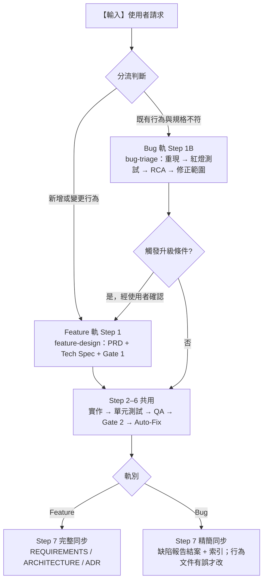

# 提案與規格書：閉環流程分軌與 workflows 目錄化（含 Bug 修正軌）

> **狀態**：已核准（Gate 1 通過，2026-11-19，待決事項依建議決議）｜**類型**：流程治理｜**影響範圍**：規範文件、Skill、驗證腳本，不涉及 `src/` 業務程式碼

## 一、產品需求文件 (PRD)

### 1. 背景與痛點
1. **只有一條流程**：現行 7 步驟閉環以「需求開發」為前提，Step 1 由 [feature-design](../../.agents/skills/feature-design/SKILL.md) 產出 PRD 與 Tech Spec。缺陷修復直接套用時落差如下：

   | 面向 | 需求開發 | Bug 處理 |
   | :--- | :--- | :--- |
   | 起點 | 一句需求 → 寫 PRD | 一個錯誤現象 → 先重現 |
   | 第一件事 | 定義「要做什麼」 | 找出「哪裡壞、為什麼壞」 |
   | 測試順序 | 先實作，再補單元測試 | 先寫會失敗的測試證明 bug 存在 |
   | 文件產出 | PRD + Tech Spec + ADR | 重現步驟 + 根因 + 修正範圍 |
   | 急迫性 | 可排程 | 可能須緊急止血 |

   `docs/specs/` 0005–0024 皆為功能規格；缺陷修正（如 `fix/evaluation-metrics-input-guards`）沒有對應的文件格式。[auto-fix](../../.agents/skills/auto-fix/SKILL.md) 處理的是**閉環內部**的失敗，重現腳本放在 `scratch/`，不留永久回歸測試，不適合作為外部回報 bug 的入口。
2. **流程全寫在 AGENTS.md**：AGENTS.md 每次對話與每個子 Agent 啟動都會自動載入。流程增加為三條後，若繼續寫在 AGENTS.md，不論執行哪種任務都要載入全部流程，既浪費 Token，也不易分辨哪段是共用、哪段屬於特定流程。

### 2. 設計原則
1. **前段分流、後段共用**：各流程只在入口與出口不同；Step 2–6 共用同一套 Skill 與品質標準。
2. **流程檔只寫編排，細節留在 Skill**：流程檔回答「何時、先後、要不要、失敗退回哪裡」；Skill 回答「怎麼做、用什麼範本與腳本、通過標準」。同一件事只寫在一個地方。
3. **AGENTS.md 只留跨流程的規則**：架構紅線、分流表、主控職責、Gate 定義、品質評測規則、Token 守則、編程規範。

### 3. 範疇界定
* **In-Scope**
  1. 新增 `.agents/workflows/`，含 `feature.md`、`bug.md`、`hotfix.md` 三個流程檔。
  2. AGENTS.md 第 2 節重構：流程細節移至流程檔，改為分流表、主控職責與流程檔連結。
  3. 新增 `bug-triage` 技能（Bug 軌 Step 1B）與缺陷報告範本，並建立 Claude Code 轉接層。
  4. 定義 Bug 軌的 PR 規則（一個 bug 一個 PR、先 test 後 fix、不得 squash）與升級回 Feature 軌的處理規則。
  5. Gate 2 Checklist 新增 Bug 軌檢查項；QA 範本註明 Bug 軌 RTM 對象。
  6. `verify_doc_sync.py` 新增 `docs/bugs/` 與分流表連結檢查，並補單元測試。
  7. `docs/README.md` 新增缺陷修正索引表。
* **Out-of-Scope**
  - 不修改 `src/` 任何業務程式碼與 CLI 介面。
  - 不回溯補寫歷史缺陷修正的報告。
  - 不建立 issue tracker 整合（如 GitHub Issues 自動同步）。

### 4. 驗收標準 (AC)
* **AC-1 流程目錄化**：`.agents/workflows/` 含三個流程檔，每份只列步驟、使用的 Skill、本軌差異、進出條件與退回路徑；不重複 Skill 內的作業細節。
* **AC-2 AGENTS.md 精簡**：第 2 節改為分流表、主控職責與流程檔連結，明寫「判定軌別後，先讀取對應流程檔再開始」；架構紅線與其他章節內容不變。
* **AC-3 Bug 軌技能**：`.agents/skills/bug-triage/SKILL.md` 與 `references/bug_report_template.md` 存在，`.claude/skills/bug-triage/SKILL.md` 轉接層與正本一致。
* **AC-4 PR 與升級規則**：`bug.md` 明載一個 bug 一個 PR、先 `test:` 後 `fix:`、不得 squash；並明載第三章第 4 節的升級處理規則。
* **AC-5 文件檢查**：`verify_doc_sync.py` 檢查 (a) `docs/bugs/` 的檔名格式、索引登錄與「品質評測範圍」宣告；(b) AGENTS.md 分流表連結的流程檔皆存在。新增檢查具備單元測試，涵蓋檔名不符、未登錄索引、缺宣告、流程檔連結失效四種負面情境。
* **AC-6 Gate 2 檢查項**：review_checklist 新增「回歸測試先紅後綠」(P0) 與「逃逸分析」(P1)。
* **AC-7 零回歸**：`verify_doc_sync.py`、`audit_guardrails.py` 與全套單元測試通過。
* **AC-8 演練**：以一個合成 bug 情境走完 Bug 軌 Step 1B，並以另一個合成情境走完升級路徑（情況 A），產出符合範本的範例紀錄，存於 QA 報告附錄，不入 `docs/bugs/`。

品質評測範圍：否

---

## 二、流程架構

### 1. 檔案分工

```
AGENTS.md                 ← 自動載入：紅線、分流表、主控職責、Gate 定義、Token 守則
.agents/
├── workflows/            ← 新增：流程編排（何時、先後、要不要、退回哪裡）
│   ├── feature.md        功能開發
│   ├── bug.md            缺陷修正
│   └── hotfix.md         S1 緊急止血
├── skills/               ← 不變：單一步驟怎麼做（範本、腳本、清單、通過標準）
│   └── bug-triage/       新增：Bug 軌 Step 1B
└── <role>/AGENT.md       ← 不變：角色職責
```

`workflows/` 不放進 `skills/`：Skill 是單一步驟的能力，流程是把多個 Skill 串起來，層級不同。

### 2. 流程檔與 Skill 的界線

| 問題 | 寫在 | 例子 |
| :--- | :--- | :--- |
| 何時做、先後順序 | 流程檔 | Step 1B 完成才進 Step 2 |
| 要不要做、走哪條分支 | 流程檔 | 觸發升級條件就轉 Feature 軌；S1 可縮減 QA |
| 失敗後退回哪裡 | 流程檔 | Gate 2 有 P0 → Step 6 |
| 怎麼做 | Skill | 紅燈測試怎麼寫、RCA 五步法 |
| 範本、腳本、清單 | Skill | `qa_report_template.md`、`audit_guardrails.py` |
| 通過標準 | Skill | RTM 零 FAIL、零 NOT COVERED |

**軌別差異**：一兩句話說得完的，寫在流程檔的「本軌差異」欄；需要步驟或範本的，在 Skill 內加「Bug 軌」小節，流程檔只放連結。

### 3. 流程檔格式（以 bug.md 為例）

```markdown
# 缺陷修正流程 (Bug Track)
適用：既有行為違反規格、文件或合理預期，且「正確行為」無須重新定義。

| 步驟 | Skill | 本軌差異 |
| :--- | :--- | :--- |
| 1B | bug-triage | 重現 → 紅燈測試 → RCA → 修正範圍 → 簡化 Gate 1 |
| 2  | （DDD 約制） | 只改修正範圍內的檔案；超出範圍回 1B |
| 3  | unit-testing | 紅燈測試須轉綠 |
| 4  | qa-testing | RTM 對象為 BC-*，範圍限受影響模組 |
| 5  | gate2-code-review | 加查先紅後綠、逃逸分析 |
| 6  | auto-fix | 不變，三振熔斷照常 |
| 7  | doc-sync | 缺陷報告結案、登錄索引；不產出 ADR |

## PR 規則
## 升級回 Feature 軌
```

每份流程檔預估 30–60 行。

### 4. AGENTS.md 分流表

| 請求類型 | 判斷條件 | 流程檔 |
| :--- | :--- | :--- |
| 簡單文件任務、問答 | 錯字、註解、說明，不改程式行為 | 不啟動閉環 |
| 功能開發 | 新增或變更行為；或「正確行為」需重新定義 | `workflows/feature.md` |
| 缺陷修正 | 既有行為違反規格、文件或合理預期 | `workflows/bug.md` |
| 緊急止血 | 缺陷且嚴重度為 S1 | `workflows/hotfix.md` |

判斷不明時預設 Feature 軌，並說明理由。

### 5. 主控職責
分流表旁明載：主對話（即接收需求的 Agent）負責分流判斷、階段轉換與退回判定、三振計數、交接 JSON 組裝、模型分級選擇、升級提議，以及最終交付報告。不另設協調者角色。

---

## 三、Bug 軌設計

### 1. 雙軌結構



### 2. Step 1B：bug-triage

| 階段 | 內容 | 產出 |
| :--- | :--- | :--- |
| **1. 受理與分級** | 記錄現象、環境、觸發條件，判定嚴重度 | 報告第 1 節 |
| **2. 重現** | 建立可穩定重現的最小步驟。**無法重現即停止**，記錄已嘗試的方法並請人類補充資訊，嚴禁猜測式修正 | 報告第 2 節 |
| **3. 紅燈回歸測試** | 將重現步驟寫成永久測試（優先 `tests/unit/`，必要時 `tests/e2e/`），確認在未修正的代碼上**失敗**，且失敗原因就是該 bug | 測試檔 + 失敗輸出摘要 |
| **4. 根因分析** | 區分症狀與真因，標出所屬 DDD 層；做**逃逸分析**：既有測試或防線為何沒抓到 | 報告第 3 節 |
| **5. 修正範圍與升級判斷** | 列出預計修改的檔案；觸發升級條件時提議升級 | 報告第 4 節 |
| **6. 簡化 Gate 1** | 確認修正只恢復既有規格行為、影響面已列出、無介面破壞 | 報告第 4 節簽核 |

**角色分工**：階段 1–5 由 developer 執行（RCA 屬深度推論，多代理模式下用 `opus`）；階段 6 由 architect 簽核。

### 3. PR 與 commit 規則

| 規則 | 內容 | 理由 |
| :--- | :--- | :--- |
| **先 test 後 fix** | 回歸測試與修正分成兩個 commit：先 `test:`（紅燈），再 `fix:`（轉綠），兩者一起推進同一個 PR | Gate 2 可在 `test:` commit 上重跑，驗證測試確實抓得到 bug；CI 只檢查 PR 最新 commit，不受紅燈 commit 影響 |
| **一個 bug 一個 PR** | 同根因的多個症狀視為一個 bug（多個測試放同一個 `test:` commit）；不同根因各自開缺陷報告與 PR；修 A 時發現 B，另開 B 排隊處理 | 可個別回退、審查範圍單純、不同嚴重度不互相拖累 |
| **不得 squash** | Bug 軌 PR 以一般 merge 合併 | squash 會把 `test:` commit 壓掉，紅燈證據消失 |

例外：若確需在同一 PR 修多個獨立 bug，順序為 `test A → fix A → test B → fix B`，每組仍可分別驗證，但須在 PR 描述說明理由。

### 4. 升級回 Feature 軌

**升級條件**（任一成立）：
1. 需修改 `src/domain/interfaces.py` 的 Protocol 或 DTO 欄位。
2. 需修改資料模型或 Redis 索引結構。
3. 需新增 `AppConfig` 環境變數或 CLI 參數。
4. 「正確行為」在現有規格中未定義或定義矛盾。
5. 修正範圍跨越 3 個以上 DDD 層。

**依發現時機處理**：

| 情況 | 處理 |
| :--- | :--- |
| **A. Step 1B 發現** | 停下並向使用者說明符合哪條升級條件；經確認後開新功能規格，背景章節引用缺陷報告的重現與 RCA，照 Feature 軌執行 |
| **B. Step 2–6 才發現** | 立即停止實作，不得為了繞過升級條件而硬改；回 Step 1B 第 5 階段，比照情況 A |
| **C. S1 但根治需升級** | 分兩段：先在 hotfix 流程做不碰介面的止血（輸入檢查並明確拒絕、關閉該功能、遮蔽輸出），快速合併；再開 Feature 軌根治。若連止血都必須改介面，停下交由使用者決定 |

**產物處理**：

| 項目 | 處理方式 |
| :--- | :--- |
| 誰決定升級 | 助理提出理由，**由使用者確認** |
| 缺陷報告 | 保留，狀態標為「已升級 → Spec-XXXX」，與新規格互相連結 |
| 編號 | 缺陷保留原號；功能規格用新號；QA 報告跟功能規格的編號 |
| 紅燈測試 | 保留，轉成新規格的 AC（如「AC-1：原缺陷情境 `test_xxx` 須通過」） |
| 已寫的程式碼 | 留在分支不合併，由新規格決定是否沿用 |
| 三振計數 | 換軌後歸零（升級不算修正失敗） |

### 5. 嚴重度與 hotfix 流程

| 等級 | 定義 | 流程 |
| :--- | :--- | :--- |
| **S1 緊急** | 資料損壞或遺失、個資外洩、安全漏洞、主要流程（轉檔、檢索）全面失敗 | `hotfix.md` |
| **S2 一般** | 功能錯誤但有替代做法，或影響非主要流程 | `bug.md` |
| **S3 輕微** | 邊角情境、訊息文字、不影響結果的瑕疵 | `bug.md`，QA 可縮為受影響範圍 |

**hotfix.md 與 bug.md 的差異**：

| 步驟 | 縮減方式 | 不可省 |
| :--- | :--- | :--- |
| 1B | RCA 可先寫摘要 | 重現、紅燈測試 |
| 4 QA | 縮為受影響範圍的冒煙測試 | — |
| 5 Gate 2 | — | 完整執行 |
| 合併後 | 3 個工作天內補齊完整 RCA 與 QA 報告 | — |

### 6. 共用段在 Bug 軌的差異

| 步驟 | Bug 軌差異 |
| :--- | :--- |
| Step 2 實作 | 只改修正範圍內的檔案；超出範圍須回 Step 1B |
| Step 3 單元測試 | 紅燈測試轉綠；全套單元測試無回歸 |
| Step 4 QA | RTM 對象為缺陷驗收條件（`BC-1`…）加上受影響功能原規格的 AC；測試計畫只涵蓋受影響範圍 |
| Step 5 Gate 2 | 加查「先紅後綠」與「逃逸分析」 |
| Step 6 Auto-Fix | 不變，三振熔斷照常 |
| Step 7 文件 | 缺陷報告結案、登錄索引；僅在文件描述有誤時更新 REQUIREMENTS／ARCHITECTURE；不產出 ADR |

---

## 四、產出物與文件

### 1. 缺陷報告：`docs/bugs/XXXX-*.md`
範本章節：
1. 受理資訊：現象、環境、嚴重度、回報來源
2. 重現步驟：最小步驟、預期 vs 實際（重現資料一律使用合成內容）
3. 根因分析：真因、所屬 DDD 層、逃逸分析
4. 修正範圍：預計修改檔案、升級判斷結果、簡化 Gate 1 簽核
5. 缺陷驗收條件：`BC-1`…（含「回歸測試由紅轉綠」）
6. 品質評測範圍宣告：`品質評測範圍：是/否`
7. 結案：`test:` 與 `fix:` commit、PR、QA 報告連結、結案日期；或「已升級 → Spec-XXXX」

### 2. 編號
`docs/specs/` 與 `docs/bugs/` **共用同一個流水號**（如 0025 為功能、0026 為缺陷），讓 `docs/qa_reports/` 的編號繼續與來源文件一一對應，`verify_doc_sync.py` 的檔名規則不必改。

### 3. QA 報告與索引
* QA 報告沿用 [qa_report_template.md](../../.agents/skills/qa-testing/references/qa_report_template.md)，第 9 節照常記錄 Gate 2。
* `docs/README.md` 新增「缺陷修正」表格，欄位：編號、缺陷摘要、嚴重度、缺陷報告、回歸測試、QA 報告、狀態（處理中／已結案／已升級）。

---

## 五、技術變更清單 (Tech Spec)

| 檔案 | 變更 |
| :--- | :--- |
| [AGENTS.md](../../AGENTS.md) | 第 2 節重構：移出流程圖與調度矩陣細節；改為分流表、主控職責、Gate 定義與流程檔連結 |
| `.agents/workflows/feature.md` | 新增：承接原第 2 節的 7 步驟編排（內容移轉，不改規則） |
| `.agents/workflows/bug.md` | 新增：Bug 軌編排、PR 規則、升級規則 |
| `.agents/workflows/hotfix.md` | 新增：S1 縮減規則與補件期限 |
| [CLAUDE.md](../../CLAUDE.md) | 模型分級表新增 Step 1B（developer `opus`）與簡化 Gate 1（architect `sonnet`）；第 4 項註明流程檔位置 |
| `.agents/skills/bug-triage/SKILL.md` | 新增：Step 1B 六階段作業規範 |
| `.agents/skills/bug-triage/references/bug_report_template.md` | 新增：缺陷報告範本 |
| `.claude/skills/bug-triage/SKILL.md` | 新增：轉接層 |
| [auto-fix/SKILL.md](../../.agents/skills/auto-fix/SKILL.md) | 註明適用於閉環內部失敗；外部回報的 bug 走 bug-triage |
| [developer/AGENT.md](../../.agents/developer/AGENT.md)、[architect/AGENT.md](../../.agents/architect/AGENT.md) | 新增 Step 1B 職責 |
| [review_checklist.md](../../.agents/skills/code-review/references/review_checklist.md)、[code-review/SKILL.md](../../.agents/skills/code-review/SKILL.md) | 新增 Bug 軌檢查項：[P0] 先紅後綠、[P1] 逃逸分析 |
| [qa_report_template.md](../../.agents/skills/qa-testing/references/qa_report_template.md) | 註明 Bug 軌 RTM 以 `BC-*` 為對象 |
| [verify_doc_sync.py](../../.agents/skills/doc-sync/scripts/verify_doc_sync.py) | 新增 `docs/bugs/` 檢查與分流表連結檢查 |
| `tests/unit/` | 新增或擴充測試，覆蓋 AC-5 的正負面情境 |
| [docs/README.md](../README.md) | 新增缺陷修正索引表 |

`GEMINI.md` 未引用步驟細節，不需修改。

**實作期間追加範圍**（2026-11-19，實作時發現，已併入本案）：
* `docs/templates/` 範本鏡像早已與正本不一致（`prd_template.md` 缺品質評測宣告、`qa_report_template.md` 缺 PR #15／#16 新增章節）。本案將鏡像改為自正本複製，並於 `verify_doc_sync.py` 新增 `check_template_mirrors()`，防止再次漂移。
* 範本內原有指向其他 Skill 的相對連結，複製到 `docs/templates/` 後會斷鏈（由 `test_repository_markdown_links_resolve` 抓出）。改為以反引號標註專案路徑，正本與鏡像皆可正確閱讀。

---

## 六、Gate 1 架構前審（8 維度）

1. **個資隱私**：缺陷報告範本規定重現資料使用合成內容，不得貼入真實履歷片段或日誌中的個資。
2. **容量與極限**：純文件與腳本，無執行期負擔。
3. **非同步與演進**：新增流程只需在 `workflows/` 加檔並登錄分流表，AGENTS.md 不再膨脹。
4. **成本與熔斷**：流程檔按需讀取，AGENTS.md 常駐內容減少；Step 1B「無法重現即停止」避免猜測式修正反覆消耗 Token；三振熔斷照常適用。
5. **可抽換性**：流程、Skill、角色三層分離，各自可獨立修改。
6. **輸入安全性**：不引入動態執行；`verify_doc_sync.py` 僅讀取 Markdown。
7. **版本相容性**：既有規格、QA 報告與編號不受影響；共用流水號免改檔名規則；Feature 軌規則僅搬移不修改。
8. **可觀測性與追溯**：缺陷報告 → 紅燈測試 commit → 修正 commit → QA 報告 → Gate 2 紀錄形成完整追溯鏈；升級時缺陷報告與新規格雙向連結。

**風險**：助理分流後可能未讀流程檔而憑印象執行。緩解：AGENTS.md 明寫讀取要求；`verify_doc_sync.py` 確保連結有效；交付說明須註明所走流程檔。

---

## 七、決議事項

> 2026-11-19 使用者核准：以下 6 項全數採「建議」欄。
>
> 第 6 項查證結果：Google Antigravity 原生 workflows 位於 `.agent/workflows/`（單數 `.agent`），且官方已於 2026-11-01 停止支援，改由 `.agents/skills/` 的 Skill 承接。本案的 `.agents/workflows/` 不與其衝突，也不會被任何工具自動當作指令執行，流程檔一律由 AGENTS.md 分流表指示讀取。來源：[Antigravity workflows to skills 遷移指南](https://antigravity.google/docs/migration/workflows-to-skills/)、[Antigravity Rules & Workflows](https://antigravity.google/docs/rules-workflows)。

| # | 問題 | 決議（建議） | 未採用方案 |
| :---: | :--- | :--- | :--- |
| 1 | 缺陷編號是否與功能規格共用流水號？ | 共用 | 獨立 `B0001` 序列，需改檔名規則與 QA 報告對應方式 |
| 2 | S1 止血後的補件期限？ | 合併後 3 個工作天 | 下一次發版前 |
| 3 | Step 1B 是否需要 architect 簽核？ | 需要，但僅限修正範圍與升級判斷 | 由 developer 自行判斷，Gate 2 再把關 |
| 4 | 紅燈證據形式？ | 分兩個 commit（`test:` → `fix:`） | 僅在報告中貼失敗輸出摘要 |
| 5 | 「不得 squash」如何落實？ | 寫入 `bug.md`，並由**使用者**於 GitHub 設定關閉 squash merge | 只寫規範，不改 repo 設定 |
| 6 | 是否讓流程檔可用指令觸發？ | 不做（Antigravity workflows 已停止支援，見上方查證） | 比照 Skill 在 `.claude/skills/` 加轉接檔，支援 `/bug-workflow` 等指令 |

---

## 八、實作順序
1. `.agents/workflows/feature.md`：先把現行流程原樣搬出，確認無遺漏
2. AGENTS.md 第 2 節改為分流表與主控職責；CLAUDE.md 同步
3. `bug-triage` 技能、範本、轉接層；`bug.md`、`hotfix.md`
4. auto-fix、角色檔、Gate 2 Checklist、QA 範本同步
5. `verify_doc_sync.py` 擴充與單元測試
6. `docs/README.md` 索引、AC-8 演練、QA 報告
